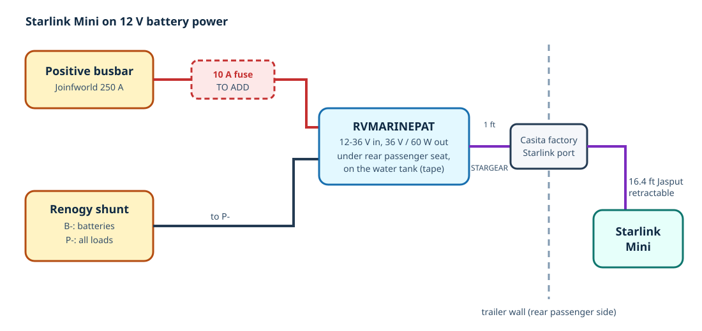

# Starlink Mini on 12 V Battery Power

> **Status: installed, October 2026; one required fix outstanding.** The Starlink Mini runs straight from the battery bank through a 12 V to 36 V adapter, so it works without the inverter. **The adapter's positive wire has no fuse yet; add a 10 A inline fuse (see [Required fix](#required-fix-add-an-inline-fuse)).**

Running the Mini from DC avoids the inverter's own 1.5-2 A idle draw and its conversion losses, and it keeps internet working with the inverter off.

## Parts

| Part | Notes | Link |
| --- | --- | --- |
| Starlink Mini | Dish with built-in router. Accepts 12-48 V DC; typically about 25-40 W | |
| RVMARINEPAT Starlink Mini 12V Battery Adapter (QL-MINI-POW-M8) | Step-up converter: 12-36 V in, 36 V / 1.67 A (60 W) out. Draws about 5 A at 12 V at full output. Built-in output overcurrent, short-circuit and reverse-polarity protection. No fuse included. 4.9 ft lead | [Amazon](https://www.amazon.com/dp/B0FHH3X3V7) |
| STARGEAR 1 ft Starlink Mini DC extension (SG-DCM-DCF-0.3M-GY) | 16 AWG, DC5521 male to female, IP67. Adapter output to the exterior port | [Amazon](https://www.amazon.com/dp/B0GVXG5GB4) |
| Jasput 16.4 ft retractable Starlink Mini DC cable | 18 AWG flat cable, DC5521 male to male. Exterior port to the dish | [Amazon](https://www.amazon.com/dp/B0H5C4R5ZJ) |
| Casita factory exterior Starlink port | Installed by Casita (most likely the port included with Casita's Video Entertainment Package), rear passenger side | |
| **To add:** waterproof inline ATO/ATC blade-fuse holder with a 10 A fuse | Required; see below | |

## Wiring

| From | To | Notes |
| --- | --- | --- |
| Positive busbar (Joinfworld 250 A) | Adapter red (positive) wire | **No fuse yet; add a 10 A inline fuse within about 7 in of the busbar** |
| Adapter black (negative) wire | Renogy shunt **P-** terminal | On the load side, so the battery monitor counts the Starlink's use |
| Adapter 36 V output | 1 ft STARGEAR extension | Inside the trailer |
| 1 ft extension | Casita's exterior Starlink port | Rear passenger side |
| Exterior port | 16.4 ft retractable cable, then the Starlink Mini | Outside |

The adapter is mounted with mounting tape on top of the plastic fresh-water tank, under the seat at the back of the trailer on the passenger side.

## Required fix: add an inline fuse

The adapter's positive lead is light-gauge wire. Its only protection today is the 200 A battery fuses, which a short in that small wire would never blow. If the lead chafed through to the frame, the wire would overheat and could start a fire before anything stopped it. The adapter's built-in protection only covers its output side.

1. Buy a waterproof inline ATO/ATC blade-fuse holder rated for the adapter's wire size or larger, and a **10 A** fuse (7.5 A also works; the adapter draws about 5 A at full output).
2. With the adapter unplugged from the dish, disconnect its red wire from the busbar.
3. Install the fuse holder in the red wire **as close to the busbar as possible** (within about 7 in): busbar stud, ring terminal, fuse holder, adapter red wire.
4. Insulate the joints and secure the holder so it can't rub or flex.

## Power use

- At about 25-40 W, the Mini draws roughly **2.5-4 A** from the 12 V bank through the adapter, which is about **60-95 Ah per day** if left on around the clock (10-16% of the 600 Ah bank). Turn it off or use its sleep schedule when it isn't needed.
- The adapter is limited to 60 W. Starlink's own Mini power supply is rated higher, so the adapter may be marginal at peak draw (for example, at startup or when melting snow). If the Mini reboots under heavy use, that is the first thing to suspect.
- A 16.4 ft run of 18 AWG on the 36 V side loses very little voltage.

## Revisions

| Date | Change |
| --- | --- |
| 2026-10 | Installed: adapter on the positive busbar and shunt P-, 1 ft extension to Casita's exterior port, 16.4 ft retractable cable to the dish. Inline fuse still to add |
