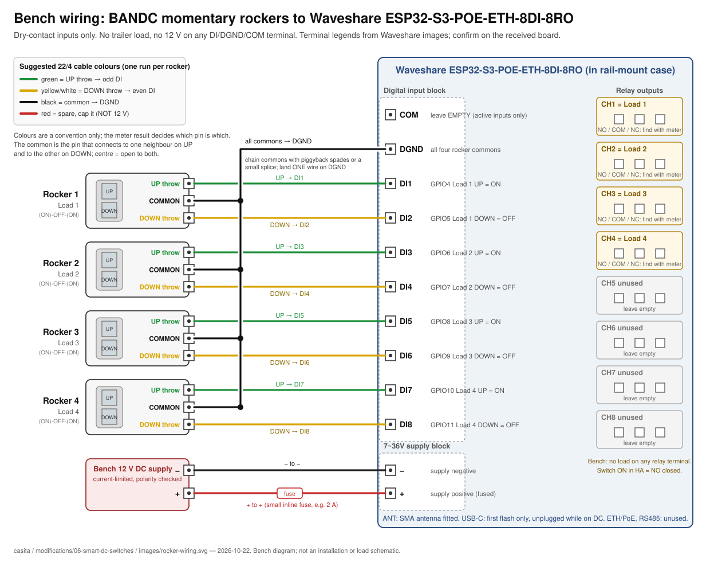
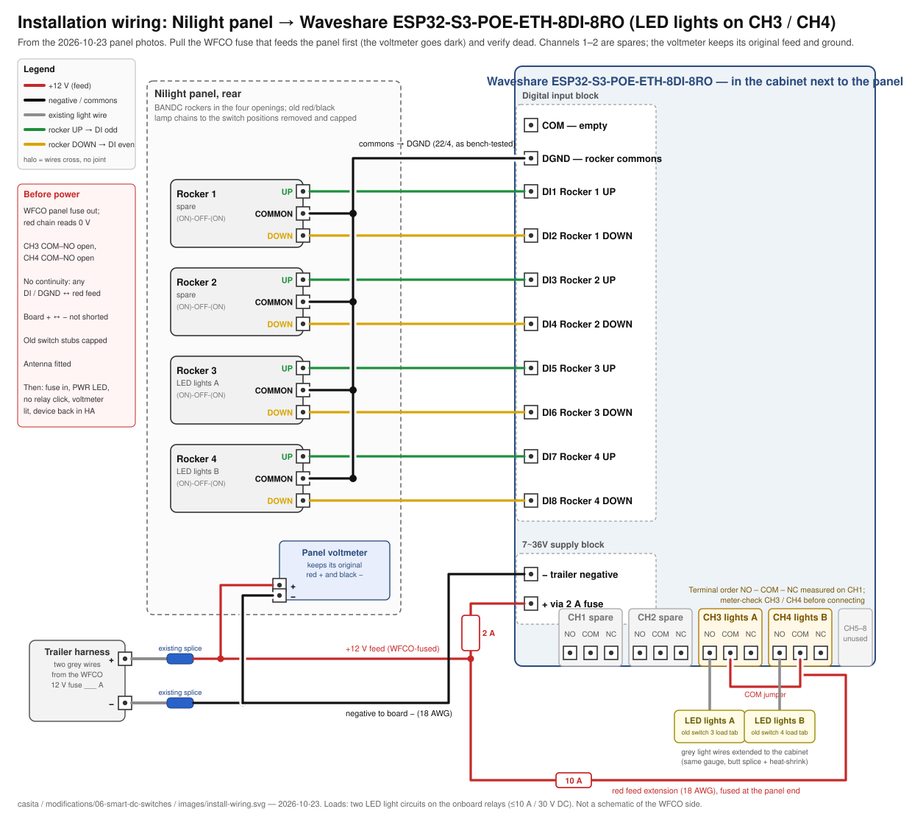

# Four Smart DC Switches — BANDC Rockers + Waveshare ESP32-S3-ETH-8DI-8RO

> **Status: Installed and working (2026-10-23); cabinet cover pending.** Four **BANDC three-pin momentary SPDT** rockers ([Amazon B0CNS17ZMK](https://www.amazon.com/dp/B0CNS17ZMK)) are in the Nilight panel and a **Waveshare ESP32-S3-POE-ETH-8DI-8RO** ([Amazon B0FBKGGKK3](https://www.amazon.com/dp/B0FBKGGKK3)) in the cabinet beside it switches the two LED light circuits on relays **CH1 and CH2**; channels 3–4 are wired spares. The device is live in the trailer Home Assistant as **Casita Smart DC Switches** (`switch.casita_smart_dc_switches_load_1`–`_4`). Verified 2026-10-23: rockers and HA agree on all four channels, a power-up leaves every relay open. Remaining: a 3D-printed cover for the board (the original cabinet cover no longer fits), the antenna check, and the pending TESTS.md items. The original `ALWAYS_OFF` restore means the lights are off after any power loss or firmware update.

Replace four existing illuminated DC rockers with unlit, two-direction momentary rockers. One controller handles four independent channels locally and exposes those same output switches to Home Assistant. Background and alternatives remain in [the research record](../../docs/smart-dc-switch-research.md).

## Required behavior

| Event | Required result, regardless of last HA or button command |
| --- | --- |
| Press UP | Command that channel ON, including when already ON |
| Press DOWN | Command that channel OFF, including when already OFF |
| Release either direction | Spring return to center; **no output action** |
| HA disconnected or Wi-Fi/router unavailable | Physical UP/DOWN still works with a powered, functioning controller |
| Power restored / normal restart | All four outputs default to `ALWAYS_OFF`; deliberate per-load review required before changing this |

This is explicit ON/OFF, never toggle. The rocker resting position is not a state indicator. Manual operation depends on the ESP32-S3, firmware, the TCA9554 relay expander, relays, and their supply; **there is no dead-controller bypass guarantee**. Commands are processed locally; HA is not in the physical control path. The most recently processed command wins; simultaneous remote/physical commands have no special priority. Contradictory contacts from a wiring fault have no safety arbitration in this candidate.

## Parts / planning BOM

Quantities below are for four channels. The BANDC rockers are purchased but not a verified mechanical/electrical fit; the Waveshare controller is ordered. Remaining exact parts and ratings are TBD. Ownership and purchase status: [components.md](components.md).

| Part | Qty | Selection / specification gate |
| --- | ---: | --- |
| BANDC three-pin SPDT `(ON)-OFF-(ON)` rockers, no lamp | 4 | [Owner-selected Amazon listing (3Pin-Momentary variant)](https://www.amazon.com/dp/B0CNS17ZMK). Seller-described behavior only; confirm exact variant and received parts before wiring. Not Carling V8D1-S00B. |
| Durable load and UP ON / DOWN OFF labels; compatible caps if needed | 4 sets, TBD | Check what is included with the received switches. Do not assume the existing Nilight caps fit. No lamp-state indication is planned. |
| Waveshare ESP32-S3-POE-ETH-8DI-8RO (PoE version; Ethernet/PoE unused) | 1 | [Amazon B0FBKGGKK3](https://www.amazon.com/dp/B0FBKGGKK3), [manufacturer wiki](https://www.waveshare.com/wiki/ESP32-S3-ETH-8DI-8RO), [manufacturer product page](https://www.waveshare.com/esp32-s3-eth-8di-8ro.htm), [ESPHome device page](https://devices.esphome.io/devices/waveshare-esp32-s3-eth-8di-8ro/). ESP32-S3-WROOM-1U module: uses the **external antenna socket**; confirm an antenna is included and route it outside any metal cavity |
| Mounting location, 35 mm DIN rail section, strain relief and terminal covering | 1 | The board ships in a rail-mount ABS case published as **175 x 90 x 40 mm**; allow wiring bends, thermal clearance, antenna routing and service access. Confirm the case covers energized screw terminals in the chosen location |
| DC-rated controller input fuse and holder | 1 set | Rating TBD from electronics demand, conductor ampacity, voltage and interrupt rating; place at source of new supply branch |
| Supply transient/reverse-polarity protection, regulation if required | 1 assembly, TBD | Board published supply **7–36 V DC** (screw terminal) is not RV transient qualification; design against measured full supply envelope |
| Signal wiring, insulated quick-disconnects, power wiring, terminals, labels | As measured | Exact lengths, gauges, terminal sizes and ratings TBD; vibration-resistant connections and no exposed energized terminals |
| External DC-rated power relays / sockets / interfaces | Per load, TBD | Required unless exact onboard DC rating is proven sufficient; motor startup/stall, duty, contact life and voltage must be covered |
| Coil suppression and any load suppression | Per inductive circuit, TBD | Match relay/coil polarity and driver capability; follow manufacturer guidance, including release-time consequences |
| Branch fuses / holders | Per circuit, TBD | Preserve existing protection and add protection for every new conductor as required; select by wire and load, not guesswork |

The BANDC listing advertises an approximately **0.83 x 1.46 in** mounting opening, but its details also give **37.2 x 21.2 mm**; these seller dimensions and tolerances are not a fit guarantee. Measure all four existing Nilight openings, panel thickness, actuator clearance, body depth and terminal clearance; check the received parts before cutting or mounting anything. Remote-mount the controller; at 175 mm long it will not fit behind the rocker panel. Do not order extra caps or alter the panel on assumed dimensions.

## Control wiring — separate from load power


### Rocker continuity and orientation

The previous Carling terminal numbering **does not apply** to the BANDC selection. The Amazon listing describes three-pin momentary SPDT behavior, but does not establish a trustworthy pin map or physical UP orientation for the received parts. Off-trailer with each loose rocker disconnected from all power, use continuity to identify its common and both throws; confirm center opens both, each press closes only one, and spring return works in both directions. Record which throw closes for the installed actuator's physical UP side. If the received switch fails any check, stop and revise the wiring plan rather than guessing from terminal position or wire color.

- The **continuity-verified common** of each rocker goes to the board's **`DGND`** terminal. The input terminal block is printed `COM  DGND  DI1 … DI8`. Waveshare's [dry-contact wiring diagram](https://www.waveshare.com/img/devkit/accBoard/ESP32-S3-ETH-8DI-8RO/ESP32-S3-ETH-8DI-8RO-details-9.jpg) (product page, read 2026-10-22) puts a plain switch between **DIx and DGND** and leaves **`COM` unconnected**; `COM` is only for "active" inputs driven from an external 5–36 V source, which this project does not use. The inputs are optocoupler-isolated and fed from the board's own isolated supply, so no external voltage is needed and the rocker commons must **not** be tied to trailer ground or 12 V. All four rocker commons share the single `DGND` terminal (daisy-chain or a small splice).
- One throw goes to the odd DI input of the pair and the other to the even input; which one is UP depends on how the body sits in the panel, and the firmware assigns the direction (see the as-installed note under the table).
- Center must leave both circuits open. Pressing one direction must close only its intended circuit. Use fresh labeled signal conductors, or reuse conductors only after complete isolation and identification.
- **Never connect the old 12 V switch-positive jumpers, illumination feed, or battery positive to any DI/GPIO or rocker common in this dry-contact circuit.** The old lamp harness is not an input harness. Keep load supply and dry signals separated.

### Exact controller signal map

Taken from the [ESPHome device page](https://devices.esphome.io/devices/waveshare-esp32-s3-eth-8di-8ro/) and the [Waveshare wiki](https://www.waveshare.com/wiki/ESP32-S3-ETH-8DI-8RO) on 2026-10-19; the device page states its configuration covers both the Ethernet and PoE versions. Match the received board and its legends before wiring; these sources establish software mapping, not an as-built harness.

**Inputs:** DI1–DI8 are ESP32-S3 **GPIO4–GPIO11**, `INPUT_PULLUP`, `inverted: true` (contact closed = pressed). **Relays:** TCA9554 I/O expander at **0x20** on I2C **SDA GPIO42 / SCL GPIO41** (Waveshare FAQ gives the 0x20 address); relay pins `inverted: false`. All polarities are from the published example and must be bench-confirmed.

| Channel / firmware ID | UP → ON | DOWN → OFF | Board output | As installed |
| --- | --- | --- | --- | --- |
| Load 1 / `load_1` | DI2, GPIO5 | DI1, GPIO4 | Relay 1, TCA9554 P0 | Rocker 1, LED lights A on CH1 |
| Load 2 / `load_2` | DI4, GPIO7 | DI3, GPIO6 | Relay 2, TCA9554 P1 | Rocker 2, LED lights B on CH2 |
| Load 3 / `load_3` | DI6, GPIO9 | DI5, GPIO8 | Relay 3, TCA9554 P2 | Rocker 3, spare |
| Load 4 / `load_4` | DI8, GPIO11 | DI7, GPIO10 | Relay 4, TCA9554 P3 | Rocker 4, spare |

**As installed, the even inputs are UP and the odd inputs are DOWN.** On the bench the bodies were held so the throw on the odd input was UP; in the panel they sit rotated 180°, and the first installed test gave DOWN = ON. The owner chose a firmware fix over re-seating four rockers: the `on_press` actions were swapped and installed over the air on 2026-10-23. Wiring is unchanged (common → `DGND`, one throw → odd DI, the other → even DI). If a rocker is ever re-seated the other way, swap its two DI wires.

All eight digital inputs are used; **there are no spare inputs** for a fifth rocker. Relays 5–8 (TCA9554 P4–P7) are unused and left unconfigured, so they stay at the expander's power-up state; confirm on the bench that they remain open. Ethernet/PoE (W5500), RS485, RTC, buzzer (GPIO46) and RGB LED (GPIO38) are not configured. Each physical input is internal to ESPHome and has **25 ms debounce on both transitions**. Only `on_press` invokes `switch.turn_on` / `switch.turn_off`; release has no action.

**Power-up relay state.** The TCA9554 starts with its pins as inputs until firmware configures them, and Waveshare publishes no schematic. On 2026-10-23 a clean power-on from a bench 12 V supply produced no relay movement and all outputs reported `off` (one observation, one board). Brownout and slow-ramp behaviour are still untested; observe the relays during those tests before connecting any load.

### Board terminals and controls (from Waveshare's published images, 2026-10-22; confirm on the received board)

| Item | As printed / published |
| --- | --- |
| Supply | Two-terminal block `7~36V`, marked `−` and `+`. USB-C (5 V/1 A) is the alternative supply and the programming port; Waveshare does not state whether USB alone runs the relays, nor whether USB and DC may be connected together. Bench: flash on USB alone, then test on DC alone. |
| Digital inputs | `COM  DGND  DI1 DI2 DI3 DI4 DI5 DI6 DI7 DI8`. Dry contact = DIx to `DGND`; `COM` unused. |
| Relays | `CH1` … `CH8`, three screw terminals each, SPDT pictogram only (no NO/NC/COM text). COM is the middle terminal. **NO is the outer terminal that is open to COM while the relay is off**; identify it with a meter rather than by left/right, because the order flips with the board's mounting orientation (measured NO–COM–NC with labels upright on the bench; the board is mounted labels-down in the cabinet, so it reads NC–COM–NO there). The installed light wires were first landed on NC, which inverted the HA state; moved to NO 2026-10-23. |
| RS485 | `A+  B−  PE`, unused. |
| Antenna | `ANT`, SMA female; a 2.4 GHz 4 dBi SMA antenna is listed in the box. The WROOM-1U module has **no PCB antenna**; Wi-Fi will not work without the external antenna fitted. |
| Buttons | `BOOT` (GPIO0) and `RESET`. Download mode: hold `BOOT`, press and release `RESET`, release `BOOT`. |
| USB | Native ESP32-S3 USB (GPIO19/20), no UART bridge chip listed. |
| LEDs | `PWR` red, `TXD` green, `RXD` blue; WS2812 RGB on GPIO38 (unused by this firmware). |

## Bench quick-start

Everything here is off-trailer with no trailer wiring involved. Record results in [TESTS.md](TESTS.md).

1. **Unbox and inspect.** Confirm the antenna is present and screw it onto `ANT`. Open the case enough to read the terminal legends and compare them with the table above. Note the board revision marking.
2. **Rocker continuity** (multimeter, no power). For each of the four rockers: find the pin that has continuity to one other pin when pressed one way and to the third pin when pressed the other way; that is the common. Confirm center position is open to both. Mark the common and the throw that closes when the actuator's top is pressed (installed UP). Fill the table in TESTS.md section 1.
3. **Wire the rockers** as in the diagram below. One 22/4 run per rocker: common → `DGND` (chain the four commons with piggyback spades or a small splice and land one wire on `DGND`), UP throw → odd DI, DOWN throw → even DI, per the signal map above. `COM` stays empty. Nothing else connects to the input block.

   
4. **Firmware.** The configuration is `casita-smart-dc-switches.yaml` in the trailer Home Assistant's ESPHome Device Builder (same place as the battery monitor). First install is over USB-C from a laptop running Chrome: open the Device Builder, **Install → Plug into this computer**, pick the board's serial port. If the port does not appear or the install fails to connect, put the board in download mode (table above) and retry. The Pi 4 compile takes about 25 minutes the first time (it builds the ESP-IDF framework) and a few minutes after that; later installs are wireless. Wi-Fi is the trailer network with the home network as a backup, like the battery monitor; if neither is found a **Casita Smart DC Fallback** hotspot appears.
5. **Power.** Unplug USB. Feed the `7~36V` block from the bench 12 V supply (current-limited, polarity checked) and watch all eight relays during power-up: none should click or close. Confirm the device reconnects in HA; the log should show the I2C scan finding `0x20`.
6. **Relay check.** With no load, use the continuity meter across each used channel's terminals to identify COM/NO/NC and confirm: HA switch ON = NO closed, OFF = NO open. Optional: a 12 V LED or lamp as a visible test load, fused, on the bench supply only.
7. **Button tests.** Work through TESTS.md sections 3–5: UP = ON, DOWN = OFF, repeated presses never toggle, release does nothing, HA and buttons stay in agreement, local control keeps working with Wi-Fi off for 30+ minutes, power-cycle restores all OFF.

## Supply and CONDITIONAL load-side design

The controller must remain powered when all four loads are OFF. Supply it from **independently fused, unswitched RV DC**, independent of the four switched load paths. “Unswitched” means not controlled by these rockers; it is not an instruction to bypass a master disconnect or battery protection. Use the protected distribution system. Return board, coil and load current to the **load/system side of the battery shunt (P-)**, never B-; do not create a shunt bypass or add unprotected direct battery wiring. See [battery distribution](../01-second-battery/README.md) and the [equipment record](../../docs/trailer.md#electrical).

Measure minimum/maximum supply during battery operation, charging, startup and disturbances. Normal charging around 14.4–14.6 V fits the published 7–36 V range, but spikes, reverse polarity and brownouts still need engineering review. Choose protection/regulation only after this assessment. Measure continuous controller/relay consumption for storage planning.

**No direct DC load connection is approved by this document.** Waveshare publishes a relay contact rating of **≤10 A at 30 V DC** (and ≤10 A at 250 V AC), 1NO/1NC per channel. That is a resistive-style contact rating, not approval for motor startup, stall or long-term inductive switching, and it says nothing about the PCB traces or terminals for this duty. Use it directly only for a load whose measured running and startup current is well inside it and whose type the relay suits; otherwise use external suitably DC-rated power relays. Waveshare recommends RC snubbers or varistors for inductive loads. Even an external relay coil is a load: verify its current/voltage, onboard-contact suitability and suppression/interface before connecting it.

Conceptually, each board relay controls an approved external relay/interface; that external relay's normally open contact switches the separately fused load branch. Final COM/NO terminal wiring, coil feed, polarity and suppression are **TBD per selected part**. The SVG intentionally does not specify unidentified power terminals. Preserve appliance interlocks and determine whether the original switch switches power or only a control input. Do not put mains or a life-safety circuit on this project by assumption.

Complete this worksheet before selecting power components or installing:

| Channel | Actual load/model; power or control signal | Existing fuse / conductor | Measured running / startup; stall requirement | DC-rated interface + suppression | Deliberate restore decision |
| --- | --- | --- | --- | --- | --- |
| 1 | LED lights A, switched positive (grey wire from an old switch load tab) | Panel feed fuse (WFCO); rating and grey wire gauge to record | Not measured; LED lighting, expected well under 2 A | Onboard relay CH1 direct (≤10 A / 30 V DC), COM ← feed, NO → light; no suppression | `ALWAYS_OFF` — lights off after a power loss is acceptable |
| 2 | LED lights B, switched positive (grey wire from the other old switch load tab) | Same | Same | Onboard relay CH2 direct, COM ← feed, NO → light | `ALWAYS_OFF` — acceptable |
| 3 | Nothing (spare) | — | n/a | CH3 empty | `ALWAYS_OFF` (no load). A level-sensor feed was planned here on 2026-10-31 and dropped the same day |
| 4 | Nothing (spare) | — | n/a | CH4 empty | `ALWAYS_OFF` (no load) |

Load identities were given by the owner and confirmed by the 2026-10-23 panel photos (two empty load tabs, two grey load wires). The panel rear has one red +12 V daisy chain and one black lamp-ground daisy chain, both spliced to two grey harness wires and shared with the panel voltmeter. **The WFCO fuse rating and the grey wire gauge still need recording.** Why the old panel had no local fuses: nothing after the WFCO fuse was thinner than the wire it protects. The same holds for the new wiring if every extension matches that gauge; the only reason to add a fuse at the panel is a thinner extension wire, and the 2 A controller fuse is device protection, not wire protection.

No fuse amperage or wire gauge is selected here. Fuses protect conductors; choose wire, protection and connectors for run length, voltage drop, environment, load and fault current. Final load wiring requires a qualified RV installer and the completed worksheet.

## Installation wiring (as built 2026-10-23)



| # | From | To | Notes |
| --- | --- | --- | --- |
| 1 | Red feed chain (keep the harness splice and the voltmeter's red) | cabinet → **CH1 COM** | Extend in the existing feed gauge or heavier and the WFCO fuse already protects it. Only if a thinner wire is used (e.g. 18 AWG) add a 10 A inline fuse at the panel end: a fuse protects the wire after it, and a step down in gauge needs its own protection |
| 2 | CH1 COM | **CH2 COM** | Short red jumper |
| 3 | Same red feed, second tap | 2 A inline fuse → **`7~36V +`** | Recommended, not required: Waveshare documents no internal input fuse, and a 2 A fuse limits a board fault to 2 A instead of the branch's 15 A. Goes away when the controller moves to its own fuse-block circuit |
| 4 | Black chain (keep the harness splice and the voltmeter's black) | **`7~36V −`** | Returns through the WFCO negative to the shunt P- side |
| 5 | Grey light wire, lights A | **CH1 NO** | NO = the outer terminal that is open while the relay is off (meter it) |
| 6 | Grey light wire, lights B | **CH2 NO** | Same |
| 7 | Red/black chain stubs at the four switch positions | removed and capped | BANDC rockers have no lamp |
| 8 | Rockers 1–4 | `DGND` / `DI1`–`DI8` | Exactly the bench wiring |
| — | CH3, CH4, CH1 NC, CH2 NC, input `COM` | empty | Spares |

As built (owner photos, 2026-10-23): board screwed to the cabinet wall with its labels facing down (so the relay row is at the top and `CH8 … CH1` read right-to-left); feed, negative and rocker commons joined with WAGO 221 lever connectors; rocker runs in 22/4 alarm cable; no inline fuses fitted (owner's decision; the WFCO branch fuse remains the only protection, see the fuse note above); panel voltmeter alive on its original chains (13.8 V shown). The original cabinet cover no longer fits over the board; a 3D-printed cover is planned. The diagram above was drawn before installation with the lights on CH3/CH4; the installed channels are CH1/CH2 as in the table.

Sequence: pull the WFCO fuse that feeds the panel (the voltmeter goes dark), verify the red chain reads 0 V, do the wiring, check CH3/CH4 COM–NO open and no continuity between any DI/DGND terminal and the red feed, refit the fuse, confirm no relay clicks at power-up, the voltmeter is lit and the device is back in Home Assistant, then test both lights from the rockers and from HA. Mounting: the case is for 35 mm DIN rail (not yet owned); screws through the wooden cabinet wall with the case strapped is acceptable meanwhile. Record the as-built result, fuse rating, wire gauge and dated photos before changing the status to installed.

## Firmware candidate

[`esphome/casita-smart-dc-switches.yaml`](esphome/casita-smart-dc-switches.yaml) is a complete four-channel candidate using built-in ESPHome components. It targets the ESP32-S3 (16 MB flash, ESP-IDF) and uses Wi-Fi, not the board's Ethernet/PoE port, the encrypted native API, and current OTA list syntax (`platform: esphome`). All credentials are `!secret` references. [`secrets.example.yaml`](esphome/secrets.example.yaml) contains only deliberately fake replacement markers; its API marker is **not** a valid encryption key. A future private build must supply valid credentials in ignored `secrets.yaml`; never publish actual SSIDs, IPs, MACs, phone identifiers, tailnet details or credentials.

Both `wifi.reboot_timeout` and `api.reboot_timeout` are **`0s`**, disabling their default 15-minute disconnected reboot timers. See [Wi-Fi](https://esphome.io/components/wifi/), [API](https://esphome.io/components/api/), [switch restore/actions](https://esphome.io/components/switch/), [PCA9554/TCA9554](https://esphome.io/components/pca9554/) and [OTA](https://esphome.io/components/ota/esphome/).

`ALWAYS_OFF` is a software initialization choice, **not a glitch-free hardware guarantee**. Reset, slow power ramps, brownout, I2C failure, boot ordering, a held input and failed boots must be tested. ESPHome OTA safe mode can disable normal components after failed boots; local switching is not guaranteed in safe mode or during firmware updates. Disabling disconnected reboot timers does not disable watchdogs, prevent crashes or guarantee network recovery. Do not enable loads until startup behavior is acceptable for each appliance; add a hardware inhibit if the load requires it.

Static checks do not compile firmware or emulate the controller:

```sh
# From repository root; requires Python 3 and PyYAML.
python3 modifications/06-smart-dc-switches/tests/test_config.py
git diff --check
```

The test never reads or provisions `secrets.yaml`. If PyYAML is missing, it exits with a dependency message rather than reporting a false pass. Actual ESPHome schema validation/compilation is a separate check; results are recorded in [TESTS.md](TESTS.md). Build-only validation uses synthetic credentials, and its firmware must never be deployed. No firmware upload is authorized by this project-file task.

## Planned build sequence

1. Photograph and label the original panel, every connector, fuse and conductor. Identify all four loads and complete the worksheet. Keep the original panel/harness intact for rollback.
2. Measure mechanical fit; inspect the received rockers and select labels/compatible actuators if needed, enclosure and rated protection/interface parts. Confirm exact received board revision against its schematic and terminal legends.
3. Off-trailer, with **no battery connected**, perform the loose-rocker continuity/orientation checks. Label each UP/DOWN conductor and match the table.
4. After separate firmware validation/compile, bench-test on a current-limited supply with low-energy, current-limited LED test loads; keep trailer loads disconnected. Verify relay contact polarity before any load trial.
5. Complete the [commissioning checklist](TESTS.md), including extended network outages, power disturbances and both orders of HA/button control. Record actual observations and firmware version.
6. Only after load ratings, protection and all acceptance gates are resolved, plan installation with an RV installer. Isolate battery, shore, solar, tow feed and every possible backfeed (including converter/inverter paths); prove dead before working. No live power changes are authorized by this document task.
7. Re-test installed behavior and temperatures under the approved operating conditions, record dated photos/as-built wiring, then change status to installed. Until then this remains **Planned**.

## Home Assistant and future import hook

Future setup uses the **native ESPHome integration in Casita's HA** for this device. Assign it to the **Casita RV** area and give the four outputs meaningful load names after identification. The API publishes the same switch state the local buttons control. That state represents the commanded output, **not proof of closed contacts or a running appliance**; separate feedback would be needed for that.

If the Casita HA entities are later imported into another HA instance, explicitly select only the intended four output entities, use an **`rv_` prefix** for imported IDs (for example `switch.rv_load_1` until meaningful names are chosen), and put them in **Casita RV**. Verify actual generated IDs; do not assume names alone enforce an ID. Do not broadly import unrelated entities or expose the eight internal buttons. This is a future integration hook, not configured automation, deployment or a dependency for manual control. No network addressing is recorded here.

## Rollback / safety notes

Keep the original panel, switches and labeled harness, plus before photos and a circuit/fuse map. If bench tests fail, leave the original trailer wiring untouched. If a later installation must be reversed, isolate **battery, shore, solar, tow and every other feed**, verify de-energized, remove/isolate the new controller and interfaces, and restore the documented original connections and branch protection. Verify original function before returning to service. Do not improvise an energized jumper bypass, combine dry-input and power wiring, or move returns to the battery side of the shunt.

## Revisions

| Date | Change / evidence |
| --- | --- |
| 2026-10-13 | Owner-selected bodies/controller; planned four-channel project, source-checked mapping, firmware candidate, diagram and acceptance checklist. Five static tests passed; SVG rendered and visually reviewed; ESPHome 2026.9.1 compilation passed using synthetic credentials. Independent review completed and I2C-failure acceptance gate added. No purchases, physical tests, firmware upload or installation recorded. |
| 2026-10-19 | Owner changed planned rocker purchase to four BANDC three-pin momentary SPDT switches (Amazon B0CNS17ZMK), replacing the previously selected Carling bodies. Pin map, fit and received-part behavior remain unverified; no purchase or physical test confirmed. Controller/firmware choice unchanged. |
| 2026-10-19 | Added [components.md](components.md). Amazon order history shows the four BANDC rockers ordered 2026-10-18 and delivered 2026-10-19 (not yet inspected). KC868-A4S not ordered; not sold on Amazon, available from the KinCony store. Owner confirmed wire, terminals, fuse holder, labels, multimeter and bench supply on hand. |
| 2026-10-19 | Controller changed from the KinCony KC868-A4S (never ordered) to a Waveshare ESP32-S3-POE-ETH-8DI-8RO, Amazon B0FBKGGKK3, ordered by the owner 2026-10-19, arriving 2026-10-23 per Amazon. Reasons: sold on Amazon, published 10 A / 30 V DC relay rating, optocoupler-isolated inputs, rail-mount case included, 7–36 V DC supply. Trade-off: all eight inputs used, no spare. Firmware, mapping, diagram, tests and checklist rewritten for the new board from the ESPHome device page and Waveshare wiki; five static tests passed; ESPHome 2026.9.1 compile passed with synthetic credentials; SVG render checked. Board not yet received; no physical tests. |
| 2026-10-23 | Installed by the owner: rockers in the Nilight panel, board in the adjacent cabinet, lights on CH1/CH2 via the onboard relays, voltmeter retained. First test showed DOWN = ON (rocker bodies rotated 180° from the bench orientation); the light wires were briefly moved to NC, which inverted the HA state, then returned to NO. Firmware `on_press` actions swapped (even DI = UP = ON) and installed over the air; recorder shows all four channels on/off from the rockers with HA in agreement. Cover to be 3D printed; antenna fitting to confirm. |
| 2026-10-23 | Installation wiring planned from the owner's panel photos (two spare switches, two LED light circuits, voltmeter on the shared red/black chains); load worksheet filled; `images/install-wiring.svg` added. Not installed. |
| 2026-10-23 | Bench session: factory image flashed over native USB with esptool from the laptop; I2C scan found 0x20 and 0x51; trailer Wi-Fi joined; HA adopted the device (area Casita RV). All four rockers verified (UP = ON, DOWN = OFF, repeats do not toggle), HA control verified, CH1 terminal order NO–COM–NC measured, clean DC power-up left all relays open. Results in TESTS.md. Note: the home HA's Remote Home-Assistant link imports every Casita entity, so `switch.rv_casita_smart_dc_switches_load_1`–`_4` appear at home automatically. |
| 2026-10-22 | Controller delivered (Amazon order status). Configuration pushed to the trailer HA's ESPHome Device Builder as `casita-smart-dc-switches.yaml` with `secrets.yaml` completed (backup Wi-Fi reuses the existing `wifi_backup_*` secrets; a fresh device-specific API key was generated and stored only there); `devices/validate` passed on ESPHome 2026.10.0 and the first compile was started. Not yet flashed. Dry-contact wiring made specific from Waveshare's product-page diagram: switch between DIx and `DGND`, `COM` unused. Added the board terminal/control table and a bench quick-start. Firmware: Wi-Fi changed to trailer-first with home backup plus a `Casita Smart DC Fallback` hotspot and captive portal (same pattern as the battery monitor); API key secret renamed `smart_dc_api_encryption_key` so the device does not share the battery monitor's key. Static tests updated and passing (five). Not yet compiled or flashed on real hardware. |
