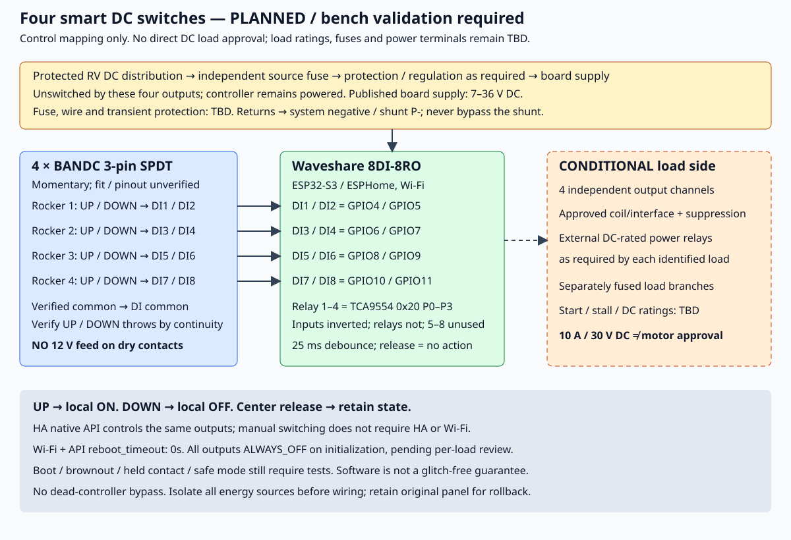

# Four Smart DC Switches — BANDC Rockers + Waveshare ESP32-S3-ETH-8DI-8RO

> **Status: Planned / bench-validation required (updated 2026-10-19).** Four **BANDC three-pin momentary SPDT** rockers ([Amazon B0CNS17ZMK](https://www.amazon.com/dp/B0CNS17ZMK)) were ordered 2026-10-18 and delivered 2026-10-19, replacing the originally selected Carling V8D1-S00B bodies; received parts are not yet checked. The controller changed on 2026-10-19 from the KinCony KC868-A4S to a **Waveshare ESP32-S3-POE-ETH-8DI-8RO** ([Amazon B0FBKGGKK3](https://www.amazon.com/dp/B0FBKGGKK3)), ordered 2026-10-19 and not yet received. Purchase status is tracked in [components.md](components.md). Nothing is installed. This project contains a control design and firmware candidate, not approval to connect the trailer's unidentified loads. The firmware candidate was rewritten for the Waveshare board; build results are in [TESTS.md](TESTS.md). Physical tests remain pending.

Replace four existing illuminated DC rockers with unlit, two-direction momentary rockers. One controller handles four independent channels locally and exposes those same output switches to Home Assistant. Background and alternatives remain in [the research record](../../docs/smart-dc-switch-research.md).

## Required behavior

| Event | Required result, regardless of last HA or button command |
| --- | --- |
| Press UP | Command that channel ON, including when already ON |
| Press DOWN | Command that channel OFF, including when already OFF |
| Release either direction | Spring return to center; **no output action** |
| HA disconnected or Wi-Fi/router unavailable | Physical UP/DOWN still works with a powered, functioning controller |
| Power restored / normal restart | All four outputs default to `ALWAYS_OFF`; deliberate per-load review required before changing this |

This is explicit ON/OFF, never toggle. The rocker resting position is not a state indicator. Manual operation depends on the ESP32-S3, firmware, the TCA9554 relay expander, relays, and their supply; **there is no dead-controller bypass guarantee**. Commands are processed locally; HA is not in the physical control path. The most recently processed command wins; simultaneous remote/physical commands have no special priority. Contradictory contacts from a wiring fault have no safety arbitration in this candidate.

## Parts / planning BOM

Quantities below are for four channels. The BANDC rockers are purchased but not a verified mechanical/electrical fit; the Waveshare controller is ordered. Remaining exact parts and ratings are TBD. Ownership and purchase status: [components.md](components.md).

| Part | Qty | Selection / specification gate |
| --- | ---: | --- |
| BANDC three-pin SPDT `(ON)-OFF-(ON)` rockers, no lamp | 4 | [Owner-selected Amazon listing (3Pin-Momentary variant)](https://www.amazon.com/dp/B0CNS17ZMK). Seller-described behavior only; confirm exact variant and received parts before wiring. Not Carling V8D1-S00B. |
| Durable load and UP ON / DOWN OFF labels; compatible caps if needed | 4 sets, TBD | Check what is included with the received switches. Do not assume the existing Nilight caps fit. No lamp-state indication is planned. |
| Waveshare ESP32-S3-POE-ETH-8DI-8RO (PoE version; Ethernet/PoE unused) | 1 | [Amazon B0FBKGGKK3](https://www.amazon.com/dp/B0FBKGGKK3), [manufacturer wiki](https://www.waveshare.com/wiki/ESP32-S3-ETH-8DI-8RO), [manufacturer product page](https://www.waveshare.com/esp32-s3-eth-8di-8ro.htm), [ESPHome device page](https://devices.esphome.io/devices/waveshare-esp32-s3-eth-8di-8ro/). ESP32-S3-WROOM-1U module: uses the **external antenna socket**; confirm an antenna is included and route it outside any metal cavity |
| Mounting location, 35 mm DIN rail section, strain relief and terminal covering | 1 | The board ships in a rail-mount ABS case published as **175 x 90 x 40 mm**; allow wiring bends, thermal clearance, antenna routing and service access. Confirm the case covers energized screw terminals in the chosen location |
| DC-rated controller input fuse and holder | 1 set | Rating TBD from electronics demand, conductor ampacity, voltage and interrupt rating; place at source of new supply branch |
| Supply transient/reverse-polarity protection, regulation if required | 1 assembly, TBD | Board published supply **7–36 V DC** (screw terminal) is not RV transient qualification; design against measured full supply envelope |
| Signal wiring, insulated quick-disconnects, power wiring, terminals, labels | As measured | Exact lengths, gauges, terminal sizes and ratings TBD; vibration-resistant connections and no exposed energized terminals |
| External DC-rated power relays / sockets / interfaces | Per load, TBD | Required unless exact onboard DC rating is proven sufficient; motor startup/stall, duty, contact life and voltage must be covered |
| Coil suppression and any load suppression | Per inductive circuit, TBD | Match relay/coil polarity and driver capability; follow manufacturer guidance, including release-time consequences |
| Branch fuses / holders | Per circuit, TBD | Preserve existing protection and add protection for every new conductor as required; select by wire and load, not guesswork |

The BANDC listing advertises an approximately **0.83 x 1.46 in** mounting opening, but its details also give **37.2 x 21.2 mm**; these seller dimensions and tolerances are not a fit guarantee. Measure all four existing Nilight openings, panel thickness, actuator clearance, body depth and terminal clearance; check the received parts before cutting or mounting anything. Remote-mount the controller; at 175 mm long it will not fit behind the rocker panel. Do not order extra caps or alter the panel on assumed dimensions.

## Control wiring — separate from load power



### Rocker continuity and orientation

The previous Carling terminal numbering **does not apply** to the BANDC selection. The Amazon listing describes three-pin momentary SPDT behavior, but does not establish a trustworthy pin map or physical UP orientation for the received parts. Off-trailer with each loose rocker disconnected from all power, use continuity to identify its common and both throws; confirm center opens both, each press closes only one, and spring return works in both directions. Record which throw closes for the installed actuator's physical UP side. If the received switch fails any check, stop and revise the wiring plan rather than guessing from terminal position or wire color.

- The **continuity-verified common** of each rocker goes to the board's **digital-input common terminal for passive (dry-contact) inputs**, after identifying that terminal on the received board's silkscreen and the Waveshare wiki wiring diagram. The inputs are optocoupler-isolated and supplied from the board's isolated supply; do not tie the input common to trailer ground unless the manufacturer's diagram requires it.
- The throw verified to close on **UP** goes to the odd DI input in the table below; the other throw goes to the even DI input.
- Center must leave both circuits open. Pressing one direction must close only its intended circuit. Use fresh labeled signal conductors, or reuse conductors only after complete isolation and identification.
- **Never connect the old 12 V switch-positive jumpers, illumination feed, or battery positive to any DI/GPIO or rocker common in this dry-contact circuit.** The old lamp harness is not an input harness. Keep load supply and dry signals separated.

### Exact controller signal map

Taken from the [ESPHome device page](https://devices.esphome.io/devices/waveshare-esp32-s3-eth-8di-8ro/) and the [Waveshare wiki](https://www.waveshare.com/wiki/ESP32-S3-ETH-8DI-8RO) on 2026-10-19; the device page states its configuration covers both the Ethernet and PoE versions. Match the received board and its legends before wiring; these sources establish software mapping, not an as-built harness.

**Inputs:** DI1–DI8 are ESP32-S3 **GPIO4–GPIO11**, `INPUT_PULLUP`, `inverted: true` (contact closed = pressed). **Relays:** TCA9554 I/O expander at **0x20** on I2C **SDA GPIO42 / SCL GPIO41** (Waveshare FAQ gives the 0x20 address); relay pins `inverted: false`. All polarities are from the published example and must be bench-confirmed.

| Channel / firmware ID | UP → ON | DOWN → OFF | Board output |
| --- | --- | --- | --- |
| Load 1 / `load_1` | DI1, GPIO4 | DI2, GPIO5 | Relay 1, TCA9554 P0 |
| Load 2 / `load_2` | DI3, GPIO6 | DI4, GPIO7 | Relay 2, TCA9554 P1 |
| Load 3 / `load_3` | DI5, GPIO8 | DI6, GPIO9 | Relay 3, TCA9554 P2 |
| Load 4 / `load_4` | DI7, GPIO10 | DI8, GPIO11 | Relay 4, TCA9554 P3 |

All eight digital inputs are used; **there are no spare inputs** for a fifth rocker. Relays 5–8 (TCA9554 P4–P7) are unused and left unconfigured, so they stay at the expander's power-up state; confirm on the bench that they remain open. Ethernet/PoE (W5500), RS485, RTC, buzzer (GPIO46) and RGB LED (GPIO38) are not configured. Each physical input is internal to ESPHome and has **25 ms debounce on both transitions**. Only `on_press` invokes `switch.turn_on` / `switch.turn_off`; release has no action.

**Power-up relay state is a known open question.** The TCA9554 starts with its pins as inputs until firmware configures them; whether any relay can briefly energize between power-on and ESPHome initialization depends on the board's relay-driver circuit, which is not documented in the sources above. Observe all eight relays during power ramps on the bench before connecting any load.

## Supply and CONDITIONAL load-side design

The controller must remain powered when all four loads are OFF. Supply it from **independently fused, unswitched RV DC**, independent of the four switched load paths. “Unswitched” means not controlled by these rockers; it is not an instruction to bypass a master disconnect or battery protection. Use the protected distribution system. Return board, coil and load current to the **load/system side of the battery shunt (P-)**, never B-; do not create a shunt bypass or add unprotected direct battery wiring. See [battery distribution](../01-second-battery/README.md) and the [equipment record](../../docs/trailer.md#electrical).

Measure minimum/maximum supply during battery operation, charging, startup and disturbances. Normal charging around 14.4–14.6 V fits the published 7–36 V range, but spikes, reverse polarity and brownouts still need engineering review. Choose protection/regulation only after this assessment. Measure continuous controller/relay consumption for storage planning.

**No direct DC load connection is approved by this document.** Waveshare publishes a relay contact rating of **≤10 A at 30 V DC** (and ≤10 A at 250 V AC), 1NO/1NC per channel. That is a resistive-style contact rating, not approval for motor startup, stall or long-term inductive switching, and it says nothing about the PCB traces or terminals for this duty. Use it directly only for a load whose measured running and startup current is well inside it and whose type the relay suits; otherwise use external suitably DC-rated power relays. Waveshare recommends RC snubbers or varistors for inductive loads. Even an external relay coil is a load: verify its current/voltage, onboard-contact suitability and suppression/interface before connecting it.

Conceptually, each board relay controls an approved external relay/interface; that external relay's normally open contact switches the separately fused load branch. Final COM/NO terminal wiring, coil feed, polarity and suppression are **TBD per selected part**. The SVG intentionally does not specify unidentified power terminals. Preserve appliance interlocks and determine whether the original switch switches power or only a control input. Do not put mains or a life-safety circuit on this project by assumption.

Complete this worksheet before selecting power components or installing:

| Channel | Actual load/model; power or control signal | Existing fuse / conductor | Measured running / startup; stall requirement | DC-rated interface + suppression | Deliberate restore decision |
| --- | --- | --- | --- | --- | --- |
| 1 | TBD | TBD | TBD | TBD | `ALWAYS_OFF` pending review |
| 2 | TBD | TBD | TBD | TBD | `ALWAYS_OFF` pending review |
| 3 | TBD | TBD | TBD | TBD | `ALWAYS_OFF` pending review |
| 4 | TBD | TBD | TBD | TBD | `ALWAYS_OFF` pending review |

No fuse amperage or wire gauge is selected here. Fuses protect conductors; choose wire, protection and connectors for run length, voltage drop, environment, load and fault current. Final load wiring requires a qualified RV installer and the completed worksheet.

## Firmware candidate

[`esphome/casita-smart-dc-switches.yaml`](esphome/casita-smart-dc-switches.yaml) is a complete four-channel candidate using built-in ESPHome components. It targets the ESP32-S3 (16 MB flash, ESP-IDF) and uses Wi-Fi, not the board's Ethernet/PoE port, the encrypted native API, and current OTA list syntax (`platform: esphome`). All credentials are `!secret` references. [`secrets.example.yaml`](esphome/secrets.example.yaml) contains only deliberately fake replacement markers; its API marker is **not** a valid encryption key. A future private build must supply valid credentials in ignored `secrets.yaml`; never publish actual SSIDs, IPs, MACs, phone identifiers, tailnet details or credentials.

Both `wifi.reboot_timeout` and `api.reboot_timeout` are **`0s`**, disabling their default 15-minute disconnected reboot timers. See [Wi-Fi](https://esphome.io/components/wifi/), [API](https://esphome.io/components/api/), [switch restore/actions](https://esphome.io/components/switch/), [PCA9554/TCA9554](https://esphome.io/components/pca9554/) and [OTA](https://esphome.io/components/ota/esphome/).

`ALWAYS_OFF` is a software initialization choice, **not a glitch-free hardware guarantee**. Reset, slow power ramps, brownout, I2C failure, boot ordering, a held input and failed boots must be tested. ESPHome OTA safe mode can disable normal components after failed boots; local switching is not guaranteed in safe mode or during firmware updates. Disabling disconnected reboot timers does not disable watchdogs, prevent crashes or guarantee network recovery. Do not enable loads until startup behavior is acceptable for each appliance; add a hardware inhibit if the load requires it.

Static checks do not compile firmware or emulate the controller:

```sh
# From repository root; requires Python 3 and PyYAML.
python3 modifications/06-smart-dc-switches/tests/test_config.py
git diff --check
```

The test never reads or provisions `secrets.yaml`. If PyYAML is missing, it exits with a dependency message rather than reporting a false pass. Actual ESPHome schema validation/compilation is a separate check; results are recorded in [TESTS.md](TESTS.md). Build-only validation uses synthetic credentials, and its firmware must never be deployed. No firmware upload is authorized by this project-file task.

## Planned build sequence

1. Photograph and label the original panel, every connector, fuse and conductor. Identify all four loads and complete the worksheet. Keep the original panel/harness intact for rollback.
2. Measure mechanical fit; inspect the received rockers and select labels/compatible actuators if needed, enclosure and rated protection/interface parts. Confirm exact received board revision against its schematic and terminal legends.
3. Off-trailer, with **no battery connected**, perform the loose-rocker continuity/orientation checks. Label each UP/DOWN conductor and match the table.
4. After separate firmware validation/compile, bench-test on a current-limited supply with low-energy, current-limited LED test loads; keep trailer loads disconnected. Verify relay contact polarity before any load trial.
5. Complete the [commissioning checklist](TESTS.md), including extended network outages, power disturbances and both orders of HA/button control. Record actual observations and firmware version.
6. Only after load ratings, protection and all acceptance gates are resolved, plan installation with an RV installer. Isolate battery, shore, solar, tow feed and every possible backfeed (including converter/inverter paths); prove dead before working. No live power changes are authorized by this document task.
7. Re-test installed behavior and temperatures under the approved operating conditions, record dated photos/as-built wiring, then change status to installed. Until then this remains **Planned**.

## Home Assistant and future import hook

Future setup uses the **native ESPHome integration in Casita's HA** for this device. Assign it to the **Casita RV** area and give the four outputs meaningful load names after identification. The API publishes the same switch state the local buttons control. That state represents the commanded output, **not proof of closed contacts or a running appliance**; separate feedback would be needed for that.

If the Casita HA entities are later imported into another HA instance, explicitly select only the intended four output entities, use an **`rv_` prefix** for imported IDs (for example `switch.rv_load_1` until meaningful names are chosen), and put them in **Casita RV**. Verify actual generated IDs; do not assume names alone enforce an ID. Do not broadly import unrelated entities or expose the eight internal buttons. This is a future integration hook, not configured automation, deployment or a dependency for manual control. No network addressing is recorded here.

## Rollback / safety notes

Keep the original panel, switches and labeled harness, plus before photos and a circuit/fuse map. If bench tests fail, leave the original trailer wiring untouched. If a later installation must be reversed, isolate **battery, shore, solar, tow and every other feed**, verify de-energized, remove/isolate the new controller and interfaces, and restore the documented original connections and branch protection. Verify original function before returning to service. Do not improvise an energized jumper bypass, combine dry-input and power wiring, or move returns to the battery side of the shunt.

## Revisions

| Date | Change / evidence |
| --- | --- |
| 2026-10-13 | Owner-selected bodies/controller; planned four-channel project, source-checked mapping, firmware candidate, diagram and acceptance checklist. Five static tests passed; SVG rendered and visually reviewed; ESPHome 2026.9.1 compilation passed using synthetic credentials. Independent review completed and I2C-failure acceptance gate added. No purchases, physical tests, firmware upload or installation recorded. |
| 2026-10-19 | Owner changed planned rocker purchase to four BANDC three-pin momentary SPDT switches (Amazon B0CNS17ZMK), replacing the previously selected Carling bodies. Pin map, fit and received-part behavior remain unverified; no purchase or physical test confirmed. Controller/firmware choice unchanged. |
| 2026-10-19 | Added [components.md](components.md). Amazon order history shows the four BANDC rockers ordered 2026-10-18 and delivered 2026-10-19 (not yet inspected). KC868-A4S not ordered; not sold on Amazon, available from the KinCony store. Owner confirmed wire, terminals, fuse holder, labels, multimeter and bench supply on hand. |
| 2026-10-19 | Controller changed from the KinCony KC868-A4S (never ordered) to a Waveshare ESP32-S3-POE-ETH-8DI-8RO, Amazon B0FBKGGKK3, ordered by the owner 2026-10-19, arriving 2026-10-23 per Amazon. Reasons: sold on Amazon, published 10 A / 30 V DC relay rating, optocoupler-isolated inputs, rail-mount case included, 7–36 V DC supply. Trade-off: all eight inputs used, no spare. Firmware, mapping, diagram, tests and checklist rewritten for the new board from the ESPHome device page and Waveshare wiki; five static tests passed; ESPHome 2026.9.1 compile passed with synthetic credentials; SVG render checked. Board not yet received; no physical tests. |
