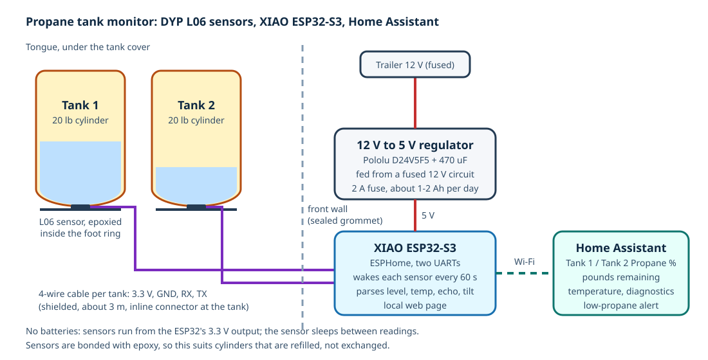
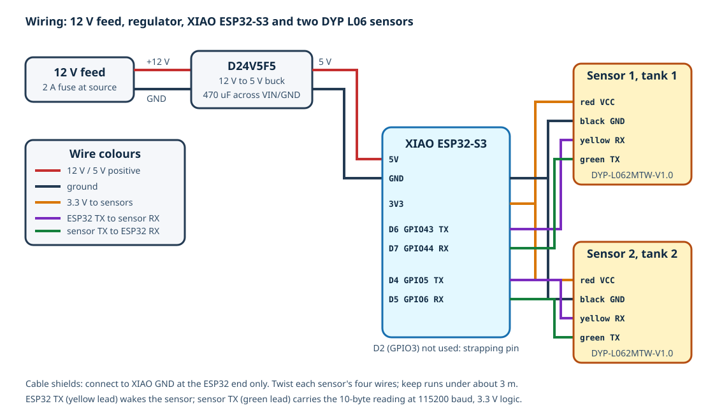
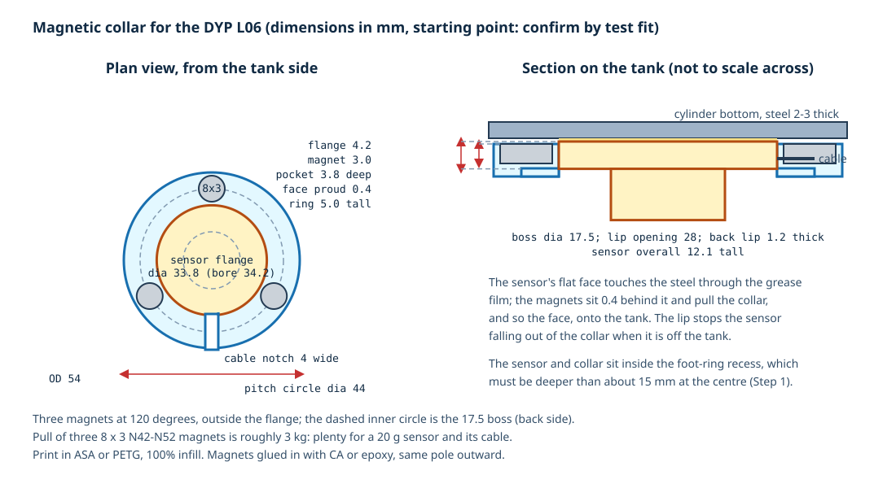

# Propane Tank Monitor to Home Assistant (DYP L06 + XIAO ESP32-S3)

Two DYP L06 ultrasonic liquid-level sensors, one held magnetically against the bottom of each 20 lb propane cylinder, read by a Seeed Studio XIAO ESP32-S3 running ESPHome. The ESP32 is powered from the trailer's 12 V system and powers the sensors, so **there are no batteries to replace**. Every minute it wakes each sensor, reads the liquid height through the steel tank wall, converts it to a percentage and pounds remaining, and publishes everything to Home Assistant over Wi-Fi. A local web page shows the same readings at the campsite without Home Assistant.



> [!IMPORTANT]
> **Status: designed, not purchased or built (October 2026).** The ESPHome configuration validates and compiles with ESPHome 2026.9.1 but has not run on hardware, and no L06 has been tried on a Casita cylinder yet. **Start at [What to order](#what-to-order):** buy one sensor first and bench-test it (Step 1) before ordering the second.
>
> **Mounting:** DYP's documented method is epoxy, which ties the sensor to one cylinder. This project mounts the sensor in a small **magnetic collar** with silicone grease as the couplant instead, the same way Mopeka and Safiery hold their ultrasonic sensors on the same spot, so a sensor moves to a new cylinder in a minute. The collar is **not tested on an L06 yet**; the epoxy method stays as the fallback (Step 3b).

**Contents:** [What to order](#what-to-order) · [Build order](#build-order) · [Why this design](#why-this-design) · [How it works](#how-it-works) · [Known limitations](#known-limitations) · [Parts](#parts) · [Wiring](#wiring) · [Steps](#steps) · [ESPHome configuration](#esphome-configuration) · [Home Assistant setup](#home-assistant-setup) · [Testing](#testing-checklist) · [Troubleshooting](#troubleshooting) · [Safety](#safety-notes)

## What to order

### The sensor: DYP-L062MTW-V1.0, and only that model

The L06 comes in four versions that look identical. Only one is right for this project:

| Model | Interface | Order? |
| --- | --- | --- |
| **DYP-L062MTW-V1.0** | **UART, controlled** (sleeps until the ESP32 sends a byte) | **Yes. This one.** |
| DYP-L062MUW-V1.0 | UART, automatic (streams readings all the time) | No |
| DYP-L062MCW-V1.0 | I2C | No: I2C is not reliable over the 3 m cable runs, and both sensors would share one bus with the same default address |
| DYP-L062M4W-V1.0 | RS-485 Modbus | No: needs transceivers; nothing here speaks RS-485 |

**Why UART controlled:** each sensor gets its own UART on the ESP32 (one failing cannot affect the other), the 115200 baud serial is fine over 3 m of shielded cable, the protocol is one byte out and ten bytes back, and the sensor sleeps at under 15 uA between readings.

### Ordering checklist

Order **one sensor first**, bench-test it (Step 1), then order the second if it works.

1. **Easiest: Amazon.** [DYP-L06 ... (UART Controlled, 1)](https://www.amazon.com/dp/B0C1GHF2M8), about $25 (seen 2026-10-13). On the listing, the **Size** option must say **UART Controlled**, not **IIC**. The listing carries DYP's own spec text (sleep current under 15 uA, 115200 baud, 3 cm blind zone), which is the UART-controlled model, but it does not say whether the couplant/EVA/epoxy kit or mating cables are included, and the brand shows as "Generic". Message the seller to ask, or just buy the [mating cables](#parts) and grease separately (both are on the parts list; the kit is only needed for the epoxy fallback).
2. **Or direct from DYP** (confirms the exact model and the propane setting, slower): the [DYP product page](https://www.dypcn.com/dyp-l06-gas-tank-lpg-level-measuring-sensor-product/) has a **Send email to us** button, or use DYP's Alibaba store (`dypsensor.en.alibaba.com`) or a distributor such as [Evelta](https://evelta.com/l06-ip67-waterproof-ultrasonic-lpg-gas-level-measuring-sensor-3-100cm/). Send this message, copied as-is:

   > Hello, I would like to order **1 x DYP-L062MTW-V1.0** (L06 liquefied gas level sensor, **UART controlled output**, TTL level, 115200 baud). Please confirm:
   >
   > 1. Measuring medium configured for **propane (LPG)**, steel cylinder wall 2-3 mm thick.
   > 2. Include the **installation kit** (ultrasonic couplant, double-sided EVA ring, AB glue).
   > 3. Include **2 x mating cables** for the sensor's white 1.25 mm 4-pin connector, at least 30 cm long with bare wire ends (or tell me the connector part number so I can buy them).
   > 4. A link to the current L06 datasheet and the Windows "Sensor Assistant" software.
   >
   > Shipping to the USA. Thank you.

3. When it arrives, check the label on the sensor says **L062MTW** (not MUW, MCW or M4W) before doing anything else. If it is the wrong model, do not try to make it work; return or exchange it.
4. Order the rest of the [Parts](#parts) list at the same time; every row has an Amazon link. Skip the second sensor until the first has passed the bench test.

## Build order

The short version of the [Steps](#steps), so nothing is done out of sequence:

1. **Measure** the recess under one cylinder (Step 1.1). Under about 15 mm deep: stop and rethink.
2. **Wire one sensor to the XIAO on the bench** and flash the firmware (Steps 4 and 5). Nothing is glued or printed yet.
3. **Hold the sensor on a part-full cylinder with grease** and watch the web page (Step 1). Good echo strength and a steady level: carry on. Otherwise stop; the sensor does not suit the cylinder.
4. **Order the second sensor** and print the collars (Step 3a).
5. **Mount both sensors**, install the ESP32 in the trailer, calibrate with **Mark Full** on the next fill (Steps 3-6).

## Why this design

The requirement was tank level in Home Assistant with no batteries to maintain. The usual RV products do not meet it:

| Option | Power | Home Assistant | Verdict |
| --- | --- | --- | --- |
| Mopeka Pro Check / Pro Check Universal | CR2032 or similar coin cell, 1-2 years | Native Bluetooth integration | Simplest, but batteries |
| Mopeka Pro Plus | 2 x AAA lithium | Native Bluetooth integration | Batteries |
| Gaslock GASLEVEL with external display | 12 V | Wired LED only; no data output | Threshold (above/below the sensor) only, no percentage |
| Safiery magnetic LPG sensor (LPG05080001-A) | 12 V | 0-5 V analog; needs an interface | Real option; about A$183 each plus a preprocessor, designed for Victron GX |
| **DYP L06 (this project)** | **3.3-5 V from the ESP32** | **Serial data, read directly by ESPHome** | **Chosen: cheapest, digital output, continuous level; mounted magnetically like the Mopeka** |

The L06 is an OEM sensor module made for exactly this job (bottom-mounted, non-contact LPG level through a steel wall, with built-in temperature compensation), not a finished consumer product. This project supplies the rest: power, mounting, wiring, firmware and the Home Assistant side.

## How It Works

1. The sensor sits in the recess inside the cylinder's foot ring, at the center of the domed bottom, its flat face pressed against the steel through a thin film of silicone grease by three magnets in a collar around it (or, as the fallback, bonded with DYP's couplant and two-part epoxy). It fires a high-frequency ultrasonic pulse through the steel into the liquid propane and times the echo from the liquid surface. Propane vapor above the liquid returns almost no echo, so the first strong echo marks the liquid height.
2. The ESP32 sends one byte to the sensor's `RX` lead. That wakes the sensor (it sleeps at under 15 uA otherwise), it measures once (about 730 ms) and replies on `TX` with a 10-byte frame: liquid height in mm, temperature, echo strength and tilt angle, with a checksum. ESPHome parses the frame and publishes the values.
3. Percentage = liquid height / "Full Level". Full Level is a per-tank calibration number stored on the ESP32, set once by pressing **Mark Full** on a freshly filled cylinder. Pounds remaining = percentage x 20 lb.
4. If the liquid is below the sensor's 30 mm blind zone the sensor reports "no liquid" (`0xFFFD`). The firmware shows that as 0 mm / 0%, and the **Liquid Detected** diagnostic turns off. A near-empty 20 lb cylinder still has roughly 1-2 lb of propane at that point, so the low-propane alert should fire well above 0%.

Everything is powered from the trailer: 12 V from a fused circuit to a 5 V buck regulator, 5 V to the XIAO, and the XIAO's 3.3 V output to both sensors. The sensors' serial lines are 3.3 V when they are powered at 3.3 V, which is what the ESP32 needs.

## Known Limitations

- **The magnetic collar is this project's design, not DYP's.** DYP only documents epoxy. Mopeka's magnetic sensors mount in the same spot with the same kind of grease couplant, which is reassuring about the physics and the geometry, but the L06 has not been tested on a US DOT 20 lb cylinder with either method. The foot-ring recess depth and the surface at the center of the dome are the two things to check in Step 1, and echo strength after the first tow is the proof that the collar holds.
- **Grease needs refreshing.** Silicone grease does not dry out, but it should be renewed whenever the sensor is moved and about yearly. A falling **Echo Strength** reading is the signal.
- **Exchanged cylinders still need a minute of work:** move the collar, wipe the dome, fresh grease, check echo strength, press **Mark Full** on the next proper fill. With the epoxy fallback the sensor stays with the old cylinder.
- **The bottom 30 mm is invisible.** Below about 30 mm of liquid the sensor reports nothing. Treat "0%" as "under about 1-2 lb".
- **Percent is linear in height.** The cylinder's domed bottom and shoulder mean the true volume per millimeter is lower near the ends. Readings are honest at full and near empty (the calibration points) and a little pessimistic in the middle. That is fine for "time to refill".
- **Level moves with temperature.** Liquid propane expands about 0.15% per degC, so a tank reads a few percent higher on a hot afternoon than on a cold morning with no gas used. The sensor's temperature entity shows why.
- **Temperature range.** DYP guarantees accuracy from 0 to 35 degC and operation from -10 (or -15, the datasheet says both) to 60 degC. Under a black tank cover in Texas sun the tank bottom may exceed 60 degC; expect odd readings then. Below -10 degC in winter the sensor may stop reading until it warms up.
- **Not a certified hazardous-location device.** The sensor runs at 3.3 V and under 50 mA and the ESP32 lives inside the trailer, but nothing here carries an intrinsic-safety rating. See Safety notes.
- **Tilt.** The sensor reports its tilt; a tank leaning more than a few degrees reads low. The trailer should be level anyway.
- **Always on.** The ESP32 draws roughly 40-80 mA on Wi-Fi, about 1-2 Ah per day from the 600 Ah bank. Power it from a circuit that the battery disconnect (when one is added) or a switch can turn off for storage.
- **Away from home** the Home Assistant connection needs a network path, the same as the battery monitor: see [mod 04](../04-battery-monitor-esp32/README.md#reading-the-battery-away-from-home).

## Parts

| Component | Qty | Notes | Purchase link |
| --- | ---: | --- | --- |
| DYP-L062MTW-V1.0 LPG level sensor (UART controlled) | 2 | **See [What to order](#what-to-order): the exact model and what to check.** About $25 each on Amazon; choose the **UART Controlled** size option, not IIC | [Amazon](https://www.amazon.com/dp/B0C1GHF2M8), or [DYP direct](https://www.dypcn.com/dyp-l06-gas-tank-lpg-level-measuring-sensor-product/) |
| Magnetic collar (3D-printed, ASA or PETG, 100% infill) | 2 | Ring around the sensor's 33.8 mm flange with three magnet pockets and a cable notch; drawing below. Print one and test-fit before printing the second | |
| Neodymium disc magnets, 8 mm x 3 mm, N42-N52 | 6 (3 per collar) | About 1 kg pull each; nickel plated. Glued into the collar pockets with CA or epoxy, faces flush with the collar. Smallest sensible pack is far more than 6 | [Amazon: LiftSun N42 8x3 mm, 100 pack](https://www.amazon.com/dp/B0GFCBFKKQ) |
| Silicone dielectric grease (couplant) | 1 tube | Any silicone dielectric grease; Mopeka's "Sonic Grease" is the same idea in single-use sachets. Not DYP's water-based gel, which dries out | [Amazon: Permatex 22058, 3 oz](https://www.amazon.com/dp/B000AL8VD2) or [Amazon: Mopeka Sonic Grease, 4 packets](https://www.amazon.com/dp/B0CVQVGMWB) |
| Seeed Studio XIAO ESP32-S3 | 1 | Same board as the battery monitor. The plain board (not the "Sense" camera version); the U.FL antenna comes in the box | [Amazon](https://www.amazon.com/dp/B0BYSB66S5) or [Seeed](https://www.seeedstudio.com/XIAO-ESP32S3-p-5627.html) |
| 12 V to 5 V buck regulator, 500 mA or more | 1 | Pololu D24V5F5 (same as mod 04), input up to 36 V | [Amazon (reseller)](https://www.amazon.com/dp/B012QE3MNE) or [Pololu](https://www.pololu.com/product/2843) |
| 470 uF 25 V electrolytic capacitor | 1 | Across the regulator input, close to it | [Amazon: 15 pack](https://www.amazon.com/dp/B0CMQ8GMCF) |
| Inline ATO/ATC fuse holder and 2 A fuse | 1 | On the 12 V feed, or use a spare position in the WFCO 12 V fuse panel. The holder kit's fuses start at 7.5 A, so buy the 2 A fuses separately | [Amazon: 14 AWG waterproof holders, 4 pack](https://www.amazon.com/dp/B0F6T8X81M) and [Amazon: Bussmann 2 A ATC, 5 pack](https://www.amazon.com/dp/B008QDH9VQ) |
| 4-conductor shielded cable, 22 AWG | About 2 x 3 m (25 ft roll) | Sensor leads are only 140 mm; this runs from the ESP32 to each tank. Shield grounded at the ESP32 end only | [Amazon: 22/4 shielded, tinned stranded, 25 ft](https://www.amazon.com/dp/B0D9JY3MC4) |
| 1.25 mm pitch 4-pin mating cables for the sensor connector | 2 (pack of 20 pairs) | "Micro JST 1.25 mm" pigtails are the usual match for the sensor's white 1.25 mm connector, to confirm on the first sensor. The pack gives male and female halves, so the same parts make the inline connector at each tank | [Amazon: Micro JST 1.25 mm 4-pin, 20 pairs, 150 mm](https://www.amazon.com/dp/B09DYLY95R) |
| Small ABS enclosure (about 80 x 60 x 30 mm) | 1 | For the XIAO and regulator inside the trailer | [Amazon: 83 x 58 x 33 mm IP65, 2 pack](https://www.amazon.com/dp/B0FDQCHNQP) |
| Cable gland (PG7) and sealant | 1-2 | Where the sensor cables pass through to the tongue, and into the enclosure | [Amazon: PG7 nylon glands, 50 pack](https://www.amazon.com/dp/B0CTCG4HMM) |
| Heat-shrink (adhesive-lined), Kapton tape, zip ties | As needed | | [Amazon: 3:1 adhesive-lined heat-shrink kit](https://www.amazon.com/dp/B0DC5YN5CD), [Amazon: Kapton tape 10 mm, 4 rolls](https://www.amazon.com/dp/B07S227ZLH) |
| USB to TTL serial adapter (3.3 V, CP2102 or FTDI) | 1, optional | For DYP's Windows "Sensor Assistant" tool during installation (Step 2). The ESPHome web page can substitute | [Amazon: DSD TECH CP2102, 2 pack](https://www.amazon.com/dp/B078W5L8W1) |

Amazon links checked on 2026-10-13; prices then were roughly: sensor $25, XIAO $17, regulator $11, magnets $18, grease $10, cable $17, pigtails $9, enclosure $9, glands $10, fuse holders $9 + fuses $7, capacitors $7, heat-shrink $10, Kapton $10, USB-TTL $12. About **$200** for everything including both sensors, most of it in packs with plenty left over.

## Tools and Supplies

- Fine-tip soldering iron, solder, flux
- Multimeter with continuity
- Isopropyl alcohol (99%, [Amazon](https://www.amazon.com/dp/B08CGVVYWV)) and lint-free cloths for cleaning the tank bottom
- Small digital scale or bathroom scale (to weigh cylinders for calibration)
- A level for checking the tank

## Wiring



| From | To | Notes |
| --- | --- | --- |
| 12 V fused circuit (2 A) | Regulator `VIN` | 18-20 AWG. Candidates: a spare WFCO 12 V fuse position, or the circuit feeding the front of the trailer. **To confirm** which is closest to the front |
| 12 V negative | Regulator `GND` and XIAO `GND` | Trailer negative returns through the shunt's P- side like every other load |
| Regulator `VOUT` (5 V) | XIAO `5V` pin | |
| XIAO `3V3` | Sensor 1 red (`VCC`) and sensor 2 red (`VCC`) | Both sensors on 3.3 V so their serial outputs are 3.3 V |
| XIAO `GND` | Sensor 1 and 2 black (`GND`), cable shields | |
| XIAO `D6` (GPIO43) | Sensor 1 yellow (`RX`) | ESP32 transmits the wake-up byte |
| XIAO `D7` (GPIO44) | Sensor 1 green (`TX`) | ESP32 receives the data frame |
| XIAO `D4` (GPIO5) | Sensor 2 yellow (`RX`) | |
| XIAO `D5` (GPIO6) | Sensor 2 green (`TX`) | |

Sensor lead colors from the DYP datasheet: red `VCC`, black `GND`, yellow `RX` (into the sensor), green `TX` (out of the sensor). The ESP32's TX goes to the sensor's RX and vice versa. GPIO3 (XIAO `D2`) is avoided because it is an ESP32-S3 strapping pin.

### Where things go

- **Sensors:** under each cylinder, inside the foot ring, at the center of the domed bottom, in their magnetic collars. The cable exits through one of the foot ring's drain notches and is zip-tied up the cylinder's side under the tank cover, with enough slack to lift the cylinder out for refilling. Use a small inline connector near each tank so a cylinder can be taken out, or the sensor moved to a new one, without cutting anything.
- **ESP32 and regulator:** inside the trailer at the front, in the enclosure, powered from the nearest 12 V circuit. The two sensor cables pass through the front wall to the tongue through an existing grommet (the propane line and 7-way harness come through somewhere nearby) or a new sealed gland. **To confirm:** find the pass-through.
- The alternative, a weatherproof box on the tongue, keeps the cables short but puts the ESP32 next to the regulator and valves. Prefer inside.

## Steps

### Step 1: Bench-test one sensor on a cylinder

Before printing or gluing anything, prove that the sensor reads through the Casita's cylinders and fits under them. Lift the cylinder out of the tray and set it on blocks so you can work under it with the valve closed.

1. Measure the cylinder: the depth of the recess from the lowest point of the foot ring up to the center of the dome. The sensor is 33.8 mm across and 12.1 mm tall, with the cable leaving the side; the collar adds 54 mm across but no height. It needs at least about 15 mm of recess so the tank still sits on its foot ring and nothing presses on the sensor. Note the value in Revisions.
2. Wire one sensor to the XIAO on the bench (table above, tank 1 pins), flash the firmware (Step 5) and open the device's web page. The regulator is not needed on the bench: power the XIAO from its USB port.
3. With the cylinder at least a third full (the sensor needs more than 10 cm of liquid to validate an installation), clean the center of the dome and put a blob of silicone grease (the same couplant the collar uses) on the sensor face. Press the sensor onto the center of the dome by hand. This is the same coupling the magnetic collar provides, so a good reading here means the collar will work. Within a few readings (press **Read Tanks Now**), **Tank 1 Liquid Level** should show a plausible height and **Echo Strength** should be well above zero; DYP's examples show about 1,500 mV at a good spot.
4. Slide the sensor around the center a few millimeters at a time. The spot with the highest echo strength and a steady level is the installation spot. If the echo is weak or the level jumps around everywhere, try a cleaner spot; if it never settles, the sensor does not suit this cylinder and the project stops here.
5. Check the reading changes with level: weigh the cylinder (propane weight = scale weight - the tare weight stamped `TW` on the collar) and compare with the height. Record both.

### Step 2 (optional): DYP's installation mode

DYP's documented installation check uses their Windows **Sensor Assistant** program with a USB-TTL adapter (115200 baud): it plots the echo waveform, and the "installation mode" has the sensor grade the spot 0-9 and adapt to the medium. The datasheet describes the same functions as Modbus registers (`0x0303` to start installation mode, `0x0120` for the grade, `0x0122` for media adaptation). Whether the MTW model answers Modbus on its TTL UART is **to confirm**; the echo-strength reading from the normal frame is the ESPHome substitute. If you have a Windows machine, run the tool once at the chosen spot and note the grade.

### Step 3a: Mount the sensors in the magnetic collars



The collar is a ring that the sensor's 33.8 mm flange drops into from the tank side, retained by a lip at the back, with three magnets in pockets on the tank-side face. The pocket is 0.4 mm shallower than the flange is thick, so the sensor's flat face stands about 0.4 mm proud of the magnet faces: the magnets pull the face into the grease film instead of leaving a gap. A cable notch lets the lead out at the side.

1. Print the collar (ASA or PETG, 100% infill, 0.2 mm layers) and test-fit: the flange should slide in without force and the face should sit proud of the ring. Adjust the pocket depth if your printer runs tight or loose.
2. Glue the three magnets into their pockets, all with the same pole facing out (it does not matter which, but they must match), faces flush with the ring. Let the glue cure.
3. Drop the sensor into the collar from the magnet side, cable through the notch. A drop of CA at two points on the back lip keeps it from falling out when it is off the tank.
4. Wipe the spot found in Step 1 clean with isopropyl alcohol. Put a pea-sized blob of silicone grease on the center of the sensor face and spread it to cover the face; no air pockets.
5. Press the collar onto the spot, give it a small twist to spread the grease, and check the reading on the web page: level and echo strength should match the hand-held bench reading. If echo strength is much lower, lift it off, re-grease and try again.
6. Route the cable out through the foot ring notch, zip-tie it up the side of the cylinder with a service loop, and add the inline connector.
7. Repeat for tank 2.

**Moving a sensor to a new cylinder:** unplug the inline connector, pull the collar off, wipe both surfaces, fresh grease, and repeat steps 4-6. Press **Mark Full** on the next full fill.

**No 3D printer?** The minimum version is three 6 mm x 2 mm magnets glued directly to the rim of the sensor's flat face at 120 degrees, outside the central 20 mm, standing no more than about 0.3 mm proud of the face, with grease filling the rest. It holds less well and is harder to get flat; try the collar first.

### Step 3b (fallback): Glue the sensors

If a collar will not hold on your cylinders, or the echo strength through a grease film is poor, use DYP's documented epoxy method ([installation instruction](../../manuals/propane/dyp-l06-lpg-level-sensor-installation-instruction.pdf)). This ties the sensor to one cylinder: refilled cylinders only.

1. Clean the spot with isopropyl alcohol: no dirt, rust, water or loose paint. Wipe the sensor face clean of grease.
2. Stick the double-sided EVA ring to the sensor (bottom release paper only).
3. Mix the AB epoxy for at least 30 seconds and spread it over the whole center face of the sensor, no gaps.
4. Peel the top release paper, press the sensor onto the spot and hold for a moment. Check the reading on the web page again: it must still show the same level and echo strength. At 25 degC the epoxy sets in 5-10 minutes and is fully cured after an hour; longer when cold.
5. Route the cable as in Step 3a.

### Step 4: Install the ESP32

1. Solder the regulator (`VIN`, `GND`, `VOUT`) with the 470 uF capacitor across `VIN`/`GND`, and wire `VOUT` to the XIAO `5V` pad and `GND` to `GND`.
2. Solder the two sensor cables to the XIAO pins in the table. Twist each cable's four wires if the cable is not already twisted, and connect the shield to `GND` at the XIAO end only.
3. Flash the firmware (below) over USB on the bench before closing the enclosure.
4. Mount the enclosure, run the cables through the pass-through, seal it, and connect the 12 V feed through the 2 A fuse.

### Step 5: Flash the firmware

1. Copy [`esphome/casita-propane-monitor.yaml`](esphome/casita-propane-monitor.yaml) and the [`esphome/packages/`](esphome/packages/) folder into the ESPHome Device Builder (the package path is relative to the main file).
2. Copy [`esphome/secrets.example.yaml`](esphome/secrets.example.yaml) into ESPHome's `secrets.yaml` and replace every placeholder (the same secrets as the battery monitor can be reused, except generate a new API key with `openssl rand -base64 32`).
3. First install over USB; later updates are wireless.
4. Open **Logs**. Every minute each tank logs a line like `level=185 mm (66%) temp=24.3 C echo=1310 mV tilt=1.2 deg`, or a warning `No valid frame` if the sensor is not answering.

### Step 6: Calibrate

1. With a cylinder freshly filled (a proper 80% fill by weight, not an exchange cage's partial fill), wait for the reading to settle and press **Tank N Mark Full**. The current height becomes that tank's **Full Level** (stored in flash; also editable as a number). Until then, Full Level defaults to 280 mm, an **assumed** value.
2. Over the next refill cycle, weigh the cylinder a few times and compare pounds on the scale against **Propane Remaining**. Expect agreement within about 10% except near empty.
3. If the two tanks were filled to different levels, each has its own Full Level; calibrate each on its own fill.

## ESPHome Configuration

Files:

- [`esphome/casita-propane-monitor.yaml`](esphome/casita-propane-monitor.yaml): the device (board, Wi-Fi, API, web page, read schedule) and two instances of the tank package.
- [`esphome/packages/dyp-l06-tank.yaml`](esphome/packages/dyp-l06-tank.yaml): everything for one tank: its UART, the read script and parser, and its entities. Included twice with different `tank`, `tx_pin` and `rx_pin` values.

| Substitution | Default | Meaning |
| --- | --- | --- |
| `read_interval` | `60s` | How often each tank is read |
| `tank_capacity_lb` | `"20"` | Propane in a full cylinder, for the pounds-remaining sensor |
| `full_level_mm` | `"280"` | Initial Full Level (mm) before Mark Full is pressed. Assumed |
| per tank `tx_pin`, `rx_pin` | `GPIO43`/`GPIO44`, `GPIO5`/`GPIO6` | XIAO `D6`/`D7` and `D4`/`D5` |

How a reading works (`read_tankN` script): flush the UART receive buffer, send one byte (`0x55`), wait 900 ms, read everything received, find the last 10-byte frame that starts with `0xFF` and whose last byte equals the low 8 bits of the sum of the other nine, then decode it. The frame layout and worked example are in the package file's header comment, copied from the DYP datasheet (section 2.2). Three consecutive bad or missing frames set the tank's entities to unknown.

Validation on bee2 with ESPHome 2026.9.1 on 2026-10-13: `esphome config` passed and `esphome compile` succeeded (RAM 30.3%, flash 48.3%). This proves only that the configuration builds; it has not run on hardware.

### Secrets

Same keys as the battery monitor: `api_encryption_key`, `ota_password`, `wifi_ssid`, `wifi_password`, `fallback_ap_password`, `web_username`, `web_password`. `secrets.yaml` is git-ignored; only `secrets.example.yaml` is committed.

## Home Assistant Setup

The device is discovered by the ESPHome integration as **Casita Propane Monitor**.

### Entities

| Entity name | Likely entity ID | Unit / notes |
| --- | --- | --- |
| Tank 1 Propane, Tank 2 Propane | `sensor.casita_propane_monitor_tank_1_propane` | % of Full Level |
| Tank 1 Propane Remaining, Tank 2 ... | `sensor.casita_propane_monitor_tank_1_propane_remaining` | lb |
| Tank 1 Temperature, Tank 2 ... | `sensor.casita_propane_monitor_tank_1_temperature` | degC at the tank bottom |
| Tank 1 Liquid Level, Tank 2 ... | `sensor.casita_propane_monitor_tank_1_liquid_level` | mm (diagnostic) |
| Tank 1 Echo Strength, Tank 2 ... | `sensor.casita_propane_monitor_tank_1_echo_strength` | mV, 0-1500 (diagnostic) |
| Tank 1 Tilt, Tank 2 ... | `sensor.casita_propane_monitor_tank_1_tilt` | degrees (diagnostic) |
| Tank 1 Liquid Detected, Tank 2 ... | `binary_sensor.casita_propane_monitor_tank_1_liquid_detected` | off = below 30 mm or no echo (diagnostic) |
| Tank 1 Full Level, Tank 2 ... | `number.casita_propane_monitor_tank_1_full_level` | mm (configuration) |
| Tank 1 Mark Full, Tank 2 ... | `button.casita_propane_monitor_tank_1_mark_full` | (configuration) |
| Read Tanks Now | `button.casita_propane_monitor_read_tanks_now` | (configuration) |
| Wi-Fi Signal, Uptime, IP Address, Restart | diagnostic entities | |

Home Assistant generates entity IDs from the device and entity names. Confirm the actual IDs on the device page and adjust the examples below if they differ.

### Dashboard card

```yaml
type: horizontal-stack
cards:
  - type: gauge
    entity: sensor.casita_propane_monitor_tank_1_propane
    name: Propane 1
    min: 0
    max: 100
    severity:
      green: 40
      yellow: 20
      red: 0
  - type: gauge
    entity: sensor.casita_propane_monitor_tank_2_propane
    name: Propane 2
    min: 0
    max: 100
    severity:
      green: 40
      yellow: 20
      red: 0
```

### Low-propane alert

Replace `notify.mobile_app_your_phone` with your phone's notify service. The trailer's automatic changeover regulator (Casita owner's manual, "Automatic Changeover Regulator") switches to the reserve tank on its own, so the first sign of an empty tank is usually the regulator's indicator; this alert tells you earlier, so the tank can be refilled at the next stop.

```yaml
alias: Casita propane tank low
triggers:
  - trigger: numeric_state
    entity_id:
      - sensor.casita_propane_monitor_tank_1_propane
      - sensor.casita_propane_monitor_tank_2_propane
    below: 20
    for: "00:30:00"
actions:
  - action: notify.mobile_app_your_phone
    data:
      title: Casita propane low
      message: >-
        {{ trigger.to_state.name }} is at {{ trigger.to_state.state }}%.
mode: queued
```

### Local web page

On the trailer's Wi-Fi, open `http://casita-propane-monitor.local` (or the device's IP address) and log in with the `web_server` username and password. It shows every entity and the Mark Full and Read Tanks Now buttons.

## Testing Checklist

1. Bench: with the sensor pressed on a part-full cylinder with couplant, **Liquid Level** is steady within a few millimeters across ten readings and **Echo Strength** is well above zero.
2. Bench: lifting the sensor off the tank makes **Liquid Detected** turn off and the level read 0 within three readings; putting it back restores the reading.
3. After gluing, the level and echo strength match the hand-held reading.
4. 3.3 V at each sensor's red lead; XIAO and regulator only slightly warm after an hour.
5. Weigh a cylinder: pounds from the scale (gross minus `TW`) agree with **Propane Remaining** within about 10% after Mark Full.
6. Reading survives a tow: level and echo strength are the same before and after a trip, and the collar has not moved on the dome (checks that the magnets and grease hold and the cable connectors are tight). Repeat after the first long or rough trip.
7. A full-to-empty cycle on one tank shows a steady decline and the low-propane alert fires once at 20%.

## Troubleshooting

| Symptom | Likely cause | Fix |
| --- | --- | --- |
| `No valid frame (0 bytes received)` every reading | Sensor not powered, TX/RX swapped, or broken cable | Check 3.3 V at the red lead, that ESP32 TX goes to sensor yellow and sensor green goes to ESP32 RX, continuity through the connectors |
| `No valid frame (n bytes received)` with n > 0 | Baud rate or checksum problem; noise on a long cable | Confirm the sensor was supplied at 115200 baud; shorten or shield the cable; try the other tank's port to separate sensor from wiring |
| Liquid Detected off and Echo Strength near 0 on a tank you know has gas | Sensor not coupled: grease film dried or squeezed out, collar moved, dirt under it, or (epoxy) a gap | Pull the collar, clean, fresh grease, re-seat; if the collar keeps moving, add a strip of foam under it or fall back to epoxy |
| Liquid Detected off, Echo Strength normal | Less than 30 mm of liquid | The tank is nearly empty |
| Level jumps between two values | Sensor near the edge of the dome, or the tank is tilted | Check Tilt; re-position closer to the center |
| Percentage over 100% after a fill | Full Level is too low (different fill level than last time) | Press Mark Full again on the new fill |
| Readings drift a few percent over the day with no use | Thermal expansion of the propane | Expected; compare readings at similar temperatures |
| Entities unknown after a tow | A connector pulled apart | Re-connect; add strain relief |

## Safety Notes

- Propane is heavier than air and collects low. The sensors are low-voltage (3.3 V, under 50 mA) and have no switching contacts, but they are not certified intrinsically safe and neither is anything else here. Keep the ESP32, regulator and all connectors inside the trailer or well away from the regulator, pigtails and valve area; never put an open connector or the ESP32 enclosure inside the tank cover.
- Turn both cylinder valves off before working under the tanks, and lift cylinders out to fit the sensors rather than working under a tank in the tray.
- Do not drill, grind or heat the cylinders. The sensor is bonded with adhesive only.
- Neodymium magnets are brittle and snap together hard; keep them away from fingers, cards and the ESP32 when loose. Silicone grease is harmless to the cylinder's paint. If using the epoxy fallback, DYP's AB adhesive and gel are consumer products; read their labels and do not substitute a solvent-based adhesive that could attack the paint.
- Fuse the 12 V feed at 2 A close to the source. The regulator and XIAO draw well under 0.5 A.
- A sensor under the cylinder does not change its DOT status, but a refill station may ask about it. It is a passive sensor; be ready to say so, and with the collar it lifts off in seconds if asked.
- The Safe-T-Alert LP/CO detector in the trailer remains the leak protection; this project only measures level.

## Photos

Add photos to `photos/` as the build progresses:

- `cylinder-recess.jpg`: the foot ring recess with a ruler, from Step 1
- `bench-test.jpg`: sensor held on the cylinder with couplant, web page in view
- `collar.jpg`: the printed collar with magnets, sensor fitted
- `sensor-mounted.jpg`: the sensor on the dome with the cable routed out of the foot ring
- `enclosure.jpg`: the XIAO and regulator in their box
- `installed.jpg`: both tanks in the tray with cables routed

## References

- [DYP L06 datasheet](../../manuals/propane/dyp-l06-lpg-level-sensor-datasheet.pdf) ([text](../../manuals/propane/dyp-l06-lpg-level-sensor-datasheet.md)): specifications, pinout, UART frame format, Modbus and I2C registers
- [DYP L06 installation instruction](../../manuals/propane/dyp-l06-lpg-level-sensor-installation-instruction.pdf) ([text](../../manuals/propane/dyp-l06-lpg-level-sensor-installation-instruction.md)): couplant, EVA ring and epoxy procedure, good and bad echo waveforms
- [DYP L06 product page](https://www.dypcn.com/dyp-l06-gas-tank-lpg-level-measuring-sensor-product/): model list (MTW/MCW/MUW/M4W)
- [ESPHome UART bus](https://esphome.io/components/uart/) and [packages](https://esphome.io/components/packages/)
- [Seeed Studio XIAO ESP32-S3 wiki](https://wiki.seeedstudio.com/xiao_esp32s3_getting_started/): pin map (`D4` = GPIO5, `D5` = GPIO6, `D6` = GPIO43, `D7` = GPIO44)
- [Home Assistant Mopeka integration](https://www.home-assistant.io/integrations/mopeka/): the battery-powered alternative, for comparison
- [Safiery LPG sensor manual](https://university.safiery.com/view/733081500): the 12 V analog alternative, for comparison

## Revisions

| Date | Change |
| --- | --- |
| 2026-10-13 | Design written: two DYP-L062MTW sensors on a XIAO ESP32-S3, ESPHome configuration validated and compiled. Nothing purchased or built |
| 2026-10-13 | Magnetic collar with silicone grease made the primary mount (sensor can move between cylinders); DYP's epoxy method kept as the fallback. Collar untested |
