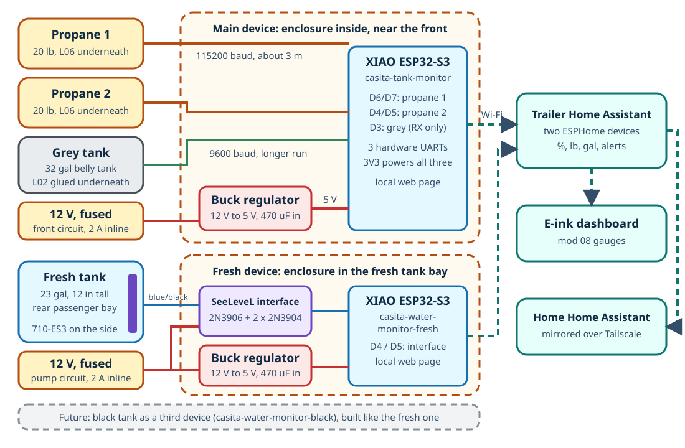
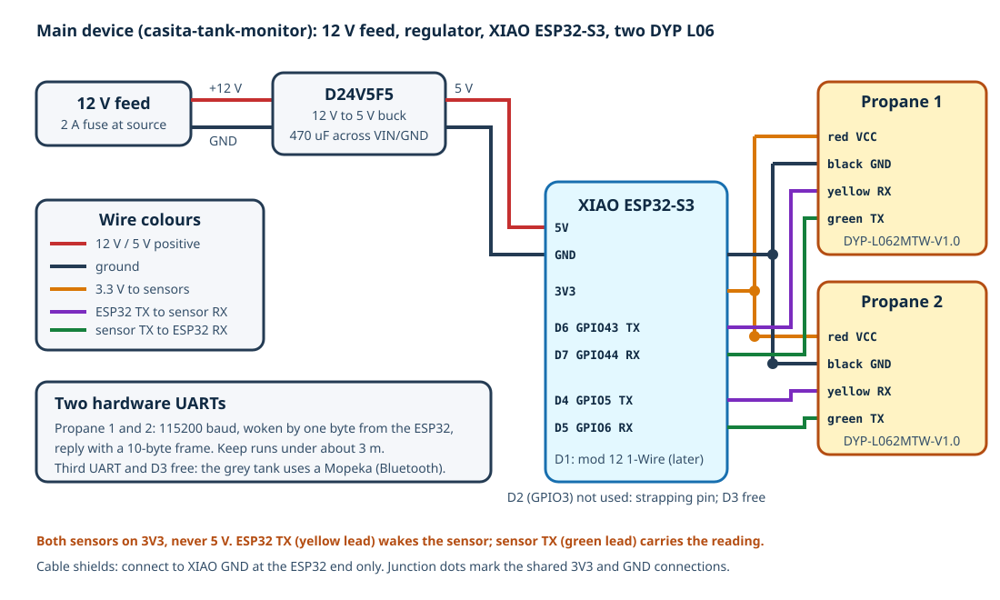

# Tank Monitor to Home Assistant (propane, fresh and grey)

Propane in both 20 lb cylinders and the fresh and grey water levels in the trailer's Home Assistant, with nothing inside any tank. One ESPHome device for propane and two Bluetooth products for the water tanks:

| Device | ESPHome name | Reads | Where | Power |
| --- | --- | --- | --- | --- |
| **Main** | `casita-tank-monitor` | Two DYP **L06** ultrasonic sensors under the propane cylinders | Inside the trailer near the front, where the propane cables come in (spot to confirm, [Step M1](#step-m1-pick-the-main-enclosure-spot-and-measure-the-runs)) | A fused 12 V circuit near the enclosure (to confirm), 2 A inline fuse |
| **Fresh** (not ESPHome) | Garnet SeeLeveL II 709-BTP7 display | A Garnet **710-ES3** sender on the side of the fresh tank, read by Garnet's Bluetooth display and the `garnet` integration | Display inside the trailer (to document) | Trailer 12 V |
| **Grey** (not ESPHome) | Mopeka Pro Check Universal | Its own ultrasonic sensor under the grey belly tank, read by the trailer's Home Assistant over Bluetooth | Under the tank, in Mopeka's collar | Coin cell |

The propane device publishes percentages, pounds and diagnostics over Wi-Fi and has a local web page that shows its readings at the campsite without Home Assistant; the water tanks are read by the trailer's Home Assistant Pi over Bluetooth. The black tank is left for later (a second sender on the Garnet display).



This README covers the project as a whole and the main device: wiring, firmware, installation and Home Assistant. The sensors have their own guides:

| Guide | Covers |
| --- | --- |
| [propane.md](propane.md) | The L06 sensors: what to order, proving they read through the cylinder, the magnetic collars, mounting, calibration (Steps P1-P7) |
| [water-tanks.md](water-tanks.md) | The fresh tank's Garnet display and the grey tank's Mopeka sensor: Home Assistant, mounting, calibration (Steps G1-G4) |
| [components.md](components.md) | Ownership and purchase status of every part |

> [!IMPORTANT]
> **Status: propane device running and reading both cylinders; fresh tank live through the Garnet display; grey Mopeka mounted, no echo yet (updated 2026-10-28).** The main device's XIAO was flashed with `casita-tank-monitor` on 2026-10-27 (ESPHome 2026.10.0 from the trailer's Device Builder), joined the trailer Wi-Fi once its U.FL antenna was fitted, and is in the trailer's Home Assistant. Both L06 sensors read once a minute; after re-seating them with grease on the boss face, echo strength is **1,400 and 1,260 mV** (first attempts gave 0-400 mV and false heights), with 43 and 56 mm of liquid on two low cylinders. Percentages still use the assumed 280 mm full level until **Mark Full** is pressed on a fresh fill ([propane.md, Step P7](propane.md#step-p7-calibrate)). The DYP L02 grey sensor never produced a byte on the third UART (power confirmed, pinout checked against DYP's datasheet, zero bytes in a UART dump), so the same day the owner replaced it with a **Mopeka Pro Check Universal** (ordered 2026-10-27, arriving 2026-10-28) and the grey tank was removed from this device's firmware. Combined on 2026-10-27 from the former propane monitor (mod 07) and water tank monitor (mod 09): the grey tank sensor moved from its own device in the closet onto the propane monitor's XIAO. All four sensors are on hand or delivered: the SeeLeveL sender and the DYP L02 (owner), and both DYP L06 (Amazon shows them delivered 2026-10-27; check each label says **L062MTW**). Both ESPHome configurations compile with ESPHome 2026.9.1 but have not run on hardware, and no sensor has been tried on this trailer's tanks. Still open: the Mopeka has to show an echo with water in the tank ([Step G2](water-tanks.md#step-g2-test-the-mopeka-under-the-grey-tank)), the propane cylinders need **Mark Full** on a fresh fill, and the fresh tank's physical installation is to be documented ([water-tanks.md](water-tanks.md#to-document)).

**Contents:** [Why two devices](#why-two-devices) · [Build order](#build-order) · [Parts](#parts) · [Main device wiring](#main-device-wiring) · [Power](#power) · [Where things go](#where-things-go) · [Main device steps](#main-device-steps) · [ESPHome configuration](#esphome-configuration) · [Home Assistant setup](#home-assistant-setup) · [Testing](#testing-checklist) · [Troubleshooting](#troubleshooting) · [Safety](#safety-notes) · [Revisions](#revisions)

## Why two devices

The main device reads the two propane sensors, one per hardware UART (each needs transmit and receive, because the ESP32 wakes it with a byte). The ESP32-S3 has three hardware UARTs; with the logger on the USB port, one UART and six of the XIAO's eleven usable pins are free, and D1 is reserved for the planned [mod 12](../12-cold-weather/README.md) temperature probes.

| XIAO pin | GPIO | Use |
| --- | --- | --- |
| `D0` | GPIO1 | Free |
| `D1` | GPIO2 | Reserved: mod 12 1-Wire temperature bus |
| `D2` | GPIO3 | Not used: ESP32-S3 strapping pin |
| `D3` | GPIO4 | Free (was the grey L02's receive pin, 2026-10-27 only) |
| `D4` | GPIO5 | ESP32 transmit to propane 2 `RX` (yellow) |
| `D5` | GPIO6 | Propane 2 `TX` (green) to ESP32 receive |
| `D6` | GPIO43 | ESP32 transmit to propane 1 `RX` (yellow) |
| `D7` | GPIO44 | Propane 1 `TX` (green) to ESP32 receive |
| `D8`, `D9`, `D10` | GPIO7, 8, 9 | Free |

The fresh tank is not on an ESPHome device either, since 2026-10-28: the owner fitted a Garnet 709-BTP7 Bluetooth display, which reads the SeeLeveL sender directly and talks to the Pi through the `garnet` integration. The ESPHome fresh device that had been designed and flashed for the same sender was retired and deleted the same day. The grey tank is not on an ESPHome device. The plan from 2026-10-14 to 2026-10-27 was a wired DYP L02 ultrasonic sensor under the belly tank, first on its own XIAO, then on this one; the L02 that arrived never sent a byte, and the owner chose a Mopeka Pro Check Universal instead: a self-contained Bluetooth sensor that the trailer's Home Assistant reads directly, with its own coin cell. The cost is one battery to change every year or two; the gain is no cable under the trailer and no ESP32 work. Details in [water-tanks.md](water-tanks.md#grey-tank-mopeka).

## Build order

The water tanks are independent of this device ([water-tanks.md](water-tanks.md#build-order)). For the main device, the propane sensors are proven on the bench and on the cylinder before anything is permanent:

| Step | What | Result |
| --- | --- | --- |
| M1 | Pick the main enclosure spot, measure the two cable runs, find 12 V | Enclosure spot, cable lengths, power source |
| P1 | [Measure the recess under one cylinder](propane.md#step-p1-measure-the-cylinder) | Go / no-go on fit |
| M2 | Bench-wire the XIAO and regulator; [flash `casita-tank-monitor`](#step-m2-flash-the-main-device) | The device on the trailer Wi-Fi, its web page up |
| P2-P4 | [Wire one propane sensor, read it on a cylinder](propane.md#step-p2-wire-one-sensor-to-the-main-xiao-on-the-bench) | **Go / no-go for propane** |
| P5-P6 | [Make the collars, mount both propane sensors](propane.md#step-p5a-make-the-magnetic-collars) | Propane sensors on the cylinders |
| M3 | [Install the main enclosure, connect the two cables and 12 V](#step-m3-install-the-main-device) | Permanent install |
| M4 | [Add to Home Assistant](#step-m4-add-to-home-assistant), then calibrate ([P7](propane.md#step-p7-calibrate)) | Done |

## Parts

The main device's own parts are below. Sensor parts are in [propane.md](propane.md#parts) and [water-tanks.md](water-tanks.md#parts). Ownership and purchase status for everything: [components.md](components.md).

| Component | Qty | Notes | Purchase link |
| --- | ---: | --- | --- |
| Seeed Studio XIAO ESP32-S3 | 1 | The plain board (not the "Sense" camera version), with its U.FL antenna | [Amazon](https://www.amazon.com/dp/B0BYSB66S5) or [Seeed](https://www.seeedstudio.com/XIAO-ESP32S3-p-5627.html) |
| Pololu D24V5F5 12 V to 5 V buck regulator | 1 | 500 mA, input up to 36 V | [Amazon (reseller)](https://www.amazon.com/dp/B012QE3MNE) or [Pololu](https://www.pololu.com/product/2843) |
| 470 uF 25 V electrolytic capacitor | 1 | Across the regulator input, close to it | [Amazon: 15 pack](https://www.amazon.com/dp/B0CMQ8GMCF) |
| Inline ATO/ATC fuse holder and 2 A fuse | 1 | On the 12 V feed, or use a spare position in the WFCO 12 V fuse panel. The holder kit's fuses start at 7.5 A, so buy the 2 A fuses separately | [Amazon: 14 AWG waterproof holders, 4 pack](https://www.amazon.com/dp/B0F6T8X81M) and [Amazon: Bussmann 2 A ATC, 5 pack](https://www.amazon.com/dp/B008QDH9VQ) |
| Small ABS enclosure, about 83 x 58 x 33 mm | 1 | XIAO and regulator; three glands (12 V and two sensor cables) | [Amazon: IP65, 2 pack](https://www.amazon.com/dp/B0FDQCHNQP) |
| PG7 cable glands | 3 | Into the enclosure | [Amazon: PG7 nylon glands, 50 pack](https://www.amazon.com/dp/B0CTCG4HMM) |
| 18-20 AWG red and black wire, crimp butt splices | | 12 V tap to the enclosure | |
| Header pins or a small screw-terminal board | | Both sensors share `3V3` and `GND`; a small terminal strip in the box is easier than two wires on one pad | |

## Main device wiring



| From | To | Notes |
| --- | --- | --- |
| 12 V fused circuit | 2 A inline fuse, then regulator `VIN` | 18-20 AWG. The 470 uF capacitor sits across `VIN` and `GND` at the regulator, stripe (negative) on `GND` |
| 12 V negative | Regulator `GND` and XIAO `GND` | Trailer negative returns through the shunt's P- side like every other load |
| Regulator `VOUT` (5 V) | XIAO `5V` pin | |
| XIAO `3V3` | Propane 1 red, propane 2 red (`VCC`) | Both sensors at 3.3 V, so their serial outputs are 3.3 V |
| XIAO `GND` | Propane 1 black, propane 2 black (`GND`), and both cable shields | Shields at this end only |
| XIAO `D6` (GPIO43) | Propane 1 yellow (`RX`) | ESP32 transmits the wake-up byte, 115200 baud |
| XIAO `D7` (GPIO44) | Propane 1 green (`TX`) | ESP32 receives the 10-byte frame |
| XIAO `D4` (GPIO5) | Propane 2 yellow (`RX`) | |
| XIAO `D5` (GPIO6) | Propane 2 green (`TX`) | |

Lead colors are from the DYP L06 datasheet: red `VCC`, black `GND`, yellow `RX` (into the sensor), green `TX` (out of the sensor). Confirm against the label before soldering.

## Power

| Load | Current | Notes |
| --- | --- | --- |
| XIAO ESP32-S3 on Wi-Fi | about 40-80 mA from 12 V | Through the buck regulator |
| Two L06 propane sensors | under 15 uA each asleep; about 20 mA for 0.75 s per reading, once a minute | From `3V3` |

Expect roughly **40-80 mA from 12 V** in total, about 1-2 Ah per day from the 600 Ah bank (to confirm at Step M3). The XIAO's 3.3 V regulator supplies both sensors comfortably. Power the device from a circuit that the trailer's 12 V master (when there is one) or a WFCO fuse cuts for storage.

## Where things go

- **Main enclosure:** inside the trailer near the front, where the two propane cables come through from the tongue, so those 115200 baud runs stay under about 3 m. **To confirm in Step M1:** the enclosure spot and the pass-through.
- **Propane sensors:** under the cylinders, in magnetic collars ([propane.md](propane.md#where-things-go)).
- **Grey sensor (Mopeka):** under the grey tank in its collar, within Bluetooth reach of the Home Assistant Pi ([water-tanks.md](water-tanks.md#grey-tank-mopeka)).
- **Fresh tank:** the sender on the tank and the Garnet display inside ([water-tanks.md](water-tanks.md#where-things-go)).
- Keep the main enclosure and all connectors inside the trailer, never in the propane tank cover or near the regulator and valves (see [Safety](#safety-notes)).

## Main device steps

### Step M1: Pick the main enclosure spot and measure the runs

Record:

| Measurement | Value | Why |
| --- | ---: | --- |
| Enclosure spot inside the trailer near the front, out of the way of stored items and any water | | |
| Where the propane cables come through from the tongue: an existing grommet near the propane line or 7-way harness, or a spot for a new sealed gland | | **To confirm** |
| Cable length to each cylinder, with slack to lift it out | | About 3 m each planned; keep under about 3 m |
| A 12 V source near the enclosure: an unswitched circuit fed from a WFCO 12 V fuse, tapped upstream of any switch, or a spare WFCO fuse position with 18 AWG run to the enclosure | | **To confirm.** Measure 12 V with every switch off |

Photograph the spot, the pass-through and the 12 V source and put the photos in `photos/`.

### Step M2: Flash the main device

1. Fit the U.FL antenna to the XIAO. Header pins on the XIAO make the bench steps easier.
2. In the trailer's Home Assistant, the **ESPHome Device Builder** add-on (**Settings > Add-ons**) is the same one the battery monitor uses. The device file needs a `packages` folder next to it, which the Device Builder cannot create: use the **File editor** or **Samba** add-on to create `/config/esphome/packages/` and copy [`esphome/packages/dyp-l06-propane.yaml`](esphome/packages/dyp-l06-propane.yaml) into it.
3. In the Device Builder, **New device**, **Skip**, name it `casita-tank-monitor`, pick ESP32-S3, then **Edit** and replace the whole file with [`esphome/casita-tank-monitor.yaml`](esphome/casita-tank-monitor.yaml).
4. Check the Device Builder's **Secrets** has every key in [`esphome/secrets.example.yaml`](esphome/secrets.example.yaml) (see [Secrets](#secrets)).
5. Connect the XIAO by USB-C to the computer running the browser, **Install > Plug into this computer**. Later updates are wireless. Give it a DHCP reservation in the travel router.
6. Open **Logs**. With nothing connected expect, once a minute, `No valid frame` from `propane1` and `propane2`. Open `http://casita-tank-monitor.local` (or the IP address in the logs) and log in: every entity is listed. This web page is the tool for the sensor bench tests.

For the bench steps the XIAO can run from USB. When the regulator is fitted: 12 V bench supply (or the trailer battery through the 2 A fuse) to `VIN` and `GND` with the 470 uF capacitor across them, `VOUT` to the XIAO `5V`, grounds together, and check with the meter for no short `+12V`, `5V` or `3V3` to `GND` before powering.

### Step M3: Install the main device

After the sensors have passed the cylinder test (Step P4) and are mounted (P6):

1. Solder the regulator: 470 uF capacitor across `VIN` and `GND` right at the regulator, **stripe (negative) on `GND`**; `VOUT` to the XIAO `5V` pad, regulator `GND` to a XIAO `GND` pad.
2. Solder or terminate the two long cables per [Main device wiring](#main-device-wiring): propane 1 to `3V3`, `GND`, `D6`, `D7`; propane 2 to `3V3`, `GND`, `D4`, `D5`. Both shield drain wires to `GND` at this end only; the shields are cut back at the sensor ends. Label the cables "P1" and "P2".
3. Fit the XIAO, regulator and antenna in the enclosure with the three cables through glands. Secure the boards with tape or hot glue so nothing can touch.
4. Mount the enclosure at the spot from Step M1. Run the propane cables through the front pass-through to the tongue; seal the penetration.
5. Connect the 12 V feed: positive through the inline holder with a **2 A** fuse, as close to the source as possible; negative to the trailer's 12 V negative. Check for 5 V on the XIAO and 3.3 V at each sensor's red wire before closing the box.
6. Plug the sensor connectors in. The web page and logs should show both cylinders reading once a minute.
7. Measure the current on the 12 V feed and record it in [Power](#power).

### Step M4: Add to Home Assistant

1. **Settings > Devices & services** shows **Casita Tank Monitor** as a discovered ESPHome device. **Configure**, paste the `api_encryption_key`, done. If it is not discovered, **Add integration > ESPHome** and enter the XIAO's reserved address, port 6053.
2. Check the entity IDs against the [entities table](#entities-main-device-casita-tank-monitor), add the dashboard card and the alerts below.
3. Calibrate: propane [Step P7](propane.md#step-p7-calibrate).

## ESPHome Configuration

| Device | Files | Components |
| --- | --- | --- |
| Propane | [`esphome/casita-tank-monitor.yaml`](esphome/casita-tank-monitor.yaml) and [`esphome/packages/dyp-l06-propane.yaml`](esphome/packages/dyp-l06-propane.yaml) (included once per cylinder with different `tank`, `tx_pin` and `rx_pin`) | Built-in `uart` (two of them), templates and scripts |

**Main device substitutions:**

| Substitution | Default | Meaning |
| --- | --- | --- |
| `read_interval` | `60s` | How often each cylinder is read |
| `tank_capacity_lb` | `"20"` | Propane in a full cylinder, for the pounds-remaining sensors |
| `full_level_mm` | `"280"` | Initial **Propane N Full Level** (mm) before Mark Full is pressed. Assumed |
| per cylinder `tx_pin`, `rx_pin` | `GPIO43`/`GPIO44`, `GPIO5`/`GPIO6` | XIAO `D6`/`D7` and `D4`/`D5` |
| `samples_per_read` | `"5"` | Measurements per read cycle, about 1 s apart |
| `level_window_cycles` | `"7"` | A rise to refill territory (see `refill_fraction`) is believed once it is the 2nd-lowest of this many cycles: 6 min |
| `suspect_window_cycles` | `"30"` | A rise that stays below refill territory (the multipath echo of a nearly empty cylinder) is not believed for this minus 1 cycles: 29 min. A drop is always believed at once |
| `refill_fraction` | `"0.5"` | Fraction of **Full Level** above which a rise counts as a refill |
| `none_hold_cycles` | `"3"` | Cycles of "no liquid" in a row before the level is shown as 0 |
| `publish_deadband_mm` | `"2"` | Minimum change before a new level is published |
| `coupling_ok_mv` | `"800"` | Echo strength at or above which **Coupling OK** is on |

What the main firmware does:

- **Propane:** every `read_interval`, the `read_propane1` and `read_propane2` scripts take `samples_per_read` measurements from each sensor and reduce them to one level with the low-pick filter described in [propane.md](propane.md#firmware-and-home-assistant) (a multipath echo is always higher than the true one, so low readings are believed, drops at once, and a rise only if it reaches refill territory within 6 min or persists for 29 min). **Propane N** (%) = liquid level / **Propane N Full Level**; **Propane N Remaining** = % x 20 lb. Three cycles without a valid frame set that cylinder's entities to unknown. **Propane N Coupling OK** is on while echo strength is at least `coupling_ok_mv`. **Read Propane Now** reads both at once.

The configuration runs on the installed device (ESPHome 2026.10.1, compiled by the trailer's Device Builder; the propane-only build with the near-empty filter was installed over the air on 2026-10-27). The water tanks have no ESPHome configuration.

### Secrets

The configuration references `api_encryption_key`, `ota_password`, `wifi_ssid`, `wifi_password`, `fallback_ap_password`, `web_username` and `web_password`, the same names as the trailer's other ESPHome devices. The Device Builder's `secrets.yaml` (from mod 04) already has them; add any missing from [`esphome/secrets.example.yaml`](esphome/secrets.example.yaml). `secrets.yaml` is git-ignored; only the example is committed. Generate an API key with `openssl rand -base64 32` if one is needed.

## Home Assistant Setup

The propane device is an ESPHome device in the trailer's Home Assistant, like the battery monitor; the water tanks come in through the `garnet` and Mopeka integrations. Home Assistant generates entity IDs from the device and entity names; confirm the actual IDs on each device page.

### Entities: main device (Casita Tank Monitor)

| Entity name | Entity ID | Unit / notes |
| --- | --- | --- |
| Propane 1, Propane 2 | `sensor.casita_tank_monitor_propane_1`, `..._propane_2` | % of Full Level. **Used by mod 08** |
| Propane 1 Remaining, Propane 2 Remaining | `sensor.casita_tank_monitor_propane_1_remaining`, `..._propane_2_remaining` | lb. **Used by mod 08** |
| Propane N Temperature | `sensor.casita_tank_monitor_propane_1_temperature` | degC at the cylinder bottom |
| Propane N Liquid Level | `sensor.casita_tank_monitor_propane_1_liquid_level` | mm (diagnostic) |
| Propane N Echo Strength | `sensor.casita_tank_monitor_propane_1_echo_strength` | mV, 0-1500 (diagnostic) |
| Propane N Tilt | `sensor.casita_tank_monitor_propane_1_tilt` | degrees (diagnostic) |
| Propane N Liquid Detected | `binary_sensor.casita_tank_monitor_propane_1_liquid_detected` | off = below 30 mm or no echo (diagnostic) |
| Propane N Coupling OK | `binary_sensor.casita_tank_monitor_propane_1_coupling_ok` | on = echo strength at least 800 mV, the probe is seated (diagnostic) |
| Propane N Samples | `text_sensor.casita_tank_monitor_propane_1_samples` | the raw levels of the last cycle, e.g. `43,74,41,43,42` (diagnostic) |
| Propane N Full Level | `number.casita_tank_monitor_propane_1_full_level` | mm (configuration) |
| Propane N Mark Full | `button.casita_tank_monitor_propane_1_mark_full` | (configuration) |
| Read Propane Now | `button.casita_tank_monitor_read_propane_now` | (configuration) |
| Wi-Fi Signal, Uptime, IP Address, Restart | diagnostic entities | |

### Entities: fresh tank (Garnet)

| Entity name | Entity ID | Unit / notes |
| --- | --- | --- |
| Fresh Tank (corrected) | `sensor.casita_fresh_tank` | %. Template helper on the Garnet display's reading: 95 (full) to 100%, 12 (pump runs dry) to 0%; **used by mod 08** |
| Fresh Water Tank Sensor Fresh Tank | `sensor.inside_fresh_water_tank_sensor_fresh_tank` | %, the display's own figure (95 = full, 12 = pump runs dry) |
| Fresh Water Tank Sensor Battery | `sensor.inside_fresh_water_tank_sensor_battery` | V, the display's 12 V supply |

### Entities: grey tank (Mopeka)

| Entity name | Entity ID | Unit / notes |
| --- | --- | --- |
| Grey Tank | `sensor.casita_grey_tank` | %. **0% means below the sensor, not empty**: the Mopeka is at the inlet (high) end of a wide, shallow tank, so it sees only the last slice of the fill; 100% is full everywhere. Template on the filtered helper divided by **Grey tank full level** (`input_number.casita_grey_full_mm`, 76 mm, set with **Mark grey tank full** on a full tank), capped at 100%; **used by mod 08**. Errs toward full (a full tank always reads full; a third-to-half-full tank may read high). Holds its value through a brief dropout, 0% after 3 min of no echo, unavailable when the Mopeka is out of reach |
| Grey Water Level (folded) | `sensor.casita_grey_level_folded` | mm. Each raw reading, halved while over 110 mm (multiple-bounce echoes); unavailable for quality-0 readings |
| Grey Water Level (filtered) | `sensor.casita_grey_level_min` | mm. The median folded reading of the last 30 min; what the percent is built on |
| Grey tank full level, Mark grey tank full | `input_number.casita_grey_full_mm`, `script.casita_grey_mark_full` | The calibration number and the button that sets it from the current filtered level |
| Grey Water Sensor Tank Level | `sensor.outside_grey_water_sensor_tank_level` | in (the integration's mm, converted by HA's US unit setting) |
| Grey Water Sensor Reading quality | `sensor.outside_grey_water_sensor_reading_quality` | %; 0 = no echo |
| Grey Water Sensor Temperature, Battery | `sensor.outside_grey_water_sensor_temperature`, `..._battery` | degF, % |

Paired and the template created 2026-10-28; details in [water-tanks.md](water-tanks.md#grey-tank-mopeka).

### Dashboard card

```yaml
type: vertical-stack
cards:
  - type: horizontal-stack
    cards:
      - type: gauge
        entity: sensor.casita_tank_monitor_propane_1
        name: Propane 1
        min: 0
        max: 100
        severity:
          green: 40
          yellow: 20
          red: 0
      - type: gauge
        entity: sensor.casita_tank_monitor_propane_2
        name: Propane 2
        min: 0
        max: 100
        severity:
          green: 40
          yellow: 20
          red: 0
  - type: horizontal-stack
    cards:
      - type: gauge
        entity: sensor.casita_fresh_tank
        name: Fresh
        min: 0
        max: 100
        severity:
          red: 0
          yellow: 25
          green: 50
      - type: gauge
        entity: sensor.casita_grey_tank
        name: Grey
        min: 0
        max: 100
        severity:
          green: 0
          yellow: 60
          red: 80
  - type: entities
    entities:
      - entity: sensor.casita_tank_monitor_propane_1_remaining
      - entity: sensor.casita_tank_monitor_propane_2_remaining
```

### Alerts

Replace `notify.mobile_app_your_phone` with your phone's notify service. The trailer's automatic changeover regulator switches to the reserve cylinder on its own, so the low-propane alert tells you earlier, so the empty one can be refilled at the next stop.

```yaml
alias: Casita propane tank low
triggers:
  - trigger: numeric_state
    entity_id:
      - sensor.casita_tank_monitor_propane_1
      - sensor.casita_tank_monitor_propane_2
    below: 20
    for: "00:30:00"
actions:
  - action: notify.mobile_app_your_phone
    data:
      title: Casita propane low
      message: >-
        {{ trigger.to_state.name }} is at {{ trigger.to_state.state }}%.
mode: queued
```

```yaml
alias: Casita grey tank nearly full
triggers:
  - trigger: numeric_state
    entity_id: sensor.casita_grey_tank
    # The sensor sees only the last slice of the tank (see water-tanks.md), so
    # 60% at the sensor is already close to full; 80% leaves almost no notice.
    above: 60
    for: "00:05:00"
actions:
  - action: notify.mobile_app_your_phone
    data:
      title: Casita grey tank
      message: >-
        Grey tank at {{ states('sensor.casita_grey_tank') }}%. Dump soon.
mode: single
```

```yaml
alias: Casita fresh water low
triggers:
  - trigger: numeric_state
    entity_id: sensor.casita_fresh_tank
    below: 20
    for: "00:05:00"
actions:
  - action: notify.mobile_app_your_phone
    data:
      title: Casita fresh water low
      message: >-
        Fresh tank at {{ states('sensor.casita_fresh_tank') }}%.
mode: single
```

### Mirroring to the home Home Assistant

The Remote Home Assistant link to the home Home Assistant mirrors whichever Casita entities carry the **`shared`** label (a service on bee2 keeps the link's include list and the **Casita RV** area in step with the label; see the agent-config `home-assistant/casita.md`). Mirrors arrive as `sensor.rv_casita_tank_monitor_propane_1`, `sensor.rv_casita_fresh_tank`, `sensor.rv_casita_grey_tank` and so on, with friendly names starting `RV `.

Labeled `shared` on 2026-10-28 for this project: the two propane percentages and pounds remaining, the two **Coupling OK** sensors, `sensor.casita_fresh_tank` (already shared by the owner), `sensor.casita_grey_tank`, the Mopeka's reading quality and battery, and `sensor.casita_ac_source`. On the home side, display precision was set (percent 0, pounds 1) because ESPHome's `accuracy_decimals` does not cross the link, and the **Casita RV** dashboard gained fresh and grey gauges, propane gauges, a **Tanks** card and the AC source and shore rows.

### Dashboards

| Where | Dashboard | What it shows |
| --- | --- | --- |
| Trailer Home Assistant | **Casita Status** (`/casita-status/status`, in the sidebar; created 2026-10-28) | Everything on the trailer in one page: battery, fresh and grey gauges; propane gauges; battery, solar, propane (with echo strength, coupling, Mark Full and full-level numbers), water (with the raw Garnet and Mopeka readings and their batteries), AC power (meter and source), the inverter (switch, status, settings) and a 24 h graph; lights and switches; the thermostat; and a **Devices** card with each ESPHome device's Wi-Fi and uptime |
| Home Home Assistant | **Casita RV** (`/casita-rv/casita`) | The `shared` mirrors: battery, fresh and grey, propane, tanks, solar, AC power, inverter, thermostat, Casita updates |
| E-ink panel in the trailer | [mod 08](../08-eink-dashboard/README.md) | Overview, details and power pages |

### Local web page

On the trailer's Wi-Fi, open `http://casita-tank-monitor.local` (or the device's IP address) and log in with the `web_server` username and password. It shows every propane entity and the Mark Full and Read buttons.

## Testing Checklist

The per-sensor checks are in [propane.md](propane.md#testing-checklist) and [water-tanks.md](water-tanks.md#testing-checklist). For the main device:

1. On the bench with nothing connected: both `propane` scripts log `No valid frame` and the web page lists every entity.
2. Each sensor connected on its own pins reads without disturbing the other: a propane reading arrives every minute on both cylinders.
3. Before closing the box: 5 V at the XIAO, 3.3 V at each sensor's red wire; no short `+12V`, `5V` or `3V3` to `GND`.
4. Installed: 12 V current 40-80 mA (record it); XIAO and regulator only slightly warm after an hour.
5. Unplug one sensor: only its own entities go unknown (after three reads); the other carries on.
6. Home Assistant shows **Casita Tank Monitor** and all entities; the e-ink dashboard's propane gauges fill in on its next refresh; the home Home Assistant shows the `rv_casita_tank_monitor_*` mirrors.
7. After the first tow: both cylinders still read, connectors tight, cables secure.

## Troubleshooting

Sensor-specific problems are in [propane.md](propane.md#troubleshooting) and [water-tanks.md](water-tanks.md#troubleshooting). For the main device:

| Symptom | Likely cause | Fix |
| --- | --- | --- |
| One cylinder never reads (`No valid frame`), the other does | That sensor's wiring: TX/RX swapped, no 3.3 V at its red wire, or a broken cable or connector (a loose propane 2 connector did exactly this on 2026-10-27) | Check that sensor's four wires against [Main device wiring](#main-device-wiring); swap the two cables at the enclosure to tell a sensor from a port |
| A cylinder answers (temperature and tilt arrive) but **Coupling OK** is off, **Echo Strength** is low and the level is 0 or nonsense | The ultrasonic pulse is not getting into the steel: no grease, an air gap, the flat flange against the tank instead of the raised boss, or the sensor off the centre of the dome (a tilt over about 2 deg is a clue) | Re-seat per [propane.md, Step P4](propane.md#step-p4-bench-test-the-sensor-on-a-cylinder): grease on the boss face, flat on the dome centre, slide a few mm at a time for the strongest echo |
| A cylinder reads an impossible height (over about 350 mm) with a weak echo | A false echo from poor coupling, not liquid | Same fix: re-seat for a strong echo |
| **Samples** show two values, one well above the other (e.g. `43,74,41,43,42`), or sit at a value well above what the cylinder held minutes ago | A multipath echo on a nearly empty cylinder, which can persist for many minutes; the filter keeps the lower level | Nothing to fix; refill when convenient. The level follows a refill (to at least half full) within 6 min, or at once if **Mark Full** is pressed |
| Both sensors dead | No 3.3 V: XIAO not powered, or a short on `3V3` pulling it down | Check 5 V at the XIAO and 3.3 V at `3V3`; unplug the sensors one at a time |
| XIAO resets | 12 V sagging on a shared circuit, or a loose 5 V joint | Confirm the 470 uF is across `VIN`; feed from a WFCO fuse position |
| Device offline after a trip | Lost Wi-Fi: the fallback hotspot **Casita Tank Fallback** appears after a minute | Join it and re-enter the trailer Wi-Fi, or check the travel router |

## Safety Notes

- Fuse the 12 V feed at 2 A close to the source. The regulator and XIAO draw well under 0.5 A. Disconnect 12 V (pull the fuse) before working inside the enclosure.
- Both sensors are powered at 3.3 V from the XIAO. Powering either from 5 V puts 5 V on an ESP32 pin and can destroy the XIAO.
- Propane is heavier than air and collects low. The sensors are low-voltage and have no switching contacts, but nothing here is certified intrinsically safe. Keep the main enclosure and every connector inside the trailer or well away from the propane regulator, pigtails and valves; never inside the tank cover. More in [propane.md](propane.md#safety-notes).
- Before drilling any pass-through, check both sides for frame members, wiring, plumbing and tanks; seal it afterward.
- The Safe-T-Alert LP/CO detector in the trailer remains the leak protection; this project only measures level.
- Working under the trailer: chock the wheels, park on firm level ground.

## Photos

Add photos to `photos/` as the build progresses. Main device: `main-enclosure-spot.jpg`, `front-pass-through.jpg`, `main-enclosure.jpg` (inside, wired). Sensor photos are listed in [propane.md](propane.md#photos) and [water-tanks.md](water-tanks.md#photos).

## References

- [Seeed Studio XIAO ESP32-S3 wiki](https://wiki.seeedstudio.com/xiao_esp32s3_getting_started/): pin map (`D4` = GPIO5, `D5` = GPIO6, `D6` = GPIO43, `D7` = GPIO44)
- [ESPHome UART bus](https://esphome.io/components/uart/) and [packages](https://esphome.io/components/packages/)
- Sensor datasheets and the rest: [propane.md](propane.md#references), [water-tanks.md](water-tanks.md#references)
- [Mod 08 e-ink dashboard](../08-eink-dashboard/README.md#entities-shown): the entity names this project produces

## Revisions

| Date | Change |
| --- | --- |
| 2026-10-13 | Propane monitor (then mod 07) designed: two DYP-L062MTW sensors on a XIAO ESP32-S3, ESPHome configuration validated and compiled. Nothing purchased or built |
| 2026-10-13 | Propane: magnetic collar with silicone grease made the primary mount (sensor can move between cylinders); DYP's epoxy method kept as the fallback. Collar untested |
| 2026-10-14 | Water tank monitor (then mod 09) designed: 710-ES3 sender on the fresh tank through a perfboard interface, DYP L02 under the grey tank, one XIAO ESP32-S3 on the water pump circuit. ESPHome configuration compiles; nothing built |
| 2026-10-19 | Components lists added for both. Propane sensors ordered 2026-10-12; water sensors ordered 2026-10-14; everything else delivered or owner stock. Nothing left to buy |
| 2026-10-20 | Water monitor split into two devices: `casita-water-monitor-fresh` in the fresh tank bay and `casita-water-monitor-grey` in the closet. Sender on hand (owner) |
| 2026-10-27 | Fresh tank capacity corrected to 25 gal (owner, 2026-10-21). Propane collar redesigned: the 17.5 mm boss face is the probe, not the flange (datasheet 1.6, installation instruction 5.2-5.8) |
| 2026-10-27 | **Propane and water projects combined into this one, mod 07 "tank monitor"** (owner). The grey L02 moved from its own closet device onto the propane device's XIAO (`D3`/GPIO4, the third hardware UART); the device is renamed `casita-tank-monitor` (friendly name **Casita Tank Monitor**), and its entities are now `sensor.casita_tank_monitor_propane_1`, `..._grey_tank` and so on (propane entity names "Tank N ..." became "Propane N ..."; the package became `dyp-l06-propane.yaml`). The fresh device is unchanged. The grey device's XIAO, regulator, capacitor, fuse and enclosure are freed as spares. Folder `07-propane-tank-monitor` became `07-tank-monitor`, mod 09 was retired (its folder keeps a pointer), the guides became [propane.md](propane.md) and [water-tanks.md](water-tanks.md), and the wiring is one main-device schematic. Mod 08's dashboard entity names and mod 12's probe plan updated to match. Both configurations compile with ESPHome 2026.9.1. L02 on hand (owner); Amazon shows both L06 delivered 2026-10-27 |
| 2026-10-27 | Tank sizes set by the owner: fresh **23 gal** (supersedes 25 gal), grey 32 gal, black 15 gal. Fresh volume map in `casita-water-monitor-fresh.yaml` changed to `level 8.0 = 23 gal`; overview diagram updated. Confirm with the calibration fills |
| 2026-10-27 | **Main device flashed and online.** `casita-tank-monitor.yaml` and `packages/dyp-l06-propane.yaml` added to the trailer's ESPHome Device Builder (the `/config/esphome/packages/` folder created through the Terminal & SSH add-on); both match this repository. Compiled there with ESPHome 2026.10.0 and flashed over USB from the laptop to the second XIAO of the 3 pack. The first boot could not join Wi-Fi (`Auth Expired`) until the U.FL antenna was fitted. Added to the trailer's Home Assistant as **Casita Tank Monitor**; all 29 entities present with the documented IDs, Wi-Fi about -69 dBm on the bench. No sensors connected yet. DHCP reservation in the travel router still to do |
| 2026-10-27 | Propane sensors connected: both answer, but with 0 mV echo (coupling), and a loose propane 2 connector was found and fixed. The L02 grey sensor never sent a byte (3.3 V confirmed at the sensor, yellow on D3 per DYP's datasheet pinout, a UART byte dump on the device showed nothing). **Grey tank moved to a Mopeka Pro Check Universal** (owner; ordered 2026-10-27 for 2026-10-28): the L02, its UART and all `grey_*` entities removed from `casita-tank-monitor.yaml` and the propane-only build installed over the air; the stale grey entities deleted from the trailer's Home Assistant. D3 and the third UART are free again. Docs, diagrams, mod 08's grey entity (now the planned template `sensor.casita_grey_tank`) and mod 12 updated |
| 2026-10-27 | Propane sensors re-seated: echo strength 1,408 mV (cylinder 1) and 1,262 mV (cylinder 2), liquid detected on both, 43 and 56 mm. Propane-only firmware confirmed running (uptime reset after the OTA); the six `casita_tank_monitor_grey_*` registry entries removed from the trailer's Home Assistant |
| 2026-10-27 | **Near-empty jitter fixed in firmware.** With 40-80 mm of liquid the L06 alternated between the true echo and a higher multipath echo (37 -> 74, 41 -> 74 or 82, 56 -> 75-82 mm). First version (installed 17:57 local) rejected readings about 2x another; a C++ harness run on the recorded sequences showed that ratio test misses the 1.4-1.8x cases. Second version (18:14) used the 2nd-lowest of the last 7 cycles; live it held cylinder 2 at 55 mm while the sensor said 85, but cylinder 1 rebooted into a multipath run longer than the window and showed 76 mm (true about 44). Final rule, ratio-free and physics-based: 5 samples per cycle, 2nd-lowest kept; a drop is believed at once; a rise is believed after 6 cycles only if it reaches at least half of **Full Level** (a refill), otherwise only after 29 cycles; 3 "no liquid" cycles before 0; 2 mm deadband; the accepted level is saved to flash and seeds the window after a reboot; **Mark Full** uses the latest cycle and resets the window. Harness: every recorded sequence, a 25-cycle multipath run, a reboot into one, a refill, a drain and the blind-zone flicker all give a steady low value and never a spurious high. New diagnostics **Propane N Coupling OK** (echo at least 800 mV) and **Propane N Samples** (the cycle's raw levels). Installed over the air from the trailer's Device Builder |
| 2026-10-27 | Filter installed (18:37 local). First boot with the new flash slot had no saved level, so it accepted the sensors' current 76 and 82 mm; the sensors had read 44 and 55 mm an hour earlier with equally strong echoes. **Which reading is true is unconfirmed**: the filter assumes the lower (multipath physics); weighing a cylinder (scale minus the stamped TW: about 1.5-2 lb at 44 mm, 3.5-4 lb at 76 mm) would settle it, and the rule is easy to flip if the higher one proves right |
| 2026-10-28 | **Grey tank Mopeka paired and mounted** (owner): Pro Check Universal 5FA8, renamed Grey Water Sensor, medium Waste Water, battery 100%, temperature updating from under the trailer (Bluetooth reach is fine). First readings: level `unknown`, quality 0%, which is what an empty or uncoupled tank looks like; to be checked with water in the tank. Template helper **Casita Grey Tank** created and renamed to `sensor.casita_grey_tank` (inches to mm, 90 mm assumed full, 0% on no echo, unavailable when out of reach). The trailer's HA also shows a **Garnet 709-BTP7 Bluetooth display** (`garnet` integration, device renamed Fresh Water Tank Sensor) reading the fresh tank at 95%, with an owner-made template `sensor.casita_fresh_tank` (Fresh Tank (corrected), = reading x 100/95, 100% today); the ESPHome fresh device `casita-water-monitor-fresh` is present but has been unavailable since 2026-10-28 01:37. The BTP7's unused channels (grey, grey2, fresh2, black, black2, LPG) were disabled in the entity registry to tidy the device page. **To confirm with the owner:** whether the BTP7 has replaced the ESPHome fresh device for good; if so, [water-tanks.md](water-tanks.md) needs rewriting around it |
| 2026-10-28 | **Fresh tank now read by a Garnet 709-BTP7 Bluetooth display** (owner's install, via the `garnet` HACS integration and the owner's `sensor.casita_fresh_tank` template). The ESPHome fresh device `casita-water-monitor-fresh` (designed 2026-10-14, flashed 2026-10-21, offline since 2026-10-28 01:37) was retired: deleted from the trailer's Home Assistant and Device Builder, and its configuration, SeeLeveL interface schematic and wiring diagram removed from this repository (history before this date has them). The BTP7's unused channels were disabled. [water-tanks.md](water-tanks.md) rewritten around the Garnet display and the Mopeka; its physical install is listed under [To document](water-tanks.md#to-document) |
| 2026-10-28 | Fresh tank capacity corrected back to **25 gal** (owner; the 23 gal of 2026-10-27 was an error). Changed in `docs/trailer.md`, the off-grid plan's weight estimate, mod 12, this project's guide and overview diagram, and the e-ink dashboard's `fresh_gal` (reinstalled on the panel the same day). Nothing in Home Assistant itself carries the gallons: the fresh template is a percentage |
| 2026-10-28 | Fresh template re-scaled: the display reads 11-12 when the pump runs dry (the sender's bottom pad is below the pump pickup), so `sensor.casita_fresh_tank` now maps 12 to 0% and 95 to 100%, with an availability template. Applied on the trailer's Home Assistant |
| 2026-10-28 | Home Assistant dashboards: the ten new tank and AC entities labeled `shared` so they mirror home; the home **Casita RV** dashboard updated (fresh and grey gauges, propane gauges, Tanks card, AC source and shore rows; six stale battery-monitor mirrors removed); a new **Casita Status** dashboard created on the trailer's Home Assistant showing every sensor on one page. Both checked in a browser: no missing entities |
| 2026-10-28 | **Grey gauge fixed.** The raw Mopeka level showed double-bounce readings (about 2x) and junk (283 mm, quality 0%) between good ones, and the assumed 90 mm full height put a 60%-full tank at 100%. Added a Statistics helper `sensor.casita_grey_level_median` (median of 15 readings, 30 min) and rebuilt `sensor.casita_grey_tank` on it with full = 150 mm, from the owner's about 20 gal at a settled 95 mm. Reads 63%. Tank height still to measure |
| 2026-10-28 | Grey tank measured by the owner: **3.75 in outside**, about 85 mm inside. That showed the Mopeka's 94-96 mm readings to be the double of a 47 mm level, and the earlier 64-166 mm readings to be 2x, 3x and 4x echoes of 32-41 mm: on this shallow tank the sensor mostly reports multiples. Template rebuilt: median, halve anything taller than the tank (up to three times), divide by 85 mm. Reads 56%, matching the owner's 18-20 gal. Limitation recorded: readings of 64-92 mm are ambiguous (nearly full, or half full doubled); options are moving the sensor to the tank's deepest point or a capacitive point switch on D3 |
| 2026-10-28 | Grey pipeline reworked for the multiple-echo behaviour: fold each raw reading first (and drop quality-0 ones), take the **lowest** folded reading of the last 30 min, then the percent; 0% only after 10 min without an echo. The plain median helper was removed. Reads 56% at a folded 48 mm. The owner will watch it in use; the sensor is already at the tank's deepest point |
| 2026-10-29 | Grey gauge behaviour on an empty tank: the Mopeka reports no echo as `unknown` (its dead zone) and the folded/min helpers go `unavailable` by design; the percent template now holds its last value for 3 min of no echo, then shows 0%, and never `unknown` while the sensor is reachable (it had shown `unknown` for 10 min after the owner dumped the tank). The Casita Status dashboard's water card labels the raw row "unknown = no echo / empty" and shows the filtered level |
| 2026-11-01 | **Grey gauge now errs toward full.** Home Assistant said 55% while the Mopeka app said 100%; the fresh-water history (about 20 gal used since the 10-29 dump) showed the tank was indeed near full, and the fold rule had been halving a full tank's 94-98 mm reading as if it were a doubled 47 mm. Readings up to 110 mm are now believed (capped at 100%), only taller ones are halved, and the 30 min filter is a median rather than the minimum. Reads 81% and settling. A third-to-half-full tank can now read high; documented, with the point switch as the definite fix |
| 2026-11-01 | **Grey full level calibrated on a full tank** (water backing up into the sink): raw readings 75-82 mm and their doubles, filtered 76 mm. Added `input_number.casita_grey_full_mm` and `script.casita_grey_mark_full` (on the Casita Status dashboard), the percent template divides by the number, and Mark grey tank full set it to 76. Gauge reads 100% |
| 2026-11-01 | Recorded the Mopeka's placement near the inlet (high) end of the wide, shallow tank (owner): 0% means below the sensor, not empty; 100% is full everywhere. Both dashboards' grey gauges relabeled "0% = below sensor"; the sample dump-soon alert lowered to 60% for 5 min (no such automation exists on the trailer yet) |
