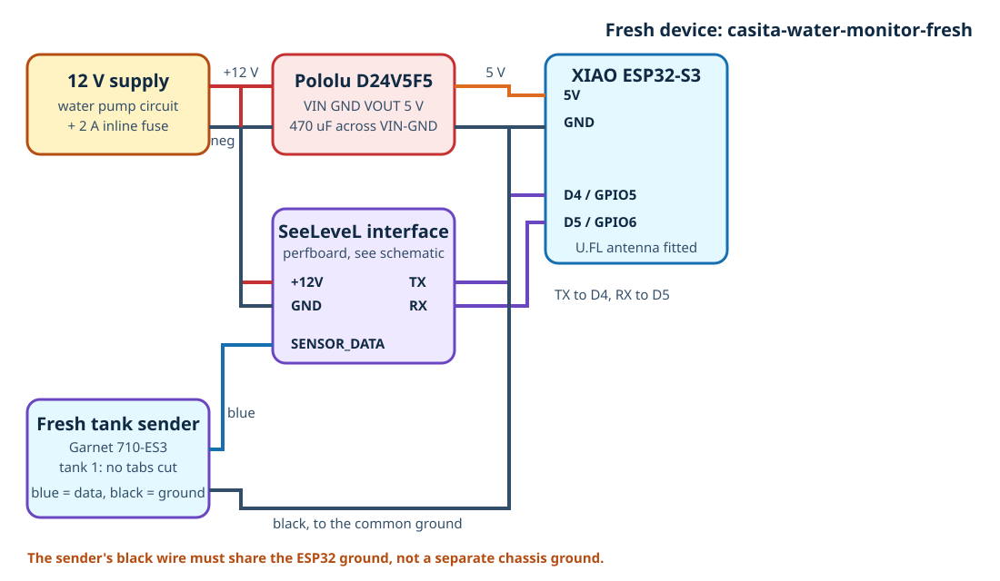
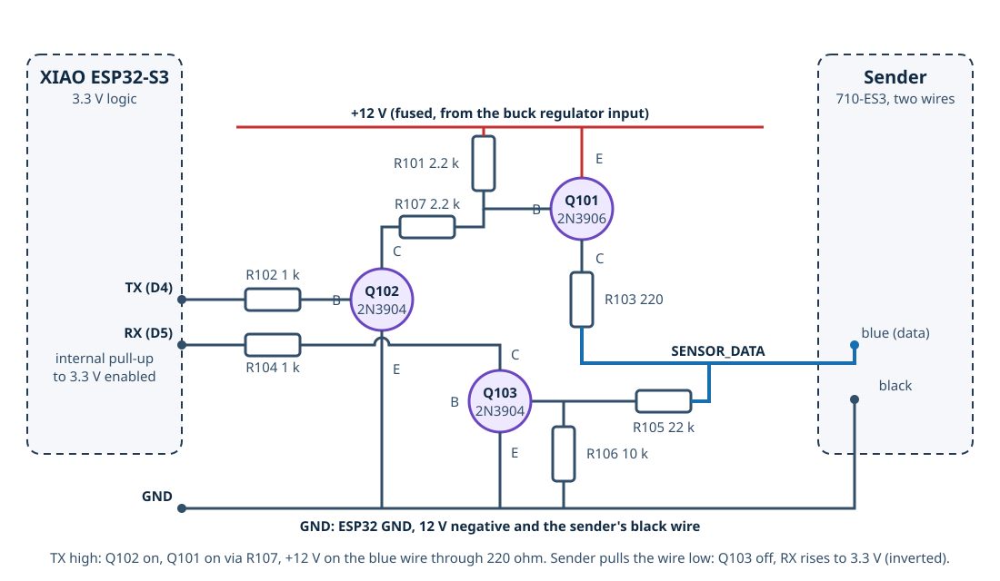

# Water Tank Sensors (SeeLeveL fresh device + Mopeka grey)

Part of [mod 07, the tank monitor](README.md). Fresh and grey water tank levels in the trailer's Home Assistant, with nothing inside either tank.

- **Fresh tank: its own ESPHome device** (`casita-water-monitor-fresh`). A Garnet SeeLeveL II **710-ES3** capacitive sender stuck to the side of the 23 gal fresh tank, read through a three-transistor interface by a XIAO ESP32-S3 in an enclosure in the fresh tank bay, powered from the 12 V water pump circuit. This guide covers the whole fresh device.
- **Grey tank: a Mopeka Pro Check Universal** under the 32 gal grey belly tank, read by the trailer's Home Assistant over Bluetooth. No ESP32, no cable, one coin cell. This guide covers mounting it, adding it to Home Assistant and turning its reading into a percentage.

The black tank is left for later, as a third device of the same kind as the fresh one.


> [!IMPORTANT]
> **Status (updated 2026-10-27): fresh device designed, not built; grey Mopeka ordered, arriving 2026-10-28.** The SeeLeveL sender and everything for the fresh device are on hand ([components.md](components.md)); its configuration compiles but has not run on hardware, and the sender has not been tried on this tank. The grey tank's first sensor, a wired DYP L02, never sent a byte (see [Why this design](#why-this-design)) and was replaced by the Mopeka the same day. Two things decide whether it works:
>
> 1. **Fresh tank:** the 710-ES3 needs a flat strip of tank wall 2.2 in wide by about 11 in tall, at least 2 in from any metal in front of it and 1 in from metal beside it ([Step F1](#step-f1-measure-the-fresh-tank)).
> 2. **Grey tank:** the Mopeka must get an echo through the tank's bottom wall and reach the Home Assistant Pi over Bluetooth from under the trailer ([Step G2](#step-g2-test-the-mopeka-under-the-grey-tank)). One Casita owner runs one on this tank, which is encouraging.
>
> The grey tank is only about 4 in tall, so any bottom-mounted ultrasonic sensor measures over roughly the top two thirds of it: good for "is it getting full", coarse near empty. See [Known limitations](#known-limitations).

**Contents:** [What to order](#what-to-order) · [Build order](#build-order) · [Why this design](#why-this-design) · [How it works](#how-it-works) · [Known limitations](#known-limitations) · [Parts](#parts) · [Tools](#tools-and-supplies) · [Wiring](#wiring) · [SeeLeveL interface](#seelevel-interface-circuit) · [Fresh device steps](#fresh-device-steps) · [Grey tank (Mopeka)](#grey-tank-mopeka) · [Grey tank steps](#grey-tank-steps) · [ESPHome configuration](#esphome-configuration) · [Home Assistant](#home-assistant) · [Calibrate](#calibrate) · [Testing](#testing-checklist) · [Troubleshooting](#troubleshooting) · [Safety](#safety-notes) · [Black tank later](#adding-the-black-tank-later)

## What to order

Two sensors, and only these models:

| Tank | Sensor | Check on arrival |
| --- | --- | --- |
| Fresh | **Garnet SeeLeveL II 710-ES3** 12 in sender, sold by RecPro as "SeeLevel 710 RV Tank Level Sensor (12")": [Amazon B0GWJR52N8](https://www.amazon.com/dp/B0GWJR52N8), about $70. Also from [Garnet direct](https://shopusa.garnetinstruments.com/solutions/holding-tanks/710-es3-710-es3-12-sender) | The board is 12.15 x 2.20 in with **9 segmented pads** and four programming tabs across the top (`2/GRY`, `3/BLK`, `4`, `TOP`). Two wires: blue and black. **Do not cut anything yet.** |
| Grey | **Mopeka Pro Check Universal, the version for aluminium, plastic and poly tanks** (with the mounting collar; not the magnetic steel-tank version): [Amazon B0C7HM61BP](https://www.amazon.com/dp/B0C7HM61BP), about $81 (seen 2026-10-27) | A round sensor with a plastic collar, a CR2032 cell and a sachet of couplant. Pull the battery tab; the Mopeka Tank Check app (or Home Assistant) should see it within a minute |

Everything else is in [Parts](#parts) and on hand. The fresh device has its own XIAO ESP32-S3, Pololu regulator, 470 uF capacitor, fuse holder and enclosure; the three transistors for its interface (one 2N3906, two 2N3904) come from one assortment kit. The Mopeka needs nothing else.

## Build order

The fresh device and the grey Mopeka are independent of each other and of the main device: do either first.

| Step | Fresh device (`casita-water-monitor-fresh`) | Result |
| --- | --- | --- |
| F1 | Measure the fresh tank and pick the sender spot | Go / no-go on fit; the sender's cut length |
| F2 | Build the SeeLeveL interface on perfboard | A board the ESP32 can drive the sender through |
| F3 | Bench-wire the XIAO, regulator and interface; flash the firmware | The device on the trailer Wi-Fi, its web page up |
| F4 | Bench-test the sender on a bucket of water | The sender talks and the level moves. **Go / no-go for the fresh tank** |
| F5 | Cut, program and stick the sender on the fresh tank | Sender installed |
| F6 | Mount the enclosure in the fresh tank bay and power it from the pump circuit | Permanent install |
| F7 | Add to Home Assistant, calibrate, set the low-water alert | Done |

| Step | Grey tank (Mopeka Pro Check Universal) | Result |
| --- | --- | --- |
| G1 | Unbox, fit the battery, pair it with the trailer's Home Assistant on the bench, set the medium to Waste Water | A **Tank level** reading in Home Assistant |
| G2 | Hold it under the grey tank with couplant and read it from inside the trailer | **Go / no-go for the tank wall and the Bluetooth reach** |
| G3 | Mount it in its collar under the tank | Sensor installed |
| G4 | Add the percent template sensor, the dashboard gauge and the alert; calibrate with a measured fill | Done |

## Why this design

The requirement was fresh and grey levels in Home Assistant, powered by the trailer, with nothing inside the tanks. Options considered for the sensors:

| Option | Fresh | Grey (about 4 in tall, under the floor) | Home Assistant | Verdict |
| --- | --- | --- | --- | --- |
| **Mopeka Pro Check Universal (bottom-mount ultrasonic)** | Yes | **Yes; one Casita owner reports 6+ months without trouble** | **Native Bluetooth integration; the medium can be set to Waste Water** | **Chosen for the grey tank on 2026-10-27.** A coin cell to change, and a template sensor turns its millimetres into a percentage |
| Garnet SeeLeveL senders + 709-BTP3 Bluetooth display | Yes | Only if a flat side wall exists; a 4 in tank leaves little | Community integration (danTapps/garnet) | A proven RV product, but $150+ for the display and no side-wall certainty on the grey tank |
| Capacitive point switches (XKC-Y25) on the grey tank side | | 2-3 steps only | GPIO | Fallback: cheap and robust, no percentage |
| **SeeLeveL 710-ES3 on the fresh tank, driven by the ESP32 directly** | **Yes** | | **ESPHome component (j9brown/esphome-seelevel) + a 3-transistor interface** | **Chosen.** The sender is the RV industry's standard external strip, 12 V, 0.33 in resolution; the interface is a few cents of parts |
| DYP L02 under the grey tank | | Specified for 0.6-5 mm non-foamed plastic, 2 cm dead zone | ESPHome's built-in `ds1603l` platform reads its frame | **Tried and dropped.** The first choice (wired, no battery), but the unit that arrived never sent a byte |

**How the grey tank got here.** The first design (2026-10-14) had one XIAO in the fresh tank bay reading the sender and a wired DYP L02 under the grey tank. On 2026-10-20 that became one device per tank, and on 2026-10-27 the L02 moved onto the propane monitor's XIAO when the projects were combined. The L02 was then wired up (3.3 V confirmed at the sensor, yellow TX on the ESP32's D3 per DYP's datasheet pinout, no LED ever lit) and a UART byte dump on the device showed **nothing at all** on that pin. Rather than chase a possibly dead sensor that was also out of stock, the owner ordered the Mopeka the same evening. It trades the L02's advantages (no battery, wired into the ESP32) for a sensor already proven on this tank, with a native Home Assistant integration and nothing to run under the trailer. The L02, its UART and its entities were removed from the main device's firmware.

The 710-ES3 and the Mopeka come from different worlds: one is a Garnet RV part with a proprietary protocol that the community has reverse-engineered and an ESP32 drives directly, the other is a finished consumer product with its own radio. The [e-ink dashboard (mod 08)](../08-eink-dashboard/README.md) reads `sensor.casita_water_monitor_fresh_tank` from the fresh device and the template sensor `sensor.casita_grey_tank` built on the Mopeka's reading.

## How It Works

**Fresh device (SeeLeveL).** The sender is a flexible circuit board with a column of copper pads, stuck to the outside of the tank. Each pad and the water behind the wall form a capacitor; the sender measures each pad's capacitance and reports ten values, 0 (air) to 255 (water), to whatever polls it. The ESP32 polls it through the [interface circuit](#seelevel-interface-circuit): it puts 12 V on the sender's blue wire for 1.5 ms (which powers the sender), sends one short low pulse to address tank 1, then counts the sender's reply pulses. The `seelevel` component turns the ten values into a level in segments (0 to the number of pads kept), and the firmware turns that into percent and gallons. A poll takes about 15 ms; the sender is unpowered in between.

**Grey tank (Mopeka).** The Pro Check Universal is a self-contained ultrasonic sensor: it sits in a collar stuck to the underside of the tank with a film of couplant, fires a pulse up through the wall and the water every few seconds, times the echo from the surface, and broadcasts the result over Bluetooth Low Energy. The trailer's Home Assistant Pi (which already has Bluetooth, see [Grey tank (Mopeka)](#grey-tank-mopeka)) picks the broadcasts up with the built-in **Mopeka** integration and publishes **Tank level** in millimetres, plus temperature, battery, signal strength and a reading-quality score. The integration's medium setting (Waste Water for this tank) sets the speed of sound it uses. A template sensor in Home Assistant divides the millimetres by the tank's full height to give the percent the dashboard and alerts use.

**Power.** On the fresh device, fused 12 V feeds a 2 A inline fuse, the 470 uF capacitor and the Pololu 5 V regulator, which powers the XIAO; the interface also takes 12 V directly, since that is what the sender needs. The Mopeka runs on a CR2032 coin cell, which Mopeka rates for a year or more; Home Assistant shows its battery percentage.

## Known Limitations

- **The grey tank is shallow, and a bottom-mounted ultrasonic sensor cannot see the first few cm.** On a tank about 4 in (100 mm) tall outside, perhaps 90 mm inside, the usable range is roughly the top two thirds. Below that the Mopeka reports 0 and the percent shows 0%. That is fine for the question that matters (is it nearly full?) and useless for "is it completely empty?".
- **The tank wall and the Bluetooth reach are untested on this trailer.** Mopeka does not publish a wall-thickness limit for the Universal on plastic; one Casita owner's working install is the evidence. The sensor broadcasts from under the belly tank and the Pi is inside; Step G2 checks both before anything is stuck on. If the reach is marginal, a cheap ESPHome Bluetooth proxy near the floor fixes it.
- **Sloshing and slope.** Both sensors read the water where they are. The Mopeka's reading-quality score drops while the trailer moves; trust readings when parked. If the trailer is not level, a wide, shallow grey tank reads quite differently at opposite ends. Park level before judging.
- **The fresh sender's percentage is an estimate.** The `seelevel` component interpolates between pads using its own algorithm, not Garnet's; another user saw a 33% reading on a full shallow tank until the segment count was set correctly. The [calibration fill](#calibrate) checks it. Resolution is one pad, 1.33 in, about 3 gal on this tank, with interpolation between.
- **Metal near the sender reads as water.** Keep steel, aluminum and copper 2 in from the sender's face and 1 in from its edges; check again with doors and covers closed.
- **One shot at sticking the sender.** Its 3M 300LSE adhesive does not survive removal, so the taped trial in Step F5 is the time to find problems.
- **Polyethylene is hard to glue.** Epoxy, CA and most tapes peel off it. The Mopeka collar comes with its own adhesive; if it lets go of this tank, 3M 9495LE (300LSE) tape with Primer 94, the same combination Garnet uses on the sender, is on hand (Step G3).
- **A battery to change.** The Mopeka's CR2032 is the only battery in the whole project. Home Assistant shows its level; expect a year or two.
- **Always on.** The fresh device's XIAO on Wi-Fi draws about 40-80 mA, 1-2 Ah per day; the main device's draw is in the [README](README.md#power). The 12 V tap should be on a circuit that the trailer's 12 V master (when there is one) or a WFCO fuse cuts for storage. If the pump switch itself cuts the fresh device's circuit, see Step F6.
- **Temperature.** The sender is rated 0 to 60 degC and will not bond below 15 degC. The Mopeka's cold-weather rating is to check in its manual; coin cells fade in deep cold; see [mod 12](../12-cold-weather/README.md) for the belly pan that keeps the tank, and the sensor, warmer.
- **Away from home** the Home Assistant connection needs a network path, the same as the battery monitor: see [mod 04](../04-battery-monitor-esp32/README.md#reading-the-battery-away-from-home).

## Parts

Ownership and purchase status, kept current as parts arrive: [components.md](components.md).

### Fresh device

| Component | Qty | Notes | Purchase link |
| --- | ---: | --- | --- |
| Garnet SeeLeveL II 710-ES3 sender, 12 in | 1 | See [What to order](#what-to-order) | [Amazon B0GWJR52N8](https://www.amazon.com/dp/B0GWJR52N8) |
| Seeed Studio XIAO ESP32-S3 | 1 | Plain board, with its U.FL antenna | [Seeed](https://www.seeedstudio.com/XIAO-ESP32S3-p-5627.html) |
| Pololu D24V5F5 12 V to 5 V regulator | 1 | | [Pololu](https://www.pololu.com/product/2843) |
| 470 uF 25 V electrolytic capacitor | 1 | Across the regulator input | |
| 2N3906 PNP transistor (TO-92) | 1 | Interface Q101, the high-side switch. 2N2907, S8550 or BC557 substitute (BC557 pin order is C-B-E, reversed). Comes in the kit below | [Amazon: MOKMMKIT 32-value TO-92 assortment, B0DGT7RTZC](https://www.amazon.com/dp/B0DGT7RTZC) |
| 2N3904 NPN transistor (TO-92) | 2 | Interface Q102, Q103. 2N2222, S8050 or BC547 substitute (BC547 pin order is C-B-E, reversed). Same kit | (same kit) |
| Resistors, 1/4 W: 2.2 k x2, 1 k x2, 220, 22 k, 10 k | 7 | Interface R101-R107 | |
| Perfboard, about 30 x 40 mm, and a 5-pin screw terminal or header | 1 | For the interface | [Amazon: perfboard assortment](https://www.amazon.com/dp/B07ZYNWJ1S) |
| Inline ATO/ATC fuse holder and 2 A fuse | 1 | On the pump-circuit tap | [Amazon: 14 AWG waterproof holders, 4 pack](https://www.amazon.com/dp/B0F6T8X81M) and [Amazon: Bussmann 2 A ATC, 5 pack](https://www.amazon.com/dp/B008QDH9VQ) |
| Small ABS enclosure, about 83 x 58 x 33 mm | 1 | XIAO, regulator and interface | [Amazon: IP65, 2 pack](https://www.amazon.com/dp/B0FDQCHNQP) |
| 22 AWG pair (or two conductors of the shielded cable) | about 1 m | Sender wires to the enclosure, if they do not reach | |

### Grey tank (Mopeka)

| Component | Qty | Notes | Purchase link |
| --- | ---: | --- | --- |
| Mopeka Pro Check Universal, aluminium/plastic/poly version with collar | 1 | See [What to order](#what-to-order). Ordered 2026-10-27 | [Amazon B0C7HM61BP](https://www.amazon.com/dp/B0C7HM61BP) |
| CR2032 coin cell | 1 spare | One comes with the sensor | |
| Silicone dielectric grease or Mopeka Sonic Grease | 1 | Couplant between the sensor and the tank; both on hand | [Amazon: Permatex 22058](https://www.amazon.com/dp/B000AL8VD2), [Mopeka Sonic Grease](https://www.amazon.com/dp/B0CVQVGMWB) |
| 3M 9495LE double-sided tape and 3M Primer 94 | | Only if the collar's own adhesive will not hold on the polyethylene; both on hand | |

### Shared supplies

| Component | Notes | Purchase link |
| --- | --- | --- |
| Rubberized undercoating | Over the sender if road spray can reach it. Garnet names 3M 03584. Do not coat the Mopeka: it needs its battery door and its radio | [Amazon search: 3M 03584](https://www.amazon.com/s?k=3M+03584+rubberized+undercoating) |
| Adhesive-lined heat-shrink, zip ties, painter's tape, Gorilla tape | | [Amazon: heat-shrink kit](https://www.amazon.com/dp/B0DC5YN5CD) |
| 18-20 AWG red and black wire, crimp butt splices | The fresh device's 12 V tap | |

Prices seen 2026-10-14: sender about $70, the rest $5-15 each; Mopeka about $81 on 2026-10-27. Links marked "search" were not checked against a specific listing; pick the genuine 3M part.

## Tools and Supplies

- Fine-tip soldering iron, solder, flux; wire strippers; crimper for butt splices
- Multimeter with continuity and a 10 A current range
- Isopropyl alcohol (99%) and lint-free cloths; 220-grit sandpaper
- Heat gun or hair dryer (the sender's adhesive needs the tank above 15 degC / 60 degF)
- Tape measure, straightedge, marker; scissors or a hole punch for the sender's tabs
- A plastic bucket and a flat-bottomed plastic tub (storage box) for the bench tests; a 1 gal jug for calibration
- USB-C cable for the first flash

## Wiring

### Fresh device wiring



| From | To | Notes |
| --- | --- | --- |
| Water pump 12 V positive (upstream of the pump switch; see Step F6) | 2 A inline fuse, then regulator `VIN` and interface `+12V` | 18-20 AWG. The 470 uF capacitor sits across `VIN` and `GND` at the regulator |
| 12 V negative (the pump's negative, or the chassis ground stud it goes to) | Regulator `GND`, XIAO `GND`, interface `GND` | One ground point in the enclosure; everything joins there |
| Regulator `VOUT` (5 V) | XIAO `5V` pin | |
| XIAO `D4` (GPIO5) | Interface `TX` | ESP32 output that drives the sender |
| XIAO `D5` (GPIO6) | Interface `RX` | ESP32 input, internal pull-up enabled in the firmware |
| Interface `SENSOR_DATA` | Sender **blue** wire | |
| Interface `GND` | Sender **black** wire | The sender must share the ESP32's ground |

### Grey tank

No wiring: the Mopeka is wireless and battery-powered.

### Where things go

- **Fresh enclosure:** inside the trailer, in or beside the fresh tank bay (rear passenger side), where the pump's 12 V is at hand. Keep it above any possible water on the floor of the bay. The sender's two wires run to it.
- **Sender:** on the fresh tank's side, [Step F5](#step-f5-cut-program-and-stick-the-sender-on-the-fresh-tank).
- **Mopeka:** under the grey tank in its collar, on a flat, smooth spot away from the drain end and the support angles, [Step G3](#step-g3-mount-the-mopeka-under-the-grey-tank). Nothing runs from it.

## SeeLeveL interface circuit

Fresh device only.



This is [j9brown's interface](https://github.com/j9brown/esphome-seelevel/tree/main/seelevel-interface) (CERN-OHL-W), built on perfboard, with one change: the high-side switch is a **2N3906 PNP transistor** instead of the original BS250 P-channel MOSFET, because the BS250 is hard to buy in small quantities while the 2N3906 is in every TO-92 assortment kit. The sender wants 12 V pulses on its blue wire and answers with short pulls to ground on the same wire; the ESP32 only has 3.3 V pins, so:

- **Transmit:** `TX` high turns on Q102 (2N3904), which pulls current out of the base of Q101 (2N3906, PNP) through R107 (2.2 k); R101 (2.2 k) from base to +12 V holds Q101 off otherwise. Q101's emitter is on +12 V and its collector connects, through R103 (220 ohm), to the blue wire. So `TX` high puts about 11.8 V on the blue wire (the sender accepts 9-15 V); `TX` low releases it. About 5 mA of base drive saturates the 2N3906 for the sender's 55 mA maximum, and it switches in well under a microsecond, fast enough for the 85 us addressing pulses.
- **Receive:** the blue wire feeds the base of Q103 (2N3904) through R105 (22 k) with R106 (10 k) to ground. While the sender is powered the wire is high, Q103 is on and `RX` reads low. When the sender pulls the wire low, Q103 turns off and `RX` is pulled up to 3.3 V by the ESP32's internal pull-up. The ESP32 never sees 12 V, and the reply is inverted, which the component expects.

If you do have a BS250 (or any P-channel MOSFET rated 30 V or more), j9brown's original works unchanged: source to +12 V, gate to the R101/Q102 node (omit R107), drain to R103. Check the pin order on its datasheet; it varies between makers.

Build it with the five connections brought out to a header or terminal: `+12V`, `GND`, `TX`, `RX`, `SENSOR_DATA`. Before connecting it to anything, check with the meter that `SENSOR_DATA` is open to `+12V` (Q101 off) and that `RX` to `GND` is tens of kilohms, not a short.

## Fresh device steps

### Step F1: Measure the fresh tank

The tank is 12 in tall (measured). Record:

| Measurement | Value | Why |
| --- | ---: | --- |
| Wall height, outside, where the sender will go | 12 in | Sets the sender length |
| Flat area available: at least 2.2 in wide, from 1/2 in below the top edge to 1/2 in above the bottom edge | | The sender must not wrap over a corner or sit on a rounded edge |
| Height of the pump's suction outlet above the tank bottom | | The sender's bottom must be at least 1 in above it, so the sender reads 0 before the pump sucks air |
| Distance from the chosen spot to the nearest metal: in front (2 in minimum) and beside (1 in minimum) | | Metal reads as water |
| Route for the two wires: they must leave the sender's top **upward or to the right**, never draped across it | | Garnet's rule |
| Spot for the enclosure in the bay, and where the pump's positive and negative wires are | | Step F6 |

With 1/2 in gaps top and bottom the measurable height is 11 in. The 710-ES3 is 12.15 in long with 9 pads, so **it must be cut**: one pad off the bottom leaves 8 pads, about 10.8 in, which Garnet's silkscreen marks as the "11-12.5 in tank" line. The cut is made in Step F5, after the bench test, on the line printed on the sender; confirm the line's label against the tank height before cutting.

Photograph the tank bay and put the photo in `photos/`.

### Step F2: Build the SeeLeveL interface

1. Lay out the [schematic](#seelevel-interface-circuit) on perfboard. All three transistors are TO-92 with the same pinout, flat face toward you, legs down: **E, B, C** left to right (2N3906 and 2N3904 alike). Check the kit's datasheet card anyway.
2. Solder R101-R107 and the three transistors; bring `+12V`, `GND`, `TX`, `RX` and `SENSOR_DATA` to a header.
3. Check: `+12V` to `SENSOR_DATA` open in one direction, a diode drop plus 220 ohm the other way (Q101's collector-base junction); `SENSOR_DATA` to `GND` about 32 k (R105 + R106); `RX` to `GND` open; `TX` to `GND` about 1 k plus a diode drop (through R102 and Q102's base).

### Step F3: Bench-wire the fresh XIAO and flash the firmware

1. Solder the XIAO's U.FL antenna on and plug the antenna in. Solder or header the XIAO to the perfboard or a second small board: `5V`, `GND`, `D4`, `D5`.
2. Wire the regulator: 12 V bench supply (or the trailer battery through the 2 A fuse) to `VIN` and `GND` with the 470 uF capacitor across them; `VOUT` to the XIAO `5V`; grounds together. Wire the interface's `+12V` to the regulator's `VIN` side, its `GND` to the common ground, `TX` to `D4`, `RX` to `D5`. Leave `SENSOR_DATA` unconnected for now.
3. Check with the meter before powering: no short between `+12V` and `GND`, nor between `5V` and `GND`.
4. Put the firmware in place: in the trailer's Home Assistant open **Settings > Add-ons > ESPHome Device Builder** (or **ESPHome** in the sidebar), **New device**, name it `casita-water-monitor-fresh`, then replace the generated YAML with [`esphome/casita-water-monitor-fresh.yaml`](esphome/casita-water-monitor-fresh.yaml). Check that the Device Builder's `secrets.yaml` has every entry in [`esphome/secrets.example.yaml`](esphome/secrets.example.yaml) (see [Secrets](#secrets)).
5. Connect the XIAO by USB-C to the computer running the browser, **Install > Plug into this computer** and flash. (After this first flash, installs are wireless.) The XIAO joins the trailer Wi-Fi; give it a DHCP reservation in the travel router.
6. Open **Logs**. Expect `seelevel` reporting a sanity error or no reply (nothing is connected yet). Open `http://casita-water-monitor-fresh.local` (or its IP) and log in: every entity is listed.

### Step F4: Bench-test the sender on a bucket

1. With everything unpowered, connect the sender: blue to `SENSOR_DATA`, black to `GND`.
2. Tape the sender vertically to the outside of a plastic bucket, pads facing the bucket, wires at the top going up. Painter's tape along both long edges, pressed flat, no air gaps.
3. Power up and open the logs. Within 30 s the component polls tank 1. Expect **Tank Segment Data** like `255,0,0,0,0,0,0,0,0,0` with the bucket empty (the single 255 is the pad that will be cut off; it reports 255 because there is no electrode). **Tank Level** may read oddly until the sender is cut to 8 pads; what matters here is that the values change.
4. Fill the bucket in steps. Segment values from the bottom should rise toward 255 as the water passes each pad, and **Tank Level** should climb. If nothing changes, see [Troubleshooting](#troubleshooting).
5. Note the values with the bucket full to the top of the sender; they are the "water" reference for later.

If the sender never answers, stop here and fix the interface before touching the tank.

### Step F5: Cut, program and stick the sender on the fresh tank

Garnet's rules, condensed. The adhesive is single-use: do the taped trial first.

1. **Cut.** Cutting from the bottom (the wires are at the top), cut straight across on the printed line that leaves **8 pads** ("11-12.5 in tank"). Cut only between pads, never through one. Three pads is the minimum; do not go below.
2. **Program.** Tank 1 (fresh) is the default: **cut no tabs**. Leave `2/GRY`, `3/BLK`, `4` and `TOP` intact.
3. **Prepare the surface.** The tank wall must be clean, dry, smooth and above 15 degC (60 degF). Wipe with alcohol; sand lightly with 220 grit if textured; warm with a heat gun in cold weather.
4. **Place.** Hold the sender against the wall with its top 1/2 in below the tank's top edge and its bottom 1/2 in above the bottom edge (both at least 1/4 in, no more than 1 in), on the flat area from Step F1, with the wires exiting at the top going up or to the right. Keep 2 in from metal in front, 1 in beside. Tape along both long edges with painter's tape, pressed so there are no air gaps under the pads.
5. **Trial.** Connect blue and black to the interface and power up. With the tank at least a quarter full, **Tank Level** should show a sensible fraction and the bottom segments should read high. Fill a little and watch it move. Fix anything now.
6. **Stick.** Remove the tape on one edge, fold the sender back, peel the backing off that half, fold it down and press it onto the wall from the center out so every bit of adhesive touches, no bubbles. Remove the other tape, peel and press the other half. Press the whole sender firmly once more.
7. **Secure the wires.** A strip of Gorilla tape across the top edge over the wire exit, then zip ties along the route, so no pull on the wires ever reaches the sender. If the wires do not reach the enclosure, butt-splice or solder and heat-shrink them to a 22 AWG pair.
8. If the sender is anywhere road spray can reach, two coats of rubberized undercoating after the adhesive has set for a day.

### Step F6: Mount the fresh enclosure and power it from the pump circuit

1. **Find the pump's feed.** In the fresh tank bay, find the pump's positive wire. With the pump switch **off**, measure it to ground. If it is still at 12 V, the switch is on the pump's other side (or elsewhere) and you can tap here. If it reads 0 V, the switch is upstream: follow the wire back to the switch and tap on the switch's supply side, or instead use a spare position in the WFCO 12 V fuse panel (under the seat by the sink) and run 18 AWG back.
2. Fit the enclosure: XIAO, regulator with the capacitor, and the interface board, with the U.FL antenna against the inside of the lid. Glands or grommets for the two cables (12 V in, sender).
3. Tap the 12 V: butt-splice or a piggyback crimp on the positive, then the **2 A inline fuse** within 150 mm of the tap, then 18-20 AWG to the enclosure. Negative from the pump's negative or the same chassis ground stud.
4. Connect everything per [Fresh device wiring](#fresh-device-wiring). Check with the meter before applying power: no short `+12V` to `GND` or `5V` to `GND`.
5. Power up. Logs should show the sender answering every 30 s. Mount the enclosure with screws or VHB where it cannot get wet or be kicked.
6. Measure the current draw on the 12 V tap: expect 40-80 mA.

### Step F7: Add the fresh device to Home Assistant and calibrate

See [Home Assistant](#home-assistant) and [Calibrate: fresh tank](#fresh-tank).

## Grey tank (Mopeka)

The trailer's Home Assistant already has Bluetooth: the Pi 4's built-in radio and a Realtek USB adapter are both loaded (checked 2026-10-27). The built-in **Mopeka** integration discovers Pro Check sensors automatically and publishes, per sensor: **Tank level** (mm), **Temperature** (degC), **Battery** (%) and battery voltage, **Reading quality** (%), **Signal strength** (dBm) and two accelerometer axes. Its options let you pick the medium; **Waste Water** is the one for this tank.

**As paired on 2026-10-28:** the sensor is **Pro Check Universal 5FA8** (Bluetooth `F2:FA:BD:30:5F:A8`), renamed **Grey Water Sensor** in the area *Outside*, medium **Waste Water**. Its entities are `sensor.outside_grey_water_sensor_tank_level` (shown in inches because the trailer's Home Assistant uses US units; the integration's native unit is mm), `..._reading_quality`, `..._temperature` and `..._battery`.

The percentage the dashboard and alerts use is a **template helper** (**Settings > Devices & services > Helpers**, type Template > Sensor), created 2026-10-28 and attached to the Mopeka device, then renamed in the entity settings to `sensor.casita_grey_tank` with the name **Grey Tank** (a helper attached to a device gets the device name prefixed to its ID otherwise):

| Field | Value |
| --- | --- |
| Name | Casita Grey Tank (entity renamed to `sensor.casita_grey_tank`, name **Grey Tank**) |
| Unit | % |
| State class | measurement |
| Device | Grey Water Sensor (the Mopeka) |
| State template | see below |
| Availability template | `{{ states('sensor.outside_grey_water_sensor_tank_level') != 'unavailable' }}` |

```jinja

0


{{ ([0, (mm / 90 * 100) | round(0), 100] | sort)[1] | int }}
```

So: an `unknown` level (no echo: the Mopeka's dead zone, or no water) shows **0%**; an `unavailable` level (out of Bluetooth reach, flat cell) makes the percent unavailable rather than 0; the reading is converted from inches if needed; and `90` is the assumed full-tank height in mm, to be replaced from the [calibration fill](#grey-tank). `sensor.casita_grey_tank` is the ID in the README's [dashboard card and alerts](README.md#home-assistant-setup) and in mod 08.

## Grey tank steps

### Step G1: Pair the Mopeka on the bench

1. Pull the battery tab (or fit the CR2032). The sensor starts broadcasting at once.
2. In the trailer's Home Assistant, **Settings > Devices & services** should show a discovered **Mopeka** device within a minute. **Add**, then open its options and set the medium to **Waste Water**. Rename the device so its entities get sensible IDs (done 2026-10-28: **Grey Water Sensor**, which gives `sensor.outside_grey_water_sensor_tank_level`); note the **Tank level** entity ID for the template above.
3. With the sensor face up on the bench, **Tank level** should read 0 and **Reading quality** low. Press it, with a dab of grease, against the underside of a plastic tub of water about 60 mm deep: the level should read close to that within a few readings.

### Step G2: Test the Mopeka under the grey tank

Nothing here is permanent.

1. Dump the grey tank, then put a known amount of water in through the sink: about 10 gal (roughly 25-30 mm in a tank this size). Park level.
2. Under the trailer, clean the chosen spot (flat, smooth, supported, away from the drain end) with alcohol. Grease the sensor face and hold it up against the tank, flat, no air gap; a strip of Gorilla tape across the collar holds it for the test.
3. Inside the trailer, read **Tank level** and **Reading quality**. **Pass:** a steady, non-zero level that rises when you add 5 more gallons, with quality well above zero, and **Signal strength** comfortably readable from where the Pi is. **Fail:** level `unknown` with quality 0% while there is water above it (wall or coupling), or no updates at all (Bluetooth reach). Note that quality 0% and level `unknown` is also exactly what an **empty** tank looks like: the Mopeka cannot see the first inch or two of water, so put water in before judging.
4. If the reach is the problem, try the USB Bluetooth adapter on a short extension nearer the floor, or plan an ESPHome Bluetooth proxy; if the wall is the problem, try another spot before giving up.
5. Note the reading and the gallons in; that is the first calibration point.

### Step G3: Mount the Mopeka under the grey tank

1. Dump the tank and park level. Clean the spot from Step G2 with alcohol; sand lightly with 220 grit if textured; wipe again; dry. Warm the plastic with a heat gun in cold weather.
2. Follow Mopeka's collar instructions: couplant on the sensor face, the sensor in the collar, the collar's adhesive onto the primed tank, firm pressure for a minute. If the collar adhesive does not grab the polyethylene, use a ring of 3M 9495LE on Primer 94 instead, as the sender uses.
3. Leave the tank empty for 24 h so the adhesive cures. Do not undercoat the sensor.
4. Check the reading again after mounting; it should match the taped test.

### Step G4: Calibrate and finish

See [Calibrate: grey tank](#grey-tank). Then add the gauge and the grey-full alert from the [README](README.md#home-assistant-setup), and the `rv_` mirror at home.

## ESPHome Configuration

| Device | Configuration | Components |
| --- | --- | --- |
| Fresh | [`esphome/casita-water-monitor-fresh.yaml`](esphome/casita-water-monitor-fresh.yaml) | The external [`seelevel`](https://github.com/j9brown/esphome-seelevel) component (MIT), fetched from GitHub at compile time |

**Fresh substitutions:**

| Substitution | Default | Meaning |
| --- | --- | --- |
| `fresh_segments` | `8` | Pads left on the sender after cutting. Must match the sender |
| `fresh_update_interval` | `30s` | How often the sender is polled |
| `seelevel_tx_pin`, `seelevel_rx_pin` | `GPIO5`, `GPIO6` | XIAO `D4`, `D5` |

The fresh volume map (`level 8.0 = 23 gal`) is written out in the sensor because the component wants real numbers there; keep it in step with `fresh_segments` and the tank size. Confirm with the calibration fill.

What the fresh firmware does beyond the component: **Tank** (%) = level / `fresh_segments` x 100, clamped 0-100. **Tank Segment Data** (diagnostic) shows the ten raw values, top to bottom, for calibration and troubleshooting.

The grey tank has no ESPHome configuration; its percent is the Home Assistant template above.

Validation on bee2 with ESPHome 2026.9.1 on 2026-10-27: `esphome compile` succeeded for the fresh configuration (RAM 31.3%, flash 58.3%). This proves only that it builds.

### Secrets

Same names as the trailer's other ESPHome devices; see the [README](README.md#secrets).

## Home Assistant

1. After Step F3, **Settings > Devices & services** shows **Casita Water Monitor Fresh** as a discovered ESPHome device. **Add**, and enter the API encryption key if asked. If it is not discovered, **Add integration > ESPHome** and enter the XIAO's reserved address, port 6053.
2. Check the entity IDs on the device page against the table below.

### Entities: fresh device (Casita Water Monitor Fresh)

| Entity name | Entity ID | Unit | Notes |
| --- | --- | --- | --- |
| Tank | `sensor.casita_water_monitor_fresh_tank` | % | **Used by mod 08** |
| Tank Volume | `sensor.casita_water_monitor_fresh_tank_volume` | gal | |
| Tank Level | `sensor.casita_water_monitor_fresh_tank_level` | seg | Diagnostic, 0 to 8 |
| Tank Segment Data | `text_sensor.casita_water_monitor_fresh_tank_segment_data` | | Diagnostic |
| Wi-Fi Signal, Uptime, IP Address, Restart | diagnostic entities | | |

The grey tank's entities come from the Mopeka integration plus the `sensor.casita_grey_tank` template ([Grey tank (Mopeka)](#grey-tank-mopeka)). The dashboard card, the fresh-low and grey-full alerts, and mirroring to the home Home Assistant are in the README's [Home Assistant setup](README.md#home-assistant-setup).

## Calibrate

Park level for all of this.

### Fresh tank

Drain the tank, then fill it with the hose in measured steps (a 1 gal jug, or time the hose against a bucket). At each step record gallons in, **Tank Level** and **Tank Segment Data**.

- Level should reach about 8.0 with the tank full (23 gal) and 0 with it empty. If full reads well under 8, a pad is probably above the water line (check the 1/2 in top gap and the tank's true inside height) or `fresh_segments` is wrong.
- If the gallons-vs-level points are not a straight line (a tank with a sloped bottom or a dome), add intermediate points to the volume `map` in the fresh YAML, for example `level 2.0 = 5 gal`, and reinstall.

### Grey tank

After dumping, with the tank empty, the Mopeka's **Tank level** should read 0 (below its dead zone). Then add water through the sink in 5 gal steps and record **Tank level** each time. From two points above the dead zone, compute millimeters per gallon; then:

`full level (mm) = 32 gal x (mm per gal)`, adjusted by the intercept if the line does not pass through zero (the first few gallons fill the tank's low spots).

Put that number in place of the `90` in the template sensor. Alternatively, keep filling while watching the shower drain, note **Tank level** the moment water appears in the shower pan, and use that; it defines 100% as "about to back up", which is the practical meaning. Dump afterwards.

Repeat the grey calibration once after the first trip, since a belly tank's shape under load can differ from the empty tank's.

## Testing Checklist

**Fresh device**

1. Interface board: `+12V` to `SENSOR_DATA` open; `SENSOR_DATA` to `GND` about 32 k.
2. Sender on a bucket: segment values rise from the bottom as water passes each pad; level climbs.
3. Sender taped on the fresh tank, tank a quarter full: bottom segments high, level sensible, moves with filling.
4. After sticking: same readings as taped. After 24 h: unchanged.
5. Enclosure powered from the pump circuit with the pump switch off and on: readings continue; the XIAO does not reset when the pump runs; current draw 40-80 mA.
6. Calibration: empty reads 0, full reads about 8.0 (100%, 23 gal).

**Grey tank (Mopeka)**

7. On the bench against a tub of water: **Tank level** within about 5 mm of a ruler; 0 in air.
8. Taped under the grey tank with 10 gal in: steady non-zero level that rises with 5 more gallons; **Reading quality** well above zero; updates arrive inside the trailer.
9. Mounted: reading matches the taped test; `sensor.casita_grey_tank` follows it.
10. Calibration: the template's full level set from a measured fill; 32 gal reads about 100%.

**Both**

11. Home Assistant shows the fresh device, the Mopeka and `sensor.casita_grey_tank`; the e-ink dashboard's water gauges fill in on its next refresh; the home Home Assistant shows the `rv_` mirrors in the Casita RV area.
12. After the first tow: both tanks still read; the Mopeka has not moved; undercoating on the sender intact.

## Troubleshooting

| Device | Symptom | Likely cause | Fix |
| --- | --- | --- | --- |
| Fresh | Log: `interface is malfunctioning: RX is low while TX is low` | `RX` is being pulled low with the sender unpowered: Q103 wired wrong, or `RX` shorted to ground | Check Q103 pinout (E-B-C) and R104 |
| Fresh | Log: `sensor wiring short-circuits to ground` | After TX goes high, `RX` is still high: the blue wire is not reaching 12 V. Q101/Q102 wiring, no +12 V on the interface, blue shorted to ground, or a 2N3904 fitted where the 2N3906 goes | Measure `SENSOR_DATA` while polling (should pulse to ~12 V); check that Q101 is the PNP and its emitter is on +12 V |
| Fresh | Sender never replies (timeout, no segment data) | Blue/black swapped, black not sharing the ESP32 ground, sender damaged, or 12 V below 9 V | Swap wires; confirm one common ground; measure `+12V` |
| Fresh | Segment data all 255 | Sender powered but every pad saturated: metal behind the sender, or sender face against a wet or conductive surface | Move it; dry the wall |
| Fresh | Segment data all 0 with water present | Air gap under the pads, wall too thick (over 3/8 in), or sender stuck to a corner | Re-tape flat on a flat area |
| Fresh | Level reads low with the tank full | `fresh_segments` too high, or a pad sits above the water line | Count the pads kept; check the top gap |
| Fresh | Level jumps while filling or reads non-zero when empty | Metal within 2 in of the face or 1 in of the edges; AC wiring bundled with the sender wires | Move the metal or the sender; reroute wires |
| Fresh | XIAO resets when the pump runs | Voltage sag on the shared circuit | Confirm the 470 uF is across `VIN`; if it persists, feed from a WFCO fuse instead |
| Grey | No Mopeka device discovered | Battery tab still in, flat cell, or the sensor out of Bluetooth reach of the Pi | Check the cell; bring the sensor inside to pair, then test reach at the tank (Step G2) |
| Grey | Updates stop when the sensor is under the tank | Bluetooth reach through the floor | USB adapter nearer the floor, or an ESPHome Bluetooth proxy |
| Grey | Level always 0 with water above it, low reading quality | No couplant, air gap, wrong medium setting, or the wall is beyond the sensor | Re-grease and press; set the medium to Waste Water; try another spot |
| Grey | `sensor.casita_grey_tank` unknown | Wrong Tank level entity ID in the template | Fix the ID (Step G1) |
| Grey | Level far off the ruler | Wrong full level in the template, or the tank is tilted | Recalibrate on level ground |
| Fresh | Device offline after a trip | Lost Wi-Fi: the fallback hotspot **Casita Fresh Fallback** appears after a minute | Join it and re-enter the trailer Wi-Fi, or check the travel router |

## Safety Notes

- The fresh device's 12 V tap is fused at 2 A as close to the tap as possible; the wire from there is sized for that fuse. Never run an enclosure off a 10-15 A circuit fuse alone.
- Disconnect 12 V (pull the inline fuse) before working inside the enclosure or on the sender wires. The fresh interface puts 12 V on the blue wire during polls.
- The Mopeka's coin cell is a swallowing hazard for children and pets; keep the spare put away.
- Working under the trailer: chock the wheels, park on firm level ground, keep clear of the drain valves.
- Undercoating and primer: ventilate, no flames, keep off the fiberglass body.
- The fresh tank is potable. Nothing in this project touches the water; keep adhesives, grease and undercoating away from the fill, vent and drain fittings.

## Adding the black tank later

Like the fresh tank, the black tank gets its own device, `casita-water-monitor-black`, built like the fresh one: a SeeLeveL sender (a 710-AR2, 9 in with 1 in pads, if the black tank is short), its own interface board, XIAO, regulator, fuse and enclosure near the toilet. Copy [`casita-water-monitor-fresh.yaml`](esphome/casita-water-monitor-fresh.yaml) and change `name` to `casita-water-monitor-black`, `friendly_name` to `Casita Water Monitor Black`, the fallback hotspot name, `fresh_segments` to the pads kept, and the volume map to 15 gal. The sender stays programmed as tank 1 (no tabs cut), since it is alone on its device. Its **Tank** sensor is then `sensor.casita_water_monitor_black_tank`, which fills the e-ink dashboard's third gauge. Garnet's rule for waste tanks: bias the sender toward the top of the tank.

## Photos

Add photos to `photos/` as the build progresses:

- `fresh-tank-bay.jpg`: the tank, the chosen flat area, the pump outlet and nearby metal
- `interface-board.jpg`: the finished perfboard
- `sender-taped.jpg` and `sender-installed.jpg`
- `fresh-enclosure.jpg`: inside the fresh enclosure, wired
- `grey-tank-underside.jpg`: the tank bottom and the sensor spot before mounting
- `mopeka-taped.jpg` and `mopeka-installed.jpg`

## References

- [Garnet SeeLeveL 709 Series manual v2.0 (Nov 2025)](https://www.garnetinstruments.com/wp-content/uploads/2025/11/SeeLeveL-709-Series-Manual-v2.0.pdf): sender cutting, tab programming, placement gaps, metal clearance, adhesion, undercoating
- [Garnet 710-ES3 product page](https://shopusa.garnetinstruments.com/solutions/holding-tanks/710-es3-710-es3-12-sender): 12.15 x 2.20 in, 9 pads, 300LSE adhesive, 0-60 degC
- [j9brown/esphome-seelevel](https://github.com/j9brown/esphome-seelevel): the ESPHome component, the interface schematic (`seelevel-interface/`), the protocol notes and the level-estimation algorithm. [Issue #3](https://github.com/j9brown/esphome-seelevel/issues/3): segment count and estimator discussion from a three-tank Airstream install
- [Home Assistant Mopeka integration](https://www.home-assistant.io/integrations/mopeka/): auto-discovery over Bluetooth, the medium list (Waste Water among them), supported sensors including the Pro Check Universal
- [Mopeka Pro Check Universal](https://www.mopekaiot.com/procheckuniversal): the sensor and its collar
- [DYP L02 datasheet](https://www.dypcn.com/uploads/L02-Datasheet1.pdf): the sensor tried first (pinout red VCC, black GND, yellow TX, white RX; 2.8-5 V; 9600 baud 4-byte frame), kept for the record
- [Mopeka grey tank install on a Casita (video)](https://www.youtube.com/watch?v=rsI1zkrDrD4): the tank measured at about 4 in tall; a Mopeka working on this tank for 6+ months
- [Seeed Studio XIAO ESP32-S3 wiki](https://wiki.seeedstudio.com/xiao_esp32s3_getting_started/)
- [Mod 08 e-ink dashboard](../08-eink-dashboard/README.md#entities-shown): the entity names this project must produce

Revision history is in the [README](README.md#revisions).
