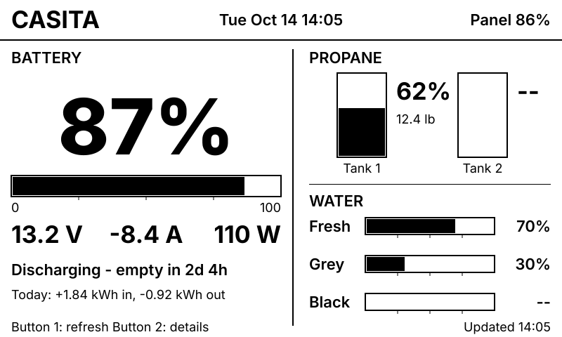
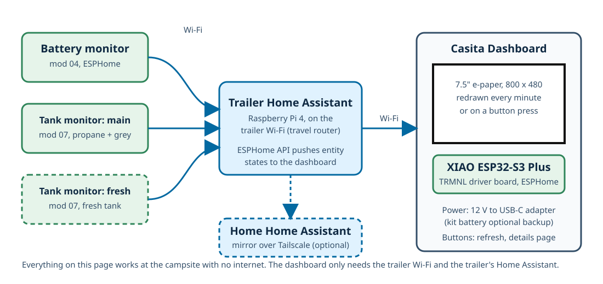

# Casita E-ink Dashboard (TRMNL 7.5" OG DIY Kit + ESPHome)

A 7.5-inch e-paper panel mounted inside the Casita that shows the trailer's state at a glance: battery state of charge, voltage, current and time to empty or full; propane in each cylinder; and fresh, grey and black water levels. It runs ESPHome on the kit's XIAO ESP32-S3 Plus, reads the values from the trailer's Home Assistant over Wi-Fi, and redraws every minute. E-paper keeps the last image with no power, so the panel is readable in full sun and draws almost nothing between refreshes.

> [!IMPORTANT]
> **Status: built and running since 2026-10-20; the configuration with real tank entities and a Power page installed 2026-10-28 (updated 2026-10-28).** The kit was bench-tested on 2026-10-20 (panel, FPC cable, SPI/busy/reset pins and the three buttons all confirmed on the first try) and the dashboard has been on the trailer since, as the ESPHome device **Casita Dashboard**. The running firmware (ESPHome 2026.9.1, compiled 2026-10-20) uses the `7.50inV2p` panel model, which gives partial refreshes every 10 s with a fast full refresh every 60th, and gained a solar line and section on 2026-10-22. The panel dropped off the trailer network at 01:37 on 2026-10-28 (a power interruption); once it was powered again that evening the new configuration (below) was installed over the air (ESPHome 2026.10.1, compiled 12:20 local) and Home Assistant reconnected on its own, fetching the rotated API key from the Device Builder. The layout drawing above is to the panel's 800 x 480 grid, not a photo.
>
> **What the new configuration shows:** battery ([mod 04](../04-battery-monitor-esp32/README.md)), solar (Victron MPPT over Bluetooth), propane and water from the real [mod 07](../07-tank-monitor/README.md) entities (both propane cylinders, the Garnet-read fresh tank and the Mopeka-read grey tank; black still `--`), and AC from [mod 10](../10-ac-power-meter/README.md) and the [mod 11](../11-xantrex-freedom-x-inverter/README.md) inverter: a one-line summary on the overview page and a full **Power** page (Button 2 cycles overview, details, power). The demo switch that drew random tank values is now off by default.

**Contents:** [What arrives in the box](#what-arrives-in-the-box) · [Design choices](#design-choices) · [How it works](#how-it-works) · [Parts](#parts) · [Steps](#steps) · [Entities shown](#entities-shown) · [Changing the layout](#changing-the-layout) · [Running on the battery](#running-on-the-battery-instead) · [Testing](#testing-checklist) · [Troubleshooting](#troubleshooting) · [Safety](#safety-notes)

## What arrives in the box

Seeed Studio [TRMNL 7.5" (OG) DIY Kit](https://www.seeedstudio.com/TRMNL-7-5-Inch-OG-DIY-Kit-p-6481.html), SKU 104991005:

| Item | Notes |
| --- | --- |
| XIAO ePaper Driver Board with a **XIAO ESP32-S3 Plus** soldered on | USB-C for power and flashing; JST 2.0 mm battery socket with a **slide power switch**; charging IC; **Reset** plus **three user buttons**; the ESP32's Wi-Fi antenna is a small external one on a U.FL lead |
| 7.5-inch monochrome e-paper panel, 800 x 480 | Driven by the `7.50inv2` controller. Full refresh only: every redraw takes about 3.5 s and flashes black and white |
| 10 cm FPC extension cable and connector | Lets the panel sit away from the board inside a case |
| 2000 mAh Li-ion battery, JST plug | Optional here; see [Power](#design-choices) |

**No enclosure is included.** Seeed publishes free 3D-printable cases (see [Parts](#parts)).

## Design choices

**ESPHome, not the TRMNL cloud.** The kit is sold for TRMNL's hosted service, which needs a paid "BYOD" licence, a TRMNL account and an internet connection, and would show the Casita's data only by round-tripping it through TRMNL's servers. ESPHome runs on the same chip, is the toolchain every other Casita project uses, and talks directly to the trailer's Home Assistant on the trailer Wi-Fi. It works at a campsite with no internet at all, and the device gets adopted into Home Assistant like the battery monitor did.

**The layout is code, not drag-and-drop.** The screen is drawn by a short block of C++ in the ESPHome configuration. It is easy to change ([Changing the layout](#changing-the-layout)) but there is no visual editor. If a visual editor matters later, the Puppet add-on can screenshot a Home Assistant dashboard and ESPHome can display the PNG; that is documented in Seeed's cookbook but is heavier on the Pi 4 and is not used here.

**Power: 12 V through USB-C, battery left out.** The dashboard is mounted permanently, so there is no reason to run it on the kit's battery and recharge it. Always-on it draws about 0.5 W, roughly 1 Ah per day from a 600 Ah bank. More important, a lithium battery held at full charge inside a parked trailer that can reach 50 C in summer is a fire risk and ages quickly; the battery is best left disconnected (or kept only as a backup, see [Safety](#safety-notes)). [Running on the battery](#running-on-the-battery-instead) covers the deep-sleep alternative if the panel is ever used somewhere without 12 V.

**One-minute refresh.** Each refresh is a full refresh with a visible black-and-white flash lasting about 3.5 s, and this panel has no partial-refresh mode in ESPHome, so the panel is not redrawn on every value change. Once a minute keeps the current and power readings close to live while the flash stays occasional; **Button 1** or the Home Assistant **Refresh Display** button forces a redraw at any time. E-paper panels are typically rated for about a million refreshes, which is roughly two years at one per minute around the clock; `refresh_interval` in the configuration can be raised (for example to `5min`) if that matters, or made longer at night with an automation later.

## How it works

1. The battery monitor, propane monitor and (later) water-tank monitor report to the trailer's Home Assistant as they do now.
2. The dashboard is one more ESPHome device on the trailer Wi-Fi. Home Assistant pushes the state of each entity listed in the configuration to it over the ESPHome API, the moment it changes.
3. Every minute (or on a button press) the ESP32 draws the page into a memory buffer and sends it to the panel, which refreshes in about 3.5 s.
4. **Button 2** on the driver board switches to a details page (all values as numbers, plus the panel's own Wi-Fi signal and battery). Pressing it again returns to the overview.
5. Values whose entity is missing or unavailable are drawn as `--` and empty gauges, so the propane and water sections are safe to leave in place before those projects exist.

The dashboard itself appears in Home Assistant as **Casita Dashboard** with a **Refresh Display** button, a **Restart** button, and diagnostic sensors (Wi-Fi signal, uptime, IP address, the two user buttons, and the panel's battery voltage and level, which read nonsense when no battery is fitted). The home Home Assistant picks these up automatically through the existing link.

## Parts

| Component | Quantity | Notes | Purchase link |
| --- | --- | --- | --- |
| TRMNL 7.5" (OG) DIY Kit | 1 | Ordered. Board, panel, FPC cable, battery | [Seeed 104991005](https://www.seeedstudio.com/TRMNL-7-5-Inch-OG-DIY-Kit-p-6481.html) |
| Enclosure | 1 | Seeed's open designs: [triangular stand](https://www.printables.com/model/1354873), [protected triangular stand](https://www.printables.com/model/1361112-upgrated-triangular-prism-3d-enclosure-for-trmnl-7), [L-shaped stand](https://www.printables.com/model/1354879) (also on [Thingiverse](https://www.thingiverse.com/thing:7091094) and [MakerWorld](https://makerworld.com/en/models/1625037-trmnl-7-5-og-diy-triangular-prism-shell-kit)). For a wall mount, print one and add a flat back, or use a 7.5" e-paper picture-frame case from Printables | |
| 12 V to USB-C power adapter, 5 V 1 A or more | 1 | Either a plug-in adapter for an existing 12 V socket, or a hardwired 12-24 V to USB-C buck module on a fused 12 V circuit (a 2 A or 3 A fuse). Must be a regulated 5 V output | |
| USB-C cable, 0.3-1 m | 1 | Power only is fine; data is useful for the first flash from a laptop | |
| Mounting | As needed | Command strips or screws for the case; cable clips for the USB lead | |

Ownership and purchase status, kept current as parts arrive: [components.md](components.md).

Optional: a short U.FL to SMA pigtail and a small external antenna if the mounting spot has a weak Wi-Fi signal; Seeed's notes suggest moving the antenna outside the case when the router is far away. In a 17-foot trailer with the travel router inside, the kit's antenna should be fine.

## Steps

### Step 1: Assemble the kit

With nothing powered:

1. Open the FPC latch on the driver board, slide the panel's flex cable in with the **metal contacts facing up** (Seeed's warning: most failures are this cable in backwards), and close the latch. The flex cable is fragile; do not crease it. If the case design needs it, use the 10 cm extension cable and its connector the same way.
2. Leave the battery **unplugged** for the bench test and the installed dashboard (see [Design choices](#design-choices)). If you do plug it in, red to `+`, black to `-`, and use the slide switch to turn it off when not needed.
3. Plug a USB-C cable from a laptop into the board. Nothing shows yet; the panel keeps whatever image it shipped with.

### Step 2: Add the device in the trailer's ESPHome Device Builder

The trailer's Home Assistant runs the ESPHome Device Builder add-on (installed for [mod 04](../04-battery-monitor-esp32/README.md)). Builds there take a few minutes now that the first one is done.

1. Open the Device Builder (**ESPHome** in the sidebar of the trailer's Home Assistant).
2. **New device**, name `casita-dashboard`, chip **ESP32-S3**, then **Skip** the install prompt.
3. **Edit** the new device and replace its whole contents with [`esphome/casita-dashboard.yaml`](esphome/casita-dashboard.yaml).
4. The configuration uses `!secret` for the Wi-Fi name and password, the API key, the OTA password and the fallback hotspot password. The Device Builder's `secrets.yaml` already has the Wi-Fi and fallback entries from the battery monitor; add new `api_encryption_key` (`openssl rand -base64 32`) and `ota_password` values for this device if you want them different. [`esphome/secrets.example.yaml`](esphome/secrets.example.yaml) lists every key.
5. **Save**, then **Install**.

### Step 3: First flash over USB

The first install must go over USB; after that every update is wireless.

- **Easiest:** choose **Manual download**, pick **Factory** format, and open [web.esphome.io](https://web.esphome.io) in Chrome or Edge on the laptop the board is plugged into. **Connect**, pick the board's port, **Install**, and choose the downloaded `.bin`.
- **Or:** plug the board into the Pi running Home Assistant and choose **Plug into the computer running ESPHome Device Builder**.

The board reboots, joins the trailer Wi-Fi, and within a minute draws the overview page with the battery values and `--` for the tanks. If the panel stays blank, see [Troubleshooting](#troubleshooting).

If the port never appears: the board may be in deep sleep from earlier firmware. Hold **Boot** (next to the USB-C port on the XIAO), press **Reset** once, release **Boot**, then unplug and replug USB.

### Step 4: Adopt it in Home Assistant

On the trailer's Home Assistant, **Settings > Devices & services** shows **Casita Dashboard** as discovered. **Add** it and enter the API key if asked. It then has the **Refresh Display** button and the diagnostic sensors. Press **Refresh Display** and watch the panel redraw.

The home Home Assistant imports the same entities automatically (as `RV Casita Dashboard ...`) through the existing link.

### Step 5: Give it a fixed address

In the travel router's admin page, under **Clients**, reserve the dashboard's IP so wireless updates always find it.

### Step 6: Mount it

1. Pick a spot in sight from the dinette or door, out of direct sun on the panel if possible (e-paper is readable in sun, but heat on the panel ages it) and away from the water heater and furnace.
2. Fit the board and panel into the printed case. Route the Wi-Fi antenna so it is not sandwiched against metal.
3. Run USB-C power from the 12 V source. For a hardwired buck module, land it on a fused 12 V circuit that is on when the trailer's 12 V is on; add an inline 2-3 A fuse at the 12 V side if the circuit's own fuse is larger than 10 A.
4. Power up, wait for the first redraw, and press **Button 1** to confirm it responds.

### Step 7: Check the values

Compare the panel against the Renogy display and the trailer's Home Assistant: state of charge, voltage and current should match the battery monitor's current values. The header date and time come from Home Assistant and appear after the first sync.

## Entities shown

The configuration's `substitutions` block names every entity. Change a name there if a project ends up using a different one.

| Section | Entity (trailer Home Assistant) | Source |
| --- | --- | --- |
| Battery | `sensor.casita_battery_monitor_state_of_charge`, `_voltage`, `_current`, `_power`, `_time_to_empty`, `_time_to_full`, `_daily_charged_energy`, `_daily_discharged_energy`, `binary_sensor.casita_battery_monitor_charging` | [mod 04](../04-battery-monitor-esp32/README.md), live |
| Solar | `sensor.outside_casita_solar_panel_solar_power`, `_battery_current`, `_yield_today`, `_charge_state`, `_charger_error` | Victron SmartSolar MPPT through the Victron BLE integration, live |
| Propane | `sensor.casita_tank_monitor_propane_1`, `_propane_1_remaining`, `_propane_2`, `_propane_2_remaining` | [mod 07](../07-tank-monitor/README.md) main device, live since 2026-10-27 |
| Water | `sensor.casita_fresh_tank` (a Home Assistant template on the Garnet 709-BTP7 display's fresh reading), `sensor.casita_grey_tank` (a template on the grey tank's Mopeka Bluetooth sensor), `sensor.casita_water_monitor_black_tank` (future); percent full | [mod 07](../07-tank-monitor/README.md). Both fresh and grey exist in the trailer's HA as of 2026-10-28 |
| AC | `sensor.casita_ac_meter_panel_voltage`, `_panel_frequency`, `_panel_power`, `_panel_current`, `_shore_power`, `_shore_current`, `_panel_energy`; `sensor.casita_ac_source` (`shore` / `inverter` / `none` / `unknown`, a template on the trailer's HA) | [mod 10](../10-ac-power-meter/README.md), live (the shore clamp is not fitted yet, so shore reads 0) |
| Inverter | `sensor.freedom_x_2000_mode`, `_load`, `_ac_output_power`, `_battery_current`, `binary_sensor.freedom_x_2000_problem` | [mod 11](../11-xantrex-freedom-x-inverter/README.md), live while the Bluetooth panel is powered |

**Pages.** Button 1 redraws. Button 2 cycles three pages: **overview** (battery gauge with the solar and AC summary lines, propane tanks, water gauges with gallons), **details** (battery table, tanks with gallons, solar, this panel's Wi-Fi and battery) and **power** (AC panel: source, voltage, frequency, panel power and current, shore power and current, total energy; inverter: mode, load and output watts, battery current, faults; solar). Values whose entity is missing or unavailable draw as `--`.

## Changing the layout

The page is drawn in the `display:` block's `lambda:` in [`esphome/casita-dashboard.yaml`](esphome/casita-dashboard.yaml). Coordinates are pixels on an 800 x 480 grid, origin top-left, matching [`images/screen-layout.svg`](images/screen-layout.svg). The useful calls:

- `it.print(x, y, id(font), "text")` and `it.printf(x, y, id(font), TextAlign::TOP_RIGHT, "%.1f V", value)`
- `it.rectangle(x, y, w, h)` outline, `it.filled_rectangle(x, y, w, h)` solid, `it.line(x1, y1, x2, y2)`
- The helpers at the top of the lambda: `hbar(...)` horizontal gauge, `vtank(...)` vertical tank, `hours_str(...)` and `pct_str(...)` formatting
- Fonts are defined under `font:` (Google's Inter at 18, 22, 34 and 110 px). Add a size there to use it.

To add a value: add a `homeassistant` sensor under `sensor:` with an `id`, then print `id(that).state` in the lambda. To add a page, extend the `page_index` arithmetic (`% 3` becomes `% 4`), add a branch in the detail-table block and a footer caption. Edit in the Device Builder, **Install** wirelessly, and the panel redraws with the new layout.

Only black and white are available (no grey), and text cannot be rotated. Keep text at 18 px or larger for readability across the trailer.

## Running on the battery instead

If the panel is ever used without 12 V, the kit's 2000 mAh battery with deep sleep gives weeks to months between charges. In the configuration:

1. Add a `deep_sleep:` block, for example `run_duration: 40s` and `sleep_duration: 15min`, and change the display's `update_interval` to `never` with a `component.update: epaper` once the Home Assistant entities have arrived (an `on_client_connected` action under `api:` plus a short delay works).
2. Plug the battery in (red to `+`), slide the switch on, and charge through USB-C.
3. Wireless updates only work during the 40 s awake window. To reflash a sleeping board, use the Boot and Reset sequence in Step 3.

Seeed quotes about three months at a six-hour refresh; expect a few weeks at 15 minutes.

## Testing checklist

1. Panel shows the overview page within a minute of power-up, with the battery values matching Home Assistant.
2. Tank sections show `--` and empty gauges while those projects do not exist.
3. **Button 1** redraws within about 5 s; **Button 2** shows the details page and back.
4. **Refresh Display** in Home Assistant redraws the panel.
5. The header time matches Home Assistant; `Updated hh:mm` in the footer advances every minute.
6. Unplug the travel router for a minute: the panel keeps its last image, and the dashboard reconnects on its own when the router returns (uptime keeps counting in Home Assistant).
7. After an hour mounted, the board and adapter are no more than slightly warm.

## Troubleshooting

| Symptom | Likely cause | Fix |
| --- | --- | --- |
| Panel blank after flashing, logs show the display updating | FPC cable in backwards or not latched | Reseat with the metal contacts facing up and the latch closed |
| Panel blank, logs show `Busy` timeouts | Wrong pins or the panel's cable damaged | Check the pin block matches the configuration; inspect the flex cable |
| Values all `--` | Not connected to Home Assistant, or the entity names differ | Check the device is adopted in the trailer's Home Assistant and the names in `substitutions` match |
| Date and time missing | Not yet synced from Home Assistant | Wait a minute after adoption, or press **Refresh Display** |
| Ghosting or faint old text | Normal for e-paper between full refreshes | Press **Button 1**; each full refresh clears it |
| No USB port on the laptop | Board in deep sleep or needs the driver | Boot and Reset sequence in Step 3; unplug and replug |
| Wireless install fails | Dashboard offline or asleep | Check it is on the trailer Wi-Fi; the fallback hotspot `Casita Dashboard Fallback` appears if it cannot join |
| `Panel --%` or a silly battery figure in the header | No battery fitted (expected) | Ignore, or delete the two `dash_batt_*` sensors and the header line |

## Safety notes

- The kit's Li-ion battery has no protection beyond the board's charger. Do not leave it fitted and on charge in a trailer that sits in the sun; store it at about half charge somewhere cool if it is kept at all.
- Use a regulated 5 V USB-C source. Never feed 12 V into the board.
- Fuse any hardwired 12 V tap close to its source.
- The flex cable and panel glass are fragile; mount the panel so nothing presses on its face.
- Keep the board's bare pins away from metal surfaces inside the case.

## Photos

Add photos to `photos/` as the build progresses:

- `kit-unboxed.jpg`: the parts as delivered
- `first-boot.jpg`: the overview page on the bench
- `mounted.jpg`: the dashboard installed in the trailer

## References

- [Seeed TRMNL 7.5" (OG) DIY Kit wiki](https://wiki.seeedstudio.com/trmnl_7inch5_diy_kit_main_page/): parts, assembly, enclosures
- [Seeed ESPHome cookbook for the kit](https://wiki.seeedstudio.com/ogdiy_kit_works_with_esphome/): the pin map, battery sense and button examples this configuration is based on
- [XIAO ePaper Driver Board schematic](https://files.seeedstudio.com/wiki/XIAO_Gadget/TRMNL_Kit_Pic/XIAO_ePaper_driver_board_sch.pdf): battery switch, charger, ADC enable
- [ESPHome Waveshare e-paper display](https://esphome.io/components/display/waveshare_epaper/) and [display rendering](https://esphome.io/components/display/): the drawing calls
- [ESPHome Home Assistant sensor](https://esphome.io/components/sensor/homeassistant/): how entity states reach the ESP32
- [Seeed TRMNL cloud guide](https://wiki.seeedstudio.com/reterminal_e10xx_trmnl): the hosted alternative that was not chosen

## Revisions

| Date | Change |
| --- | --- |
| 2026-10-13 | Project written: ESPHome design, layout, configuration validated and compiled (not run on hardware). Kit ordered |
| 2026-10-14 | AC line added to both pages (voltage, panel watts, source) for mod 10; `--` until it is built |
| 2026-10-19 | Added [components.md](components.md). Kit delivered; owner confirmed the 12 V to USB-C adapter, USB-C cable and mounting hardware on hand. Nothing left to buy. |
| 2026-10-27 | Propane and grey entity IDs changed to the combined [mod 07 tank monitor](../07-tank-monitor/README.md) device: `sensor.casita_tank_monitor_propane_1` / `_2` (and `_remaining`), `sensor.casita_tank_monitor_grey_tank`. Fresh and black unchanged. Configuration not yet flashed, so nothing on the trailer to update |
| 2026-10-27 | Grey changed again, to `sensor.casita_grey_tank`: mod 07's grey sensor is now a Mopeka read by Home Assistant over Bluetooth, with a template sensor for the percentage |
| 2026-10-28 | Fresh changed to `sensor.casita_fresh_tank`, the owner's template on the Garnet 709-BTP7 display's reading, which is what the trailer's HA actually has. `sensor.casita_grey_tank` now exists. The running dashboard still has the old IDs until it is re-installed |
| 2026-10-28 | **Repository configuration brought in line with the trailer's.** The dashboard had been built and running since 2026-10-20 from a configuration edited only in the Device Builder (bench test, `7.50inV2p` panel model with partial refresh, `full_update_every` number, Demo Tank Values switch, gallons beside the water percentages, solar line and section from 2026-10-22, Wi-Fi backup network); this file now carries all of that. On top of it: real tank entity IDs; a **Power** page (AC panel, inverter, solar) with Button 2 cycling three pages; the overview AC line shows the inverter load while inverting; demo off by default; the dashboard's own API key, OTA and fallback passwords moved to `secrets.yaml` as `dashboard_*` (the API key was rotated the same day) so the committed file has no credentials. `sensor.casita_ac_source` created on the trailer's HA (mod 10's template, extended with the inverter's state). Compiles on bee2 with ESPHome 2026.9.1 (flash 55.6%); validated in the Device Builder; installed over the air that evening once the panel was powered again (ESPHome 2026.10.1). Home Assistant re-paired without a manual step. The Demo Tank Values switch, which had restored its old "on" state, was switched off from Home Assistant |
