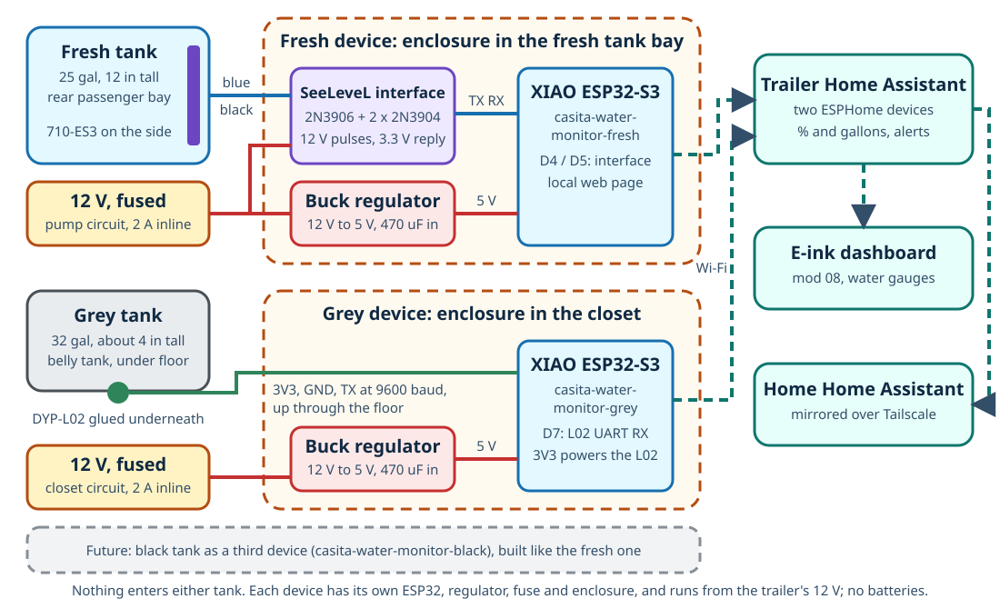
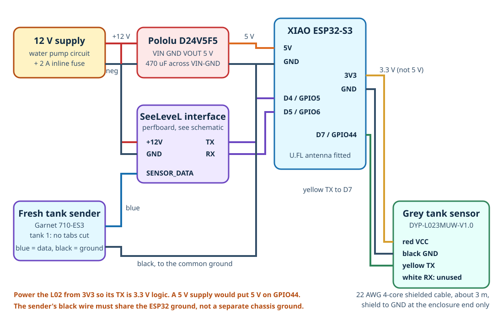
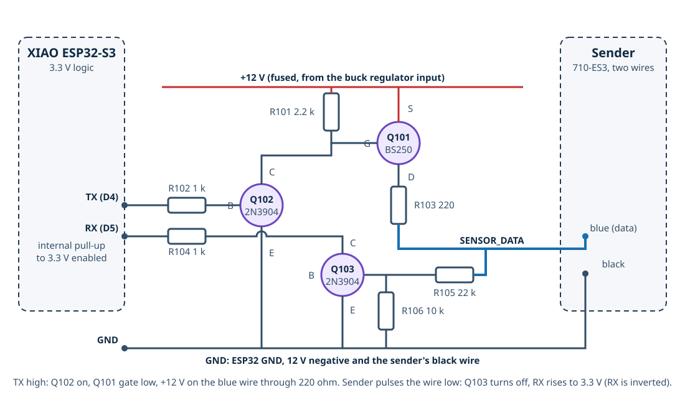

# Water Tank Monitor to Home Assistant (SeeLeveL sender + DYP L02 + XIAO ESP32-S3)

Fresh and grey water tank levels in the trailer's Home Assistant, with nothing inside either tank and no batteries to replace. A Garnet SeeLeveL II **710-ES3** capacitive sender is stuck to the side of the 16 gal fresh tank, and a DYP **L02** ultrasonic sensor is glued to the underside of the 32 gal grey tank. A Seeed Studio XIAO ESP32-S3 running ESPHome reads both, powered from the trailer's 12 V water pump circuit, and publishes percent full and gallons over Wi-Fi. A local web page shows the same readings at the campsite without Home Assistant. The black tank is left for later; the wiring and firmware already have a place for it.



> [!IMPORTANT]
> **Status: designed, not built (October 2026).** The ESPHome configuration validates and compiles with ESPHome 2026.9.1 (RAM 31.5%, flash 59.3%) but has not run on hardware. Neither sensor has been tried on a Casita tank by this project. Two things decide whether it works and are checked early, before anything is glued down:
>
> 1. **Fresh tank:** the 710-ES3 needs a flat strip of tank wall 2.2 in wide by about 11 in tall, at least 2 in from any metal in front of it and 1 in from metal beside it ([Step 1](#step-1-measure-and-plan-the-sender-and-sensor-positions)).
> 2. **Grey tank:** the L02 must get an echo through the tank's bottom wall. DYP rates it for walls up to 5 mm; rotomolded tanks are usually 4.5-6 mm. The tape-and-grease test in [Step 6](#step-6-test-the-l02-on-the-grey-tank-before-gluing-it) answers this with nothing permanent done.
>
> The grey tank is only about 4 in tall, so the L02 measures over roughly 2-3.5 in of its height: good for "is it getting full", coarse near empty. See [Known limitations](#known-limitations).

**Contents:** [What to order](#what-to-order) · [Build order](#build-order) · [Why this design](#why-this-design) · [How it works](#how-it-works) · [Known limitations](#known-limitations) · [Parts](#parts) · [Tools](#tools-and-supplies) · [Wiring](#wiring) · [SeeLeveL interface](#seelevel-interface-circuit) · [Steps](#steps) · [ESPHome configuration](#esphome-configuration) · [Home Assistant setup](#home-assistant-setup) · [Calibrate](#calibrate) · [Testing](#testing-checklist) · [Troubleshooting](#troubleshooting) · [Safety](#safety-notes) · [Black tank later](#adding-the-black-tank-later)

## What to order

Two sensors, and only these models:

| Tank | Sensor | Check on arrival |
| --- | --- | --- |
| Fresh | **Garnet SeeLeveL II 710-ES3** 12 in sender, sold by RecPro as "SeeLevel 710 RV Tank Level Sensor (12")": [Amazon B0GWJR52N8](https://www.amazon.com/dp/B0GWJR52N8), about $70. Also from [Garnet direct](https://shopusa.garnetinstruments.com/solutions/holding-tanks/710-es3-710-es3-12-sender) | The board is 12.15 x 2.20 in with **9 segmented pads** and four programming tabs across the top (`2/GRY`, `3/BLK`, `4`, `TOP`). Two wires: blue and black. **Do not cut anything yet.** |
| Grey | **DYP-L023MUW-V1.0** ("DYP-L02, UART Automatic"): [Amazon B0C1GFJKMV](https://www.amazon.com/dp/B0C1GFJKMV), about $22. The listing's **Size** option must say **UART Automatic**, not UART Controlled | A 27.7 mm round puck 17 mm tall with a 450 mm lead ending in a white 4-pin 2.54 mm (XH) plug. Wire colors red, black, yellow, white. The Amazon listing does not say whether the plug's mating cable is included; the pigtails in [Parts](#parts) cover it |

Everything else is in [Parts](#parts). From earlier mods you already have the XIAO ESP32-S3, the Pololu regulator and 470 uF capacitor, the shielded 22 AWG cable, and the resistors for the interface. The three transistors (one 2N3906, two 2N3904) come from one assortment kit.

## Build order

| Step | What | Result |
| --- | --- | --- |
| 1 | Measure both tanks and pick the sensor spots | Go / no-go on fit; the sender's cut length |
| 2 | Build the SeeLeveL interface on perfboard | A board the ESP32 can drive the sender through |
| 3 | Wire the XIAO, regulator and interface on the bench; flash the firmware | Readings on the ESP32's web page |
| 4 | Bench-test the sender on a bucket of water | The sender talks and the level moves. **Go / no-go for the fresh tank** |
| 5 | Bench-test the L02 on a plastic tub of water | A height in mm that tracks the water. **Go / no-go for the L02 itself** |
| 6 | Tape the L02 under the grey tank with grease and read it | **Go / no-go for the grey tank wall.** Only now is anything permanent |
| 7 | Cut, program and stick the sender on the fresh tank | Fresh tank sensor installed |
| 8 | Glue the L02 under the grey tank, run its cable, protect it | Grey tank sensor installed |
| 9 | Mount the enclosure near the fresh tank and power it from the pump circuit | Permanent install |
| 10 | Add to Home Assistant, calibrate, set alerts | Done |

## Why this design

The requirement was fresh and grey levels in Home Assistant, powered by the trailer, with nothing inside the tanks. Options considered:

| Option | Fresh | Grey (about 4 in tall, under the floor) | Home Assistant | Verdict |
| --- | --- | --- | --- | --- |
| Mopeka Pro Check Universal (bottom-mount ultrasonic) | Yes | Yes; one Casita owner reports 6+ months without trouble | Native Bluetooth integration | Simplest, but coin cells, and HA receives propane-scaled millimeters that need rescaling for water |
| Garnet SeeLeveL senders + 709-BTP3 Bluetooth display | Yes | Only if a flat side wall exists; a 4 in tank leaves little | Community integration (danTapps/garnet) | A proven RV product, but $150+ for the display and no side-wall certainty on the grey tank |
| Capacitive point switches (XKC-Y25) on the grey tank side | | 2-3 steps only | GPIO | Fallback if the L02 fails: cheap and robust, no percentage |
| **SeeLeveL 710-ES3 on the fresh tank, driven by the ESP32 directly** | **Yes** | | **ESPHome component (j9brown/esphome-seelevel) + a 3-transistor interface** | **Chosen.** The sender is the RV industry's standard external strip, 12 V, 0.33 in resolution; the interface is a few cents of parts |
| **DYP L02 under the grey tank** | | **Yes if the wall passes the echo test.** Specified for 0.6-5 mm non-foamed plastic, 2 cm dead zone, water-based liquids | **ESPHome's built-in `ds1603l` platform reads its frame directly** | **Chosen.** Wired, continuous, 1 mm resolution, no custom code |

The 710-ES3 and the L02 come from different worlds: one is a Garnet RV part with a proprietary protocol that the community has reverse-engineered, the other is an OEM module from DYP (Shenzhen Dianyingpu) meant for product designers. Both are read by one XIAO. The firmware names its entities so the [e-ink dashboard (mod 08)](../08-eink-dashboard/README.md) shows the water gauges without any change.

## How It Works

**Fresh tank (SeeLeveL).** The sender is a flexible circuit board with a column of copper pads, stuck to the outside of the tank. Each pad and the water behind the wall form a capacitor; the sender measures each pad's capacitance and reports ten values, 0 (air) to 255 (water), to whatever polls it. The ESP32 polls it through the [interface circuit](#seelevel-interface-circuit): it puts 12 V on the sender's blue wire for 1.5 ms (which powers the sender), sends one short low pulse to address tank 1, then counts the sender's reply pulses. The `seelevel` component turns the ten values into a level in segments (0 to the number of pads kept), and the firmware turns that into percent and gallons. A poll takes about 15 ms; the sender is unpowered in between.

**Grey tank (L02).** The L02 sits against the underside of the tank with a film of couplant between its face and the plastic. Once a second it fires a 2 MHz ultrasonic pulse up through the wall and the water and times the echo from the water surface, then sends the height in millimeters as a 4-byte serial frame (`FF`, high byte, low byte, checksum) at 9600 baud. ESPHome's `ds1603l` sensor platform, written for DYP's DS1603L which uses the identical frame, parses it. Percent = height / **Grey Tank Full Level**, a calibration number stored on the ESP32 and set from the [calibration fill](#calibrate) or with the **Grey Tank Mark Full** button. Below the sensor's dead zone (about 2-4 cm of water, depending on the wall) the sensor reports 0, which the firmware shows as 0%.

**Power.** Fused 12 V from the water pump circuit feeds a 2 A inline fuse, the 470 uF capacitor and the Pololu 5 V regulator, which powers the XIAO; the XIAO's 3.3 V pin powers the L02 (so its serial output is 3.3 V, safe for the ESP32). The interface takes 12 V directly, since that is what the sender needs.

## Known Limitations

- **The grey tank is shallow, and the L02 cannot see the bottom 2-4 cm.** On a tank about 4 in (100 mm) tall outside, perhaps 90 mm inside, the measurable range is roughly 30-90 mm: the top two thirds. Below that the sensor reports 0 and Home Assistant shows 0%. That is fine for the question that matters (is it nearly full?) and useless for "is it completely empty?". The volume sensor is a straight line from 0 to 32 gal over the full height, so it reads low in the dead zone.
- **The grey tank wall may be too thick.** DYP's limit is 5 mm; the tank is probably 4.5-6 mm. Step 6 tests it. If the sensor reads 0 with water above it and the LED stays solid, the wall is too thick or too textured for this sensor and the fallback is capacitive point switches on the tank side (see [Why this design](#why-this-design)).
- **Sloshing and slope.** Both sensors read the water where they are. The L02 is unreliable while the trailer moves; the firmware's median filter smooths it, but trust readings when parked. If the trailer is not level, a wide, shallow grey tank reads quite differently at opposite ends. Park level before judging.
- **The fresh sender's percentage is an estimate.** The `seelevel` component interpolates between pads using its own algorithm, not Garnet's; another user saw a 33% reading on a full shallow tank until the segment count was set correctly. The [calibration fill](#calibrate) checks it. Resolution is one pad, 1.33 in, about 1.5 gal on this tank, with interpolation between.
- **Metal near the sender reads as water.** Keep steel, aluminum and copper 2 in from the sender's face and 1 in from its edges; check again with doors and covers closed.
- **One shot at sticking the sender.** Its 3M 300LSE adhesive does not survive removal, so the taped trial in Step 7 is the time to find problems.
- **Polyethylene is hard to glue.** Epoxy, CA and most tapes peel off it. The L02 mount uses 3M 300LSE tape (the same adhesive Garnet uses on the sender, made for low-energy plastics) with a polyolefin primer; see Step 8.
- **Always on.** About 40-80 mA for the XIAO on Wi-Fi, 1-2 Ah per day. The pump circuit is a reasonable place because the trailer's 12 V master (when there is one) and the WFCO fuse both cut it for storage. If the pump switch itself cuts the circuit, see Step 9.
- **Temperature.** The sender is rated 0 to 60 degC and will not bond below 15 degC; the L02 is rated -15 to 60 degC. Winter readings from the belly tank may stop below about -15 degC.
- **Away from home** the Home Assistant connection needs a network path, the same as the battery monitor: see [mod 04](../04-battery-monitor-esp32/README.md#reading-the-battery-away-from-home).

## Parts

| Component | Qty | Notes | Purchase link |
| --- | ---: | --- | --- |
| Garnet SeeLeveL II 710-ES3 sender, 12 in | 1 | Fresh tank. See [What to order](#what-to-order) | [Amazon B0GWJR52N8](https://www.amazon.com/dp/B0GWJR52N8) |
| DYP-L023MUW-V1.0 (L02, UART Automatic) | 1 | Grey tank. See [What to order](#what-to-order) | [Amazon B0C1GFJKMV](https://www.amazon.com/dp/B0C1GFJKMV) |
| Seeed Studio XIAO ESP32-S3 | 1 | **On hand.** Plain board, with its U.FL antenna | [Seeed](https://www.seeedstudio.com/XIAO-ESP32S3-p-5627.html) |
| Pololu D24V5F5 12 V to 5 V regulator | 1 | **On hand** | [Pololu](https://www.pololu.com/product/2843) |
| 470 uF 25 V electrolytic capacitor | 1 | **On hand.** Across the regulator input | |
| 2N3906 PNP transistor (TO-92) | 1 | Interface Q101, the high-side switch. 2N2907, S8550 or BC557 substitute (BC557 pin order is C-B-E, reversed). Comes in the kit below | [Amazon: MOKMMKIT 32-value TO-92 assortment, B0DGT7RTZC](https://www.amazon.com/dp/B0DGT7RTZC) |
| 2N3904 NPN transistor (TO-92) | 2 | Interface Q102, Q103. 2N2222, S8050 or BC547 substitute (BC547 pin order is C-B-E, reversed). Same kit | (same kit) |
| Resistors, 1/4 W: 2.2 k x2, 1 k x2, 220, 22 k, 10 k | 7 | **On hand.** Interface R101-R107 | |
| Perfboard, about 30 x 40 mm, and a 5-pin screw terminal or header | 1 | For the interface | [Amazon: perfboard assortment](https://www.amazon.com/dp/B07ZYNWJ1S) |
| 4-conductor shielded cable, 22 AWG | about 4 m | **On hand** (25 ft roll from mod 07). About 3 m to the grey tank, 1 m to the sender | |
| JST-XH 2.54 mm 4-pin pigtails | 1 pack | Mates with the L02's plug; the joint to the long cable is the disconnect point at the tank. **Confirm the plug on the first sensor**: if it is the smaller 1.25 mm type, use the mod 07 pigtails instead | [Amazon search: JST XH 2.54 mm 4-pin pigtail](https://www.amazon.com/s?k=JST+XH+2.54mm+4+pin+connector+pigtail+cable) |
| Inline ATO/ATC fuse holder and 2 A fuses | 1 | On the 12 V tap | [Amazon: 14 AWG waterproof holders, 4 pack](https://www.amazon.com/dp/B0F6T8X81M) and [Amazon: Bussmann 2 A ATC, 5 pack](https://www.amazon.com/dp/B008QDH9VQ) |
| Small ABS enclosure, about 83 x 58 x 33 mm | 1 | XIAO, regulator and interface | [Amazon: IP65, 2 pack](https://www.amazon.com/dp/B0FDQCHNQP) |
| Silicone dielectric grease | 1 | Couplant for the L02 (test and final). Not DYP's water-based gel, which dries | [Amazon: Permatex 22058](https://www.amazon.com/dp/B000AL8VD2) |
| 3M 9495LE double-sided tape (300LSE adhesive) | 1 roll | Holds the L02 to the polyethylene tank; the same adhesive family as the sender's backing | [Amazon search: 3M 9495LE](https://www.amazon.com/s?k=3M+9495LE+300LSE+tape) |
| 3M Primer 94 or Loctite polyolefin primer | 1 | Pre-treats the polyethylene so the tape bonds | [Amazon search: 3M Primer 94](https://www.amazon.com/s?k=3M+Primer+94+adhesion+promoter) |
| Rubberized undercoating | 1 can | Over the L02, its cable joint and the sender if road spray can reach them. Garnet names 3M 03584 | [Amazon search: 3M 03584](https://www.amazon.com/s?k=3M+03584+rubberized+undercoating) |
| Adhesive-lined heat-shrink, zip ties, painter's tape, Gorilla tape | | | [Amazon: heat-shrink kit](https://www.amazon.com/dp/B0DC5YN5CD) |
| 18-20 AWG red and black wire, crimp butt splices | | 12 V tap to the enclosure | |
| Cable gland (PG7) or grommet | 1-2 | Where the L02 cable goes through the floor and into the enclosure | [Amazon: PG7 glands](https://www.amazon.com/dp/B0CTCG4HMM) |

Prices seen 2026-10-14: sender about $70, L02 $22, the rest $5-15 each. Links marked "search" were not checked against a specific listing; pick the genuine 3M part. About **$150** for what is not already on hand.

## Tools and Supplies

- Fine-tip soldering iron, solder, flux; wire strippers; crimper for butt splices
- Multimeter with continuity and a 10 A current range
- Isopropyl alcohol (99%) and lint-free cloths; 220-grit sandpaper
- Heat gun or hair dryer (the sender's adhesive needs the tank above 15 degC / 60 degF)
- Tape measure, straightedge, marker; scissors or a hole punch for the sender's tabs
- A plastic bucket and a flat-bottomed plastic tub (storage box) for the bench tests; a 1 gal jug for calibration
- USB-C cable for the first flash

## Wiring



| From | To | Notes |
| --- | --- | --- |
| Water pump 12 V positive (upstream of the pump switch; see Step 9) | 2 A inline fuse, then regulator `VIN` and interface `+12V` | 18-20 AWG. The 470 uF capacitor sits across `VIN` and `GND` at the regulator |
| 12 V negative (the pump's negative, or the chassis ground stud it goes to) | Regulator `GND`, XIAO `GND`, interface `GND` | One ground point in the enclosure; everything joins there |
| Regulator `VOUT` (5 V) | XIAO `5V` pin | |
| XIAO `D4` (GPIO5) | Interface `TX` | ESP32 output that drives the sender |
| XIAO `D5` (GPIO6) | Interface `RX` | ESP32 input, internal pull-up enabled in the firmware |
| Interface `SENSOR_DATA` | Sender **blue** wire | |
| Interface `GND` | Sender **black** wire | The sender must share the ESP32's ground |
| XIAO `3V3` | L02 **red** (`VCC`) | **3.3 V, not 5 V**, so the L02's serial output is 3.3 V |
| XIAO `GND` | L02 **black** (`GND`) and the cable shield (enclosure end only) | |
| XIAO `D7` (GPIO44) | L02 **yellow** (`TX`) | ESP32 receives the frames |
| (nothing) | L02 **white** (`RX`) | Not used by the UART-auto model; fold back and insulate |

L02 lead colors are from DYP's datasheet photo (red, black, yellow, white, top to bottom on the housing). Confirm against the label or by measuring: red reads 0 ohm to nothing else, black is common with the housing's ESD shell. `D2` (GPIO3) is avoided because it is an ESP32-S3 strapping pin.

### Where things go

- **Enclosure:** inside the trailer, in or beside the fresh tank bay (rear passenger side), where the pump's 12 V is at hand. Keep it above any possible water on the floor of the bay.
- **Sender:** on the fresh tank's side, [Step 7](#step-7-cut-program-and-stick-the-sender-on-the-fresh-tank). Its two wires run to the enclosure.
- **L02:** under the grey tank, [Step 8](#step-8-glue-the-l02-under-the-grey-tank). Its cable comes up through the floor near the tank (an existing drain or vent penetration, or a new sealed gland) and runs to the enclosure.

## SeeLeveL interface circuit



This is [j9brown's interface](https://github.com/j9brown/esphome-seelevel/tree/main/seelevel-interface) (CERN-OHL-W), built on perfboard, with one change: the high-side switch is a **2N3906 PNP transistor** instead of the original BS250 P-channel MOSFET, because the BS250 is hard to buy in small quantities while the 2N3906 is in every TO-92 assortment kit. The sender wants 12 V pulses on its blue wire and answers with short pulls to ground on the same wire; the ESP32 only has 3.3 V pins, so:

- **Transmit:** `TX` high turns on Q102 (2N3904), which pulls current out of the base of Q101 (2N3906, PNP) through R107 (2.2 k); R101 (2.2 k) from base to +12 V holds Q101 off otherwise. Q101's emitter is on +12 V and its collector connects, through R103 (220 ohm), to the blue wire. So `TX` high puts about 11.8 V on the blue wire (the sender accepts 9-15 V); `TX` low releases it. About 5 mA of base drive saturates the 2N3906 for the sender's 55 mA maximum, and it switches in well under a microsecond, fast enough for the 85 us addressing pulses.
- **Receive:** the blue wire feeds the base of Q103 (2N3904) through R105 (22 k) with R106 (10 k) to ground. While the sender is powered the wire is high, Q103 is on and `RX` reads low. When the sender pulls the wire low, Q103 turns off and `RX` is pulled up to 3.3 V by the ESP32's internal pull-up. The ESP32 never sees 12 V, and the reply is inverted, which the component expects.

If you do have a BS250 (or any P-channel MOSFET rated 30 V or more), j9brown's original works unchanged: source to +12 V, gate to the R101/Q102 node (omit R107), drain to R103. Check the pin order on its datasheet; it varies between makers.

Build it with the five connections brought out to a header or terminal: `+12V`, `GND`, `TX`, `RX`, `SENSOR_DATA`. Before connecting it to anything, check with the meter that `SENSOR_DATA` is open to `+12V` (Q101 off) and that `RX` to `GND` is tens of kilohms, not a short.

## Steps

### Step 1: Measure and plan the sender and sensor positions

**Fresh tank.** The tank is 12 in tall (measured). Record:

| Measurement | Value | Why |
| --- | ---: | --- |
| Wall height, outside, where the sender will go | 12 in | Sets the sender length |
| Flat area available: at least 2.2 in wide, from 1/2 in below the top edge to 1/2 in above the bottom edge | | The sender must not wrap over a corner or sit on a rounded edge |
| Height of the pump's suction outlet above the tank bottom | | The sender's bottom must be at least 1 in above it, so the sender reads 0 before the pump sucks air |
| Distance from the chosen spot to the nearest metal: in front (2 in minimum) and beside (1 in minimum) | | Metal reads as water |
| Route for the two wires: they must leave the sender's top **upward or to the right**, never draped across it | | Garnet's rule |

With 1/2 in gaps top and bottom the measurable height is 11 in. The 710-ES3 is 12.15 in long with 9 pads, so **it must be cut**: one pad off the bottom leaves 8 pads, about 10.8 in, which Garnet's silkscreen marks as the "11-12.5 in tank" line. The cut is made in Step 7, after the bench test, on the line printed on the sender; confirm the line's label against the tank height before cutting.

**Grey tank.** Nobody has published its dimensions; a Casita owner measured one at about 4 in tall. Record:

| Measurement | Value | Why |
| --- | ---: | --- |
| Tank height, outside | | Sets the expected full level (about height minus 2 x wall thickness) |
| Wall thickness, if any edge, fitting or the drain let you gauge it (calipers at the drain fitting lip, or compare the outside height with a probe through the drain) | | DYP's limit is 5 mm. Over that, expect the echo test to fail |
| A flat, smooth, horizontal spot on the bottom, at least 40 mm across, **away from the drain end** (it collects sludge) and from any supporting angle iron or strap, where the tank is supported (not a sagging unsupported span) | | The sensor must sit flat with no air gap and the surface must not flex |
| Is the tank bottom sloped toward the drain? By how much? | | A sloped tank reads differently at each end; a middle spot is the best compromise |
| Cable route from that spot to a floor penetration and on to the enclosure | | About 3 m of cable is on hand |

Photograph both tanks and put the photos in `photos/`.

### Step 2: Build the SeeLeveL interface

1. Lay out the [schematic](#seelevel-interface-circuit) on perfboard. All three transistors are TO-92 with the same pinout, flat face toward you, legs down: **E, B, C** left to right (2N3906 and 2N3904 alike). Check the kit's datasheet card anyway.
2. Solder R101-R107 and the three transistors; bring `+12V`, `GND`, `TX`, `RX` and `SENSOR_DATA` to a header.
3. Check: `+12V` to `SENSOR_DATA` open in one direction, a diode drop plus 220 ohm the other way (Q101's collector-base junction); `SENSOR_DATA` to `GND` about 32 k (R105 + R106); `RX` to `GND` open; `TX` to `GND` about 1 k plus a diode drop (through R102 and Q102's base).

### Step 3: Bench-wire the XIAO and flash the firmware

1. Solder the XIAO's U.FL antenna on and plug the antenna in. Solder or header the XIAO to the perfboard or a second small board: `5V`, `GND`, `3V3`, `D4`, `D5`, `D7`.
2. Wire the regulator: 12 V bench supply (or the trailer battery through the 2 A fuse) to `VIN` and `GND` with the 470 uF capacitor across them; `VOUT` to the XIAO `5V`; grounds together. Wire the interface's `+12V` to the regulator's `VIN` side, its `GND` to the common ground, `TX` to `D4`, `RX` to `D5`. Leave `SENSOR_DATA` unconnected for now.
3. Check with the meter before powering: no short between `+12V` and `GND`, nor between `5V` and `GND`.
4. Put the firmware in place: in the trailer's Home Assistant open **Settings > Add-ons > ESPHome Device Builder** (or **ESPHome** in the sidebar), **New device**, name it `casita-water-monitor`, then replace the generated YAML with [`esphome/casita-water-monitor.yaml`](esphome/casita-water-monitor.yaml). Add the entries from [`esphome/secrets.example.yaml`](esphome/secrets.example.yaml) to the Device Builder's `secrets.yaml` with real values (the trailer Wi-Fi, a new API key from `openssl rand -base64 32`, passwords).
5. Connect the XIAO by USB-C to the computer running the browser, **Install > Plug into this computer** and flash. (After this first flash, installs are wireless.) The XIAO joins the trailer Wi-Fi; give it a DHCP reservation in the travel router.
6. Open **Logs**. Expect: `seelevel` reporting a sanity error or no reply (nothing is connected yet), the L02 UART silent, and after 30 s `No frame from the L02 for 30 s`. Open `http://casita-water-monitor.local` (or its IP) and log in: every entity is listed.

### Step 4: Bench-test the sender on a bucket

1. With everything unpowered, connect the sender: blue to `SENSOR_DATA`, black to `GND`.
2. Tape the sender vertically to the outside of a plastic bucket, pads facing the bucket, wires at the top going up. Painter's tape along both long edges, pressed flat, no air gaps.
3. Power up and open the logs. Within 30 s the component polls tank 1. Expect `Fresh Tank Segment Data` like `255,0,0,0,0,0,0,0,0,0` with the bucket empty (the single 255 is the pad that will be cut off; it reports 255 because there is no electrode).
4. Fill the bucket in steps. Segment values from the bottom should rise toward 255 as the water passes each pad, and `Fresh Tank Level` should climb. If nothing changes, see [Troubleshooting](#troubleshooting).
5. Note the values with the bucket full to the top of the sender; they are the "water" reference for later.

If the sender never answers, stop here and fix the interface before touching the tank.

### Step 5: Bench-test the L02 on a plastic tub

1. Unpowered, connect the L02 through a pigtail: red to XIAO `3V3`, black to `GND`, yellow to `D7`. Insulate the white lead.
2. Smear a thin layer of silicone grease on the sensor's flat face and press it against the **underside** of an empty flat-bottomed plastic storage tub (1-3 mm wall; a thin tub is the easy case). Tape it in place.
3. Power up. The L02's LED stays solid with no liquid. The logs show `Grey Tank Level` readings of 0 (the firmware treats 0 as no echo).
4. Add water to about 60 mm deep. The LED should blink at 1 Hz and the level should read close to the real depth (expect within about 5 mm). Add and remove water; the reading should follow within a couple of seconds (the median filter adds a few).
5. Press **Grey Tank Mark Full** on the web page with a known depth and check that **Grey Tank** reads 100% and tracks lower as you remove water.

A sensor that fails this test on a thin tub is defective or miswired; return it rather than try it on the trailer.

### Step 6: Test the L02 on the grey tank before gluing it

This is the decisive test. Nothing here is permanent.

1. Dump the grey tank, then put a known amount of water in through the sink: about 10 gal (that should be 25-30 mm deep in a tank this size, above the dead zone). Park level.
2. Under the trailer, clean the chosen spot (Step 1) with alcohol. Grease the sensor face and press it up against the tank; hold it with a strip of Gorilla tape across the sensor and onto the tank, or a stick wedged against the ground. It must be flat against the plastic with no air gap.
3. Run the sensor's lead to the XIAO on a long bench lead, or temporarily bring the whole bench setup under the trailer on a 12 V supply.
4. Read `Grey Tank Level`. **Pass:** a steady, non-zero value that changes when you add 5 more gallons. **Fail:** 0 with the LED solid, or wildly varying values.
5. If it fails, try one more spot (thinner-looking, smoother, better supported), and try more grease pressed harder. If it still fails, the wall is beyond this sensor: stop, and use the capacitive-switch fallback for the grey tank instead of gluing anything.
6. If it passes, note the reading and the gallons in; that is the first calibration point.

### Step 7: Cut, program and stick the sender on the fresh tank

Garnet's rules, condensed. The adhesive is single-use: do the taped trial first.

1. **Cut.** Cutting from the bottom (the wires are at the top), cut straight across on the printed line that leaves **8 pads** ("11-12.5 in tank"). Cut only between pads, never through one. Three pads is the minimum; do not go below.
2. **Program.** Tank 1 (fresh) is the default: **cut no tabs**. Leave `2/GRY`, `3/BLK`, `4` and `TOP` intact.
3. **Prepare the surface.** The tank wall must be clean, dry, smooth and above 15 degC (60 degF). Wipe with alcohol; sand lightly with 220 grit if textured; warm with a heat gun in cold weather.
4. **Place.** Hold the sender against the wall with its top 1/2 in below the tank's top edge and its bottom 1/2 in above the bottom edge (both at least 1/4 in, no more than 1 in), on the flat area from Step 1, with the wires exiting at the top going up or to the right. Keep 2 in from metal in front, 1 in beside. Tape along both long edges with painter's tape, pressed so there are no air gaps under the pads.
5. **Trial.** Connect blue and black to the interface and power up. With the tank at least a quarter full, `Fresh Tank Level` should show a sensible fraction and the bottom segments should read high. Fill a little and watch it move. Fix anything now.
6. **Stick.** Remove the tape on one edge, fold the sender back, peel the backing off that half, fold it down and press it onto the wall from the center out so every bit of adhesive touches, no bubbles. Remove the other tape, peel and press the other half. Press the whole sender firmly once more.
7. **Secure the wires.** A strip of Gorilla tape across the top edge over the wire exit, then zip ties along the route, so no pull on the wires ever reaches the sender. Butt-splice or solder and heat-shrink the sender's wires to a 22 AWG pair (or two conductors of the shielded cable) to the enclosure.
8. If the sender is anywhere road spray can reach, two coats of rubberized undercoating after the adhesive has set for a day.

### Step 8: Glue the L02 under the grey tank

Polyethylene rejects most adhesives, so this uses 3M 300LSE tape with a primer, the way Garnet's sender is stuck to the same plastic, with grease as the couplant in a pocket in the tape. Epoxy around the ring is a backup, not the main bond.

1. Dump the tank and park level. Clean the spot from Step 6 with alcohol; sand lightly with 220 grit if textured; wipe again; dry.
2. Cut a ring of 9495LE tape: a piece about 40 x 40 mm with a 24 mm hole punched or cut in the middle (the sensor face is 27.7 mm; the hole must be smaller than the sensor so the tape grips the sensor's rim, and large enough to leave a grease pocket under most of the face). Two layers of tape if the sensor's face is recessed below its rim.
3. Apply primer to the tank spot and to the sensor's rim per the primer's instructions (Primer 94: wipe on, let flash 5 minutes).
4. Stick the tape ring to the tank, press firmly for 30 s. Fill the hole with silicone grease, slightly proud.
5. Peel the tape's other liner, press the sensor up into the grease so the face seats on the plastic and the rim lands on the tape. Hold with firm pressure for a minute. Grease should squeeze out all around; wipe the excess.
6. Optional extra hold: a bead of polyurethane sealant (Sikaflex 221 or 3M 5200) around the sensor's edge, onto the primed tank. Do not get sealant under the face.
7. Plug the sensor into its pigtail, splice the pigtail to the shielded cable (solder and adhesive-lined heat-shrink each conductor, then heat-shrink over the whole joint), and zip-tie the cable to the tank's support frame with a drip loop, so no pull reaches the sensor.
8. Route the cable up through the floor (existing penetration if one is near; otherwise a PG7 gland in a new hole, sealed) and on to the enclosure. Ground the shield at the enclosure end only.
9. After 24 h, two coats of rubberized undercoating over the sensor, the tape, the joint and the first inches of cable.
10. Leave the tank empty for 24 h before the first fill so the tape cures.

### Step 9: Mount the enclosure and power it from the pump circuit

1. **Find the pump's feed.** In the fresh tank bay, find the pump's positive wire. With the pump switch **off**, measure it to ground. If it is still at 12 V, the switch is on the pump's other side (or elsewhere) and you can tap here. If it reads 0 V, the switch is upstream: follow the wire back to the switch and tap on the switch's supply side, or instead use a spare position in the WFCO 12 V fuse panel (under the seat by the sink) and run 18 AWG back.
2. Fit the enclosure: XIAO, regulator with the capacitor, and the interface board, with the U.FL antenna against the inside of the lid. Glands or grommets for the three cables (12 V in, sender, L02).
3. Tap the 12 V: butt-splice or a piggyback crimp on the positive, then the **2 A inline fuse** within 150 mm of the tap, then 18-20 AWG to the enclosure. Negative from the pump's negative or the same chassis ground stud.
4. Connect everything per [Wiring](#wiring). Check with the meter before applying power: no short `+12V` to `GND`, `5V` to `GND`, or `3V3` to `GND`.
5. Power up. Logs should show the sender answering every 30 s and the L02 streaming once a second. Mount the enclosure with screws or VHB where it cannot get wet or be kicked.
6. Measure the current draw on the 12 V tap: expect 50-100 mA.

### Step 10: Add to Home Assistant, calibrate, set alerts

See [Home Assistant setup](#home-assistant-setup) and [Calibrate](#calibrate).

## ESPHome Configuration

The configuration is [`esphome/casita-water-monitor.yaml`](esphome/casita-water-monitor.yaml). It uses ESPHome's built-in `uart` and `ds1603l` components for the L02 and the external [`seelevel`](https://github.com/j9brown/esphome-seelevel) component (MIT) for the sender, fetched from GitHub at compile time.

| Substitution | Default | Meaning |
| --- | --- | --- |
| `fresh_segments` | `8` | Pads left on the sender after cutting. Must match the sender |
| `fresh_update_interval` | `30s` | How often the sender is polled |
| `seelevel_tx_pin`, `seelevel_rx_pin` | `GPIO5`, `GPIO6` | XIAO `D4`, `D5` |
| `grey_full_level_mm` | `"90"` | Starting value of **Grey Tank Full Level**; replaced by calibration (stored in flash) |
| `grey_capacity_gal` | `"32"` | Grey tank capacity for the volume sensor |
| `l02_rx_pin` | `GPIO44` | XIAO `D7` |

The fresh volume map (`level 8.0 = 16 gal`) is written out in the sensor because the component wants real numbers there; keep it in step with `fresh_segments` and the tank size.

What the firmware does beyond the components:

- **Fresh Tank** (%) = level / `fresh_segments` x 100, clamped 0-100.
- **Grey Tank Level** is median-filtered (window 7, one output every 5 readings), so a reading settles in about 5 s. **Grey Tank** (%) = level / **Grey Tank Full Level** x 100, clamped. **Grey Tank Volume** = % x 32 gal.
- **Grey Tank Mark Full** copies the current level into **Grey Tank Full Level**. The number is saved to flash within a minute.
- **Grey Tank Sensor Online** goes off, and the grey readings become unknown, if no valid frame arrives for 30 s.
- **Fresh Tank Segment Data** (diagnostic) shows the ten raw values, top to bottom, for calibration and troubleshooting.

Validation on bee2 with ESPHome 2026.9.1 (esp-idf 5.5.5) on 2026-10-14: `esphome config` passed and `esphome compile` succeeded (RAM 31.5%, flash 59.3%). This proves only that the configuration builds.

### Secrets

The configuration references `api_encryption_key`, `ota_password`, `wifi_ssid`, `wifi_password`, `fallback_ap_password`, `web_username` and `web_password`. Copy [`esphome/secrets.example.yaml`](esphome/secrets.example.yaml) into the Device Builder's `secrets.yaml` and replace every placeholder (the trailer's existing `secrets.yaml` from mod 04 already has most of them; add any missing). Generate a new API key with `openssl rand -base64 32`.

## Home Assistant Setup

The device belongs in the trailer's Home Assistant, like the battery monitor.

1. After Step 3, **Settings > Devices & services** should show **Casita Water Monitor** as a discovered ESPHome device. **Add**, and enter the API encryption key if asked. If it is not discovered, **Add integration > ESPHome** and enter the XIAO's reserved address, port 6053.
2. Check the entity IDs on the device page against the table below. The e-ink dashboard looks for the first two by exact name.

### Entities

| Entity name | Entity ID | Unit | Notes |
| --- | --- | --- | --- |
| Fresh Tank | `sensor.casita_water_monitor_fresh_tank` | % | **Used by mod 08** |
| Grey Tank | `sensor.casita_water_monitor_grey_tank` | % | **Used by mod 08** |
| Fresh Tank Volume | `sensor.casita_water_monitor_fresh_tank_volume` | gal | |
| Grey Tank Volume | `sensor.casita_water_monitor_grey_tank_volume` | gal | |
| Fresh Tank Level | `sensor.casita_water_monitor_fresh_tank_level` | seg | Diagnostic, 0 to 8 |
| Grey Tank Level | `sensor.casita_water_monitor_grey_tank_level` | mm | Diagnostic |
| Fresh Tank Segment Data | `text_sensor.casita_water_monitor_fresh_tank_segment_data` | | Diagnostic |
| Grey Tank Full Level | `number.casita_water_monitor_grey_tank_full_level` | mm | Configuration |
| Grey Tank Mark Full | `button.casita_water_monitor_grey_tank_mark_full` | | Configuration |
| Grey Tank Sensor Online | `binary_sensor.casita_water_monitor_grey_tank_sensor_online` | | Diagnostic |
| Wi-Fi Signal, Uptime, IP Address, Restart | diagnostic entities | | |

### Dashboard card

```yaml
type: vertical-stack
cards:
  - type: horizontal-stack
    cards:
      - type: gauge
        entity: sensor.casita_water_monitor_fresh_tank
        name: Fresh
        min: 0
        max: 100
        severity:
          red: 0
          yellow: 25
          green: 50
      - type: gauge
        entity: sensor.casita_water_monitor_grey_tank
        name: Grey
        min: 0
        max: 100
        severity:
          green: 0
          yellow: 60
          red: 80
  - type: entities
    entities:
      - entity: sensor.casita_water_monitor_fresh_tank_volume
      - entity: sensor.casita_water_monitor_grey_tank_volume
      - entity: binary_sensor.casita_water_monitor_grey_tank_sensor_online
```

### Alerts

Replace `notify.mobile_app_your_phone` with your phone's notify service.

```yaml
alias: Casita grey tank nearly full
triggers:
  - trigger: numeric_state
    entity_id: sensor.casita_water_monitor_grey_tank
    above: 80
    for: "00:02:00"
actions:
  - action: notify.mobile_app_your_phone
    data:
      title: Casita grey tank
      message: >-
        Grey tank at {{ states('sensor.casita_water_monitor_grey_tank') }}%
        ({{ states('sensor.casita_water_monitor_grey_tank_volume') }} gal). Dump soon.
mode: single
```

```yaml
alias: Casita fresh water low
triggers:
  - trigger: numeric_state
    entity_id: sensor.casita_water_monitor_fresh_tank
    below: 20
    for: "00:05:00"
actions:
  - action: notify.mobile_app_your_phone
    data:
      title: Casita fresh water low
      message: >-
        Fresh tank at {{ states('sensor.casita_water_monitor_fresh_tank') }}%
        ({{ states('sensor.casita_water_monitor_fresh_tank_volume') }} gal).
mode: single
```

### Mirroring to the home Home Assistant

The same Remote Home Assistant link used for the battery monitor carries these entities; add `sensor.casita_water_monitor_fresh_tank`, `sensor.casita_water_monitor_grey_tank` and the two volume sensors to the included entities and to the **Casita RV** page. See [mod 04](../04-battery-monitor-esp32/README.md#mirroring-to-the-home-home-assistant).

## Calibrate

Park level for all of this.

**Fresh tank.** Drain the tank, then fill it with the hose in measured steps (a 1 gal jug, or time the hose against a bucket). At each step record gallons in, **Fresh Tank Level** and the segment data.

- Level should reach about 8.0 with the tank full and 0 with it empty. If full reads well under 8, a pad is probably above the water line (check the 1/2 in top gap and the tank's true inside height) or `fresh_segments` is wrong.
- If the gallons-vs-level points are not a straight line (a tank with a sloped bottom or a dome), add intermediate points to the volume `map` in the YAML, for example `level 2.0 = 3 gal`, and reinstall.

**Grey tank.** After dumping, with the tank empty, **Grey Tank Level** should read 0 (below the dead zone). Then add water through the sink in 5 gal steps and record **Grey Tank Level** each time. From two points above the dead zone, compute millimeters per gallon; then:

`Grey Tank Full Level (mm) = 32 gal x (mm per gal)`, adjusted by the intercept if the line does not pass through zero (the first few gallons fill the tank's low spots).

Enter that into **Grey Tank Full Level**. Alternatively, keep filling while watching the shower drain and press **Grey Tank Mark Full** the moment water appears in the shower pan; that defines 100% as "about to back up", which is the practical meaning. Dump afterwards.

Repeat the grey calibration once after the first trip, since a belly tank's shape under load can differ from the empty tank's.

## Testing Checklist

1. Interface board: `+12V` to `SENSOR_DATA` open; `SENSOR_DATA` to `GND` about 32 k.
2. Sender on a bucket: segment values rise from the bottom as water passes each pad; level climbs.
3. L02 on a thin tub: level within 5 mm of a ruler; LED blinks with liquid, solid without.
4. L02 taped under the grey tank with 10 gal in: steady non-zero reading that rises with 5 more gallons.
5. Sender taped on the fresh tank, tank a quarter full: bottom segments high, level sensible, moves with filling.
6. After sticking: same readings as taped. After 24 h: unchanged.
7. Enclosure powered from the pump circuit with the pump switch off and on: readings continue; current draw 50-100 mA.
8. Home Assistant shows all entities; the e-ink dashboard's water gauges fill in on its next refresh.
9. Fresh calibration: empty reads 0, full reads about 8.0 (100%).
10. Grey calibration: **Grey Tank Full Level** set from a measured fill; 32 gal reads about 100%.
11. After the first tow: both sensors still read; **Grey Tank Sensor Online** on; undercoating intact.

## Troubleshooting

| Symptom | Likely cause | Fix |
| --- | --- | --- |
| Log: `interface is malfunctioning: RX is low while TX is low` | `RX` is being pulled low with the sender unpowered: Q103 wired wrong, or `RX` shorted to ground | Check Q103 pinout (E-B-C) and R104 |
| Log: `sensor wiring short-circuits to ground` | After TX goes high, `RX` is still high: the blue wire is not reaching 12 V. Q101/Q102 wiring, no +12 V on the interface, blue shorted to ground, or a 2N3904 fitted where the 2N3906 goes | Measure `SENSOR_DATA` while polling (should pulse to ~12 V); check that Q101 is the PNP and its emitter is on +12 V |
| Sender never replies (timeout, no segment data) | Blue/black swapped, black not sharing the ESP32 ground, sender damaged, or 12 V below 9 V | Swap wires; confirm one common ground; measure `+12V` |
| Segment data all 255 | Sender powered but every pad saturated: metal behind the sender, or sender face against a wet or conductive surface | Move it; dry the wall |
| Segment data all 0 with water present | Air gap under the pads, wall too thick (over 3/8 in), or sender stuck to a corner | Re-tape flat on a flat area |
| Level reads low with the tank full | `fresh_segments` too high, or a pad sits above the water line | Count the pads kept; check the top gap |
| Level jumps while filling or reads non-zero when empty | Metal within 2 in of the face or 1 in of the edges; AC wiring bundled with the sender wires | Move the metal or the sender; reroute wires |
| `Grey Tank Sensor Online` off, no frames | L02 unpowered (3V3), yellow not on `D7`, wrong baud, or cable broken | Check 3.3 V at the sensor's red/black; check the joint; the LED must light |
| Grey level always 0, LED solid | No echo: no couplant, air gap, wall too thick or textured, water below the dead zone | Re-grease and press; try another spot; add water |
| Grey level noisy or jumping | Sloshing, the tank flexing where the sensor sits, or a poor bond | Read when parked; move to a supported spot |
| Grey level far off the ruler | Wrong **Grey Tank Full Level**, or the tank is tilted | Recalibrate on level ground |
| XIAO resets when the pump runs | Voltage sag on the shared circuit | Confirm the 470 uF is across `VIN`; if it persists, feed from a WFCO fuse instead |
| Device offline after a trip | Lost Wi-Fi: the fallback hotspot **Casita Water Fallback** appears after a minute | Join it and re-enter the trailer Wi-Fi, or check the travel router |

## Safety Notes

- The 12 V tap is fused at 2 A as close to the tap as possible; the wire from there is sized for that fuse. Never run the enclosure off the pump's 10-15 A fuse alone.
- Disconnect 12 V (pull the inline fuse) before working inside the enclosure or on the sender wires. The interface puts 12 V on the blue wire during polls.
- The L02 is powered at 3.3 V. Powering it from 5 V puts 5 V on an ESP32 pin and can destroy the XIAO.
- Working under the trailer: chock the wheels, park on firm level ground, keep clear of the drain valves.
- Undercoating and primer: ventilate, no flames, keep off the fiberglass body.
- The fresh tank is potable. Nothing in this project touches the water; keep adhesives, grease and undercoating away from the fill, vent and drain fittings.

## Adding the black tank later

The sender bus carries up to seven senders on the same two wires. For the black tank: a second sender (a 710-AR2, 9 in with 1 in pads, if the black tank is short) with the `3/BLK` tab cut, its blue and black wires joined to the fresh sender's at the enclosure, and the commented `tank: 3` block at the end of the YAML enabled with its segment count. The entity `sensor.casita_water_monitor_black_tank` then fills the e-ink dashboard's third gauge. Garnet's rule for waste tanks: bias the sender toward the top of the tank.

## Photos

Add photos to `photos/` as the build progresses:

- `fresh-tank-bay.jpg`: the tank, the chosen flat area, the pump outlet and nearby metal
- `grey-tank-underside.jpg`: the tank bottom and the sensor spot before gluing
- `interface-board.jpg`: the finished perfboard
- `sender-taped.jpg` and `sender-installed.jpg`
- `l02-taped.jpg` and `l02-installed.jpg`
- `enclosure.jpg`: inside the enclosure, wired

## References

- [Garnet SeeLeveL 709 Series manual v2.0 (Nov 2025)](https://www.garnetinstruments.com/wp-content/uploads/2025/11/SeeLeveL-709-Series-Manual-v2.0.pdf): sender cutting, tab programming, placement gaps, metal clearance, adhesion, undercoating
- [Garnet 710-ES3 product page](https://shopusa.garnetinstruments.com/solutions/holding-tanks/710-es3-710-es3-12-sender): 12.15 x 2.20 in, 9 pads, 300LSE adhesive, 0-60 degC
- [j9brown/esphome-seelevel](https://github.com/j9brown/esphome-seelevel): the ESPHome component, the interface schematic (`seelevel-interface/`), the protocol notes and the level-estimation algorithm. [Issue #3](https://github.com/j9brown/esphome-seelevel/issues/3): segment count and estimator discussion from a three-tank Airstream install
- [DYP L02 product page](https://www.dypcn.com/integrated-waterproof-ultrasonic-liquid-level-sensor-dyp-l02-product/), [datasheet](https://www.dypcn.com/uploads/L02-Datasheet1.pdf) and [output interfaces](https://www.dypcn.com/uploads/L02-Output-Interfaces.pdf): 2.8-5 V, 2-200 cm, 1 mm, 0.6-5 mm walls, 9600 baud 4-byte frame
- [ESPHome `ds1603l` sensor](https://esphome.io/components/sensor/ds1603l/): the same 4-byte frame; "needs some kind of couplant, no air gap"
- [DS1603L on a plastic water container (Home Assistant community)](https://community.home-assistant.io/t/continuous-ultra-sonic-level-measurement-ds1603l/214959): "tested with both metallic and plastic container filled with water and works; you need a coupling compound like silicone grease"
- [Mopeka grey tank install on a Casita (video)](https://www.youtube.com/watch?v=rsI1zkrDrD4): the tank measured at about 4 in tall; a bottom-mounted ultrasonic sensor working on this tank for 6+ months
- [Seeed Studio XIAO ESP32-S3 wiki](https://wiki.seeedstudio.com/xiao_esp32s3_getting_started/)
- [Mod 08 e-ink dashboard](../08-eink-dashboard/README.md#entities-shown): the entity names this project must produce

## Revisions

| Date | Change |
| --- | --- |
| 2026-10-14 | Project designed: 710-ES3 sender on the fresh tank through a perfboard interface, DYP L02 under the grey tank, one XIAO ESP32-S3 on the water pump circuit. ESPHome configuration compiles; nothing built |
