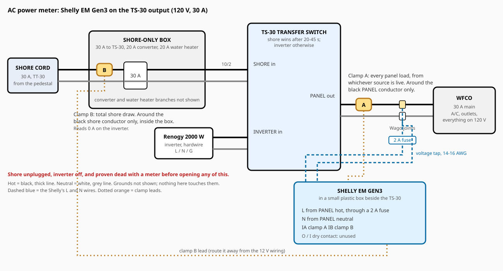

# AC Voltage and Power Meter (Shelly EM Gen3)

A Shelly EM Gen3 energy meter on the output of the TS-30 transfer switch, so the trailer's 120 V voltage, current, power and energy are measured **whichever source is live**: shore power when plugged in, the inverter when not. A second clamp on the shore cord measures total shore draw, which also tells Home Assistant which source the trailer is on. Everything reports locally to the trailer's Home Assistant over Wi-Fi, mirrors to the home Home Assistant, and shows on the e-ink dashboard.



> [!IMPORTANT]
> **Status: meter and both clamps reporting; shore, inverter and no-AC states exercised 2026-11-01.** The Shelly EM Gen3 was observed on the trailer's Home Assistant on 2026-10-28; its physical installation has not yet been documented. Owner reported installing the second CT on 2026-11-01. An initial negative shore reading was corrected during the live test. Shore and panel load response, source transfers, no-AC detection, energy accumulation and home mirror were observed; see [live acceptance record](#live-acceptance-record-2026-11-01). Physical placement, exact accuracy, water-heater heating and an intermittent meter dropout remain unverified.

**Contents:** [Why here](#why-the-ts-30-output) · [What you get](#what-you-get) · [Parts](#parts) · [Wiring](#wiring) · [Steps](#steps) · [Home Assistant setup](#home-assistant-setup) · [Dashboard](#e-ink-dashboard) · [Testing](#testing-checklist) · [Troubleshooting](#troubleshooting) · [Safety](#safety-notes)

## Why the TS-30 output

Since [mod 03](../03-whole-panel-inverter/README.md), one cable carries all of the trailer's 120 V: the TS-30's **PANEL** output to the WFCO 30 A main breaker. The transfer switch puts shore power on it when the cord is plugged in and inverter power otherwise. A meter on that cable therefore answers both questions, "what is the AC voltage?" and "what is the AC draw?", without knowing or caring which source is live.

The one thing that cable does **not** carry is the converter and the water heater's electric element: they sit on the shore-only box ahead of the TS-30 and only ever run on shore. A second clamp on the shore cord picks those up and gives total shore draw.

## What you get

| Reading | From | Notes |
| --- | --- | --- |
| **AC voltage** | Shelly's L and N, tapped from the PANEL output | Shore or inverter, whichever is live. About 120 V; the inverter's output and the pedestal's sag under load both become visible |
| **Panel power, current, power factor, energy** | Clamp A on the PANEL hot | Every WFCO load (A/C, outlets, fridge on AC, TV), from either source |
| **Shore power, current, energy** | Clamp B on the shore cord hot | Total draw from the pedestal, including the converter and water heater element. 0 A on the inverter |
| **AC source** | Template sensor in Home Assistant | `shore` when clamp B shows current, `inverter` when only clamp A does, `none` when the meter is offline |
| **Converter + water heater draw** | Template: shore minus panel | On shore power only |
| **Inverter efficiency** | Template: panel AC watts against the battery monitor's DC watts | On inverter power only |

**When there is no AC at all** (unplugged, inverter off), the Shelly has no power and drops off Wi-Fi. Home Assistant then shows its sensors as **unavailable**, which the `AC source` template turns into `none`. That is a correct reading of "no AC", not a fault. A meter that reads a true 0 V would have to be powered from 12 V, which means a DIY mains enclosure (an ESP32 with a PZEM-004T module); the Shelly's simplicity was preferred.

## Parts

| Component | Quantity | Notes | Purchase link |
| --- | ---: | --- | --- |
| Shelly EM Gen3 with 50 A clamp | 1 | Wi-Fi energy meter, 110-240 V supply, two clamp inputs, 37 x 42 x 16 mm. Comes with one 50 A clamp | [Shelly](https://www.shelly.com/products/shelly-em-gen3-50a-clamp) |
| Shelly 50 A clamp (CT) | 1 more | Second channel. The included clamp plus this one; the 80 A clamp is not needed for a 30 A service | [Shelly](https://www.shelly.com/products/shelly-em-gen3) (accessories) |
| Inline fuse holder, 5 x 20 mm, 250 V, with a 2 A fuse | 1 | Shelly specifies 2 A external protection for its supply. Use a holder rated for 250 V with an insulated body | |
| Plastic junction box, about 4 x 4 x 2 in, with cable glands or clamps | 1 | Houses the Shelly beside the TS-30. Same style as the DJC box used in mod 03 | [Amazon](https://www.amazon.com/dp/B08RHN8H2B) |
| 14 or 16 AWG stranded wire, black and white, about 1 m each | | The Shelly's L and N tap. Its terminals take 20-11 AWG with 6-7 mm stripped | |
| Wago lever connectors, 3- or 5-port, rated to 10 AWG | 2 | To add the tap to the PANEL hot and neutral joints if the existing connectors have no spare port | |
| Ferrules for 14/16 AWG (optional) | 2 | Shelly's terminals accept bare stranded wire, but ferrules make a cleaner termination | |
| Zip ties, labels | As needed | | |

Ownership and purchase status, kept current as parts arrive: [components.md](components.md).

The Shelly's rated ambient range is -20 to 40 C (105 F). Under the dinette seat beside the TS-30 is usually cooler than the trailer's air, but a closed trailer in summer can exceed that; the meter is low-power (under 1.2 W) and the risk is reduced accuracy or a Wi-Fi drop rather than damage. Mount it on the coolest wall of the compartment, not against the inverter.

## Wiring

All of it is at the TS-30 and shore-only box, under the seating beside the sink.

| Shelly terminal | Connects to | Notes |
| --- | --- | --- |
| **L** | TS-30 PANEL **hot** joint (the Wago where the TS-30's black PANEL lead meets the 10 AWG to the WFCO main), **through the 2 A fuse** | Powers the meter and is the voltage measurement |
| **N** | TS-30 PANEL **neutral** joint (the Wago where the white PANEL lead meets the 10 AWG to the WFCO neutral bar) | |
| **IA** (clamp A) | Clamp around the **black** PANEL conductor, between the TS-30 and the WFCO | Panel loads, any source |
| **IB** (clamp B) | Clamp around the **black** shore-cord conductor inside the shore-only box, between the cord entry and the hot Wago | Total shore draw |
| **O / I** | Nothing | Dry contact output; unused |

Rules that matter:

- A clamp goes around **one conductor**, the black hot. Around the whole cable (hot and neutral together) it reads zero, because the two currents cancel.
- Clamp direction sets the sign. Shelly's clamps have an arrow or a "K -> L" mark; point it from source toward load (toward the WFCO for clamp A, into the box for clamp B). If a channel reads negative, flip that clamp.
- The tap must come from the **PANEL side** of the TS-30, not the SHORE side, or the meter dies on the inverter.
- Ground is not connected to the Shelly; it has no ground terminal.
- The 12 V wiring in the same compartment stays untouched. Route the clamp leads away from the battery cables.

## Steps

### Step 1: Bench check (optional, 10 minutes)

With the Shelly on the bench, wire L and N to a plug-in cord (through the fuse), plug it into a household outlet, and join its Wi-Fi hotspot (`ShellyEMG3-...`) from a phone. Confirm it powers up and shows about 120 V in its web page. This proves the unit before it goes into the trailer. Unplug it afterwards.

### Step 2: Make the trailer dead

1. Unplug the shore cord at the pedestal.
2. Turn the inverter **off** at its switch.
3. Open the TS-30 compartment. At the PANEL output Wagos, measure hot to neutral: **0 V**. Measure at the shore-only box's hot Wago: **0 V**. Only then continue.

### Step 3: Fit the clamps

1. **Clamp A:** open the clamp, close it around the **black** 10 AWG conductor of the TS-30 PANEL output (the one going to the WFCO main breaker), arrow toward the WFCO. Make sure it clicks fully shut.
2. **Clamp B:** inside the shore-only box, close the second clamp around the **black** shore-cord conductor between the cable entry and the hot Wago, arrow pointing into the box. Route its lead out through a spare gland or beside an existing one so the box still closes.
3. Route both clamp leads to where the Shelly box will sit, away from the 12 V cables, and label them A and B.

### Step 4: Wire the Shelly

1. Mount the junction box beside the TS-30, on the compartment's coolest wall.
2. Make the L tap: a black 14-16 AWG wire from the PANEL **hot** Wago, through the inline fuse holder (2 A fuse fitted), into the Shelly's **L**. If the existing Wago has no spare port, replace it with a 3- or 5-port one; every conductor fully in, lever down.
3. Make the N tap: white wire from the PANEL **neutral** Wago into **N**.
4. Clamp A's two wires into **IA**, clamp B's into **IB**, following the polarity marked on the Shelly and on the clamp leads.
5. Terminals to 0.4 N m (3.5 in-lb), about a quarter turn past snug with a small screwdriver. Tug-test every wire.
6. Close the Shelly's box with the leads through the glands. Label it "120 V AC meter: fed from TS-30 output, live on shore OR inverter".
7. Close the shore-only box and the TS-30 compartment.

### Step 5: Power up and join the trailer Wi-Fi

1. Turn the inverter on. The TS-30 feeds the panel from it, and the Shelly powers up (its LED lights).
2. On a phone, join the Shelly's hotspot (`ShellyEMG3-...`) and open `192.168.33.1`, or use the Shelly app and add the device. Give it the trailer Wi-Fi name and password.
3. In its settings:
   - Device name: `Casita AC Meter`.
   - Channel names: **A** `Panel`, **B** `Shore`.
   - Shelly cloud: off (everything here is local). Bluetooth: off after setup.
   - Check it found the right time zone; the energy counters roll over daily on it.
4. In the travel router's admin page, give the Shelly a DHCP reservation.

AP isolation on the travel router must already be off (it is, since [mod 04](../04-battery-monitor-esp32/README.md)); otherwise Home Assistant cannot reach the meter.

### Step 6: Adopt it in Home Assistant

On the trailer's Home Assistant, **Settings > Devices & services** shows the Shelly as discovered. **Add** it. The Shelly integration is built in and talks to the device locally; nothing else to install. The home Home Assistant then imports the same entities through the existing link.

### Step 7: Check the signs and readings

1. With the inverter on and the trailer unplugged, turn on a known load (a hair dryer or kettle, around 1,000 W). **Panel power** should read about that, positive; **Shore power** should read 0. **Voltage** should be about 120 V, dipping slightly under the load.
2. Plug the shore cord in and wait for the TS-30 to click over (20-45 s). The Shelly stays powered through the transfer. **Shore power** now reads the same load plus the converter (which starts charging) and the water heater element if it is on; **Panel power** reads the load alone.
3. If either channel reads **negative**, flip that clamp (dead the trailer first, Step 2).
4. Compare **Panel power** on the inverter against the battery monitor's DC power: the AC figure should be about 85-90% of the DC figure, the inverter's efficiency.

## Home Assistant setup

Expected entities (the device name and channel names set in Step 5 become the IDs; confirm on the device page):

| Reading | Likely entity ID |
| --- | --- |
| AC voltage | `sensor.casita_ac_meter_panel_voltage` |
| Panel power / current / power factor / frequency | `sensor.casita_ac_meter_panel_power`, `_panel_current`, `_panel_power_factor`, `_panel_frequency` |
| Panel energy (kWh, total) | `sensor.casita_ac_meter_panel_energy` |
| Shore power / current / energy | `sensor.casita_ac_meter_shore_power`, `_shore_current`, `_shore_energy` |
| Meter temperature, Wi-Fi signal | diagnostic |

Add these template sensors to the trailer's Home Assistant (**Settings > Devices & services > Helpers > Template**, or `configuration.yaml`):

```yaml
template:
  - sensor:
      - name: "Casita AC Source"
        unique_id: casita_ac_source
        icon: mdi:power-plug
        # As created on the trailer's Home Assistant on 2026-10-28 (a template
        # helper named "Casita AC Source"). Until the shore clamp is fitted the
        # shore power reads 0, so the inverter's own state (mod 11) decides:
        # inverting = inverter; anything else with AC present = shore.
        state: >-
          
          
          
          
           none
           shore
           inverter
           shore
           unknown
          
      - name: "Casita Converter and Water Heater Power"
        unique_id: casita_converter_water_heater_power
        unit_of_measurement: W
        device_class: power
        state_class: measurement
        state: >-
          
          
          {{ [shore - panel, 0] | max | round(0) }}
        availability: "{{ states('sensor.casita_ac_meter_shore_power') not in ['unknown', 'unavailable'] }}"
  - binary_sensor:
      - name: "Casita AC Present"
        unique_id: casita_ac_present
        device_class: power
        state: "{{ states('sensor.casita_ac_meter_panel_voltage') not in ['unknown', 'unavailable'] }}"
```

The Shelly reads 0 below about 30 VA per channel, so the `shore > 20` test is safe: a plugged-in trailer always draws more than that once the converter is awake.

**Energy dashboard:** add `sensor.casita_ac_meter_shore_energy` as grid consumption on the trailer's Home Assistant to see kWh taken from pedestals. `sensor.casita_ac_meter_panel_energy` is total AC used from either source.

**Casita RV page at home:** add `sensor.rv_casita_ac_meter_panel_voltage`, `sensor.rv_casita_ac_meter_panel_power`, `sensor.rv_casita_ac_meter_shore_power` and `sensor.rv_casita_ac_source` to the Battery card (the mirror imports them automatically; the template sensors mirror too).

## E-ink dashboard

[Mod 08](../08-eink-dashboard/README.md)'s configuration names these entities under `substitutions` and, since 2026-10-28, draws an **AC** line on the overview page (voltage, panel watts, `Shore` / `Inverter` / `No AC`, and the inverter's load while inverting) and a full **Power** page (Button 2 twice): source, voltage, frequency, panel power and current, shore power and current and total energy from this meter, plus the inverter's mode, load, output power, battery current and faults from mod 11, and the solar controller. Shore power and current read 0 until the second clamp is fitted.

## Testing checklist

1. Trailer dead: 0 V at both tap points before touching anything (Step 2).
2. Shelly powers up on the inverter alone, and stays up through a transfer to shore and back.
3. Panel power matches a known load within about 5% (the Shelly's clamps are rated 2%; a hair dryer's label is not exact).
4. Shore power reads 0 on the inverter and more than the panel figure on shore.
5. Voltage reads about 120 V on both sources and is within about 2 V of a multimeter at an outlet.
6. `Casita AC Source` shows `inverter`, then `shore`, then `none` with everything off.
7. Panel AC watts are 85-90% of the battery monitor's DC watts on the inverter.
8. The home Home Assistant shows the `rv_` copies and the Casita RV page updates.
9. After a day, the Shelly's internal temperature stays well under its 40 C ambient limit in the compartment.

### Live acceptance record (2026-11-01)

Read-only API observations from the **trailer** HA with the owner operating the cord, inverter, water-heater switch and a heat gun. Times below are UTC; only physical actions explicitly reported by the owner are treated as confirmed. Home HA was read separately for the final mirror check.

| Test | Observation | Result |
| --- | --- | --- |
| Shore, heat gun at regular outlet | Before: shore 551 W, panel 96 W; running: shore 1,486 W, panel 1,065 W, 119.3 V; off: shore 488 W, panel 85 W | Both channels respond positively to a panel load; close wattage deltas, not a calibrated accuracy test |
| Shore to inverter, shore unplugged after inverter on | Shore 0 W / 0 A, panel 87 W, 119.3 V, source `inverter`; Shelly stayed online | Passed |
| Inverter-only load | Heat gun running: panel 609 W, shore 0 W, 119.1 V, source `inverter`; panel returned to about 86 W when off | Passed |
| Inverter to shore, cord reconnected | Shore 705 W, panel 87 W, 120.5 V, source `shore`; inverter subsequently turned off with shore readings continuing | Passed |
| No AC | Owner reported regular outlet had no power with inverter off and shore unplugged. Shelly entities became `unavailable`, source became `none` at 22:40:05; HA first held stale shore readings for over a minute | Passed with detection delay; `none` is not instantaneous |
| Restore shore, inverter off | At 22:41:53: shore 493.3 W, panel 82.6 W, 121.1 V, source `shore` | Passed |
| Shore energy and home mirror | Shore energy rose from 0.01247 to 0.07729 kWh during tests; final home `rv_` meter power, voltage, energy and source matched trailer HA | Passed for accumulation and entity mirror; dashboard appearance not inspected |
| Water-heater electric switch | With shore plugged in, switching off coincided with shore power dropping from 657.5 to 551.3 W while panel stayed ~96 W | Inconclusive for element heating: ~106 W change is far below the manual's unconfirmed ~1,440 W reference; thermostat/converter variation possible |

**Open follow-ups:** The Shelly became unavailable at 22:26 while the owner later confirmed a regular outlet still had power; it returned by 22:31 without a documented cause. This is not the intentional no-AC test and warrants attention if it recurs. `sensor.freedom_x_2000_mode` and `binary_sensor.freedom_x_2000_inverting` were unavailable during the earlier source check; the shore CT alone did correctly identify shore/inverter while loads were present. The meter's enclosure, clamp placement, fuse, ambient temperature over a hot day, and calibrated voltage/power accuracy have not been independently checked. Owner confirmed the water-heater tank is full on 2026-11-01, but did not confirm air was purged; element heating was not demonstrated by these readings. Leave the electric element off until the hot tap flows steadily without sputtering.

## Troubleshooting

| Symptom | Likely cause | Fix |
| --- | --- | --- |
| Meter dead on the inverter but alive on shore | Tap taken from the SHORE side of the TS-30 | Move L and N to the PANEL output joints |
| A channel reads 0 with a load on | Clamp around the whole cable, or not fully closed | Clamp the black conductor only; click it shut |
| A channel reads negative | Clamp backwards | Flip it (trailer dead first) |
| Shore power reads less than panel power on shore | Clamps swapped | Swap the IA/IB leads at the Shelly |
| Voltage reads but the 2 A fuse blows | Short in the tap wiring | Dead the trailer; inspect the L wire and the Wago |
| Not discovered by Home Assistant | AP isolation, wrong Wi-Fi, or the Shelly asleep because there is no AC | Check the router, confirm the meter is on the trailer network, confirm AC is present |
| Entities `unavailable` | No AC (expected), or Wi-Fi dropped | `AC Present` tells the two apart only if the meter was online; check the router's client list |
| Readings jump around at low load | Normal below about 30 VA (the Shelly's no-load threshold) | Ignore below that |

## Safety notes

- 120 V work. Shore unplugged, inverter off, both tap points proven dead with a meter, every time the boxes are open.
- The Shelly's L wire is fused at 2 A as Shelly requires; the fuse holder must be rated 250 V and insulated.
- Never take the voltage tap from the TS-30's SHORE or INVERTER inputs: on the SHORE input the meter is dead whenever the trailer runs on the inverter, and on the INVERTER input it is dead on shore. Only the PANEL output is live from both.
- Clamps are non-contact; they do not break the conductor. Do not cut any conductor to fit them.
- The Shelly EM Gen3 is CE marked, not UL listed. It is a low-power metering device used widely in North American panels, but it is not a listed component in the way the 30 A breaker is.
- Keep the Shelly's box closed and labelled; it contains a live 120 V tap from either source.

## Photos

Add photos to `photos/` as the build progresses:

- `clamps.jpg`: clamp A on the PANEL hot and clamp B in the shore-only box
- `shelly-box.jpg`: the Shelly wired in its box
- `ha-first-readings.jpg`: the device page after adoption

## References

- [Shelly EM Gen3 knowledge base](https://kb.shelly.cloud/knowledge-base/shelly-em-gen3): terminals (L, N, IA, IB, O, I), 110-240 V supply, under 1.2 W, 2 A external protection, 0-80 A, 2% accuracy, 30 VA no-load threshold, -20 to 40 C ambient
- [Shelly EM Gen3 product page](https://www.shelly.com/products/shelly-em-gen3)
- [Home Assistant Shelly integration](https://www.home-assistant.io/integrations/shelly/)
- [Mod 03 as built](../03-whole-panel-inverter/README.md#as-built): the TS-30 leads, Wago joints and shore-only box this taps into
- [Mod 08 e-ink dashboard](../08-eink-dashboard/README.md): where the readings are displayed

## Revisions

| Date | Change |
| --- | --- |
| 2026-10-14 | Project written: Shelly EM Gen3 on the TS-30 PANEL output with a second clamp on the shore cord; Home Assistant templates; dashboard entities reserved. Not purchased or built |
| 2026-10-19 | Added [components.md](components.md). Shelly EM Gen3 (with one 50 A clamp), a second 50 A clamp and a 5 x 20 mm inline fuse kit ordered from Amazon; junction box and Wago 221 kit already delivered; owner confirmed 14/16 AWG wire on hand. Nothing left to buy. |
| 2026-10-28 | Noted from the trailer's Home Assistant: the Shelly EM Gen3 is installed and adopted as **Casita AC Meter** (`sensor.casita_ac_meter_*`, matching the table above; 122.8 V, a few watts, on 2026-10-28), with the shore clamp still to fit (shore power 0). `sensor.casita_ac_source` created as a template helper, extended with the inverter's state so it is right before the shore clamp exists. The e-ink dashboard gained a Power page. The physical installation (Steps 1-6) is not yet written up; the status line above predates it |
| 2026-11-01 | Owner confirms the second current transformer is on hand; shore-clamp installation and test have not been reported. Updated status and components record; physical installation of the meter still needs documentation |
| 2026-11-01 | Owner subsequently reported installing the second CT. Live read-only check at 22:16 UTC: trailer HA shore current 9.224 A, shore power -693.5 W, panel power 2.0 W, voltage 120.9 V, `sensor.casita_ac_source` unknown; home HA mirror showed the same shore reading and connected link. CT channel reports but sign is wrong (orientation/polarity to verify and retest safely); Xantrex inverter mode and inverting entities were unavailable, so source helper cannot fall back to them. Physical installation not independently inspected |
| 2026-11-01 | Follow-up live trailer HA check at 22:23 UTC: shore power **526.8 W**, current **6.629 A**, panel power 2.2 W, voltage 121.0 V, AC source **shore**. Polarity and source are now correct for this snapshot; shore energy still 0.0 kWh. Inverter-only, source transfer, energy accumulation and physical placement not verified; Xantrex state entities remained unavailable |
| 2026-11-01 | Completed shore/inverter/no-AC and return-to-shore live checks with owner; see [live acceptance record](#live-acceptance-record-2026-11-01). Shore energy accumulated and home mirror matched. Water-heater element heating, physical install and earlier Shelly dropout remain unresolved |
