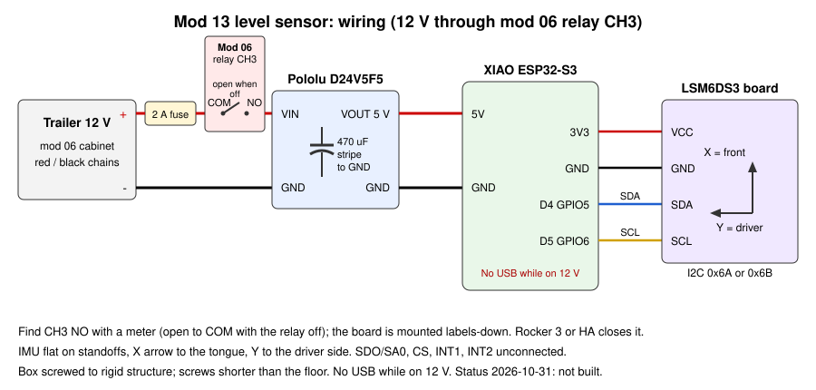

# Level Sensor to Home Assistant (LSM6DS3TR-C + XIAO ESP32-S3)

A small ESPHome device screwed to the trailer's structure that reports how far the Casita is out of level **side to side** and **front to back**, in degrees, to the trailer's Home Assistant. It also works out the fix in inches: how much to raise the low wheel and how far to raise or lower the tongue jack. You can read it on a phone at the wheel or the tongue, either in the Home Assistant app or on the device's own web page over the trailer Wi-Fi. The home Home Assistant gets the same entities through the existing Remote Home-Assistant link.

> [!NOTE]
> **Status:** planned 2026-10-25. Designed, not built. Everything except the sensor board is owner stock (confirmed 2026-10-25); the sensor board is **to buy**, see [components.md](components.md). The ESPHome configuration passes `esphome config` on ESPHome 2026.10.0; the compile result is in [Revisions](#revisions). Nothing has run on hardware, and no sign convention, geometry or accuracy figure below has been checked on the trailer.

**Contents:** [What to order](#what-to-order) · [Why this design](#why-this-design) · [How it works](#how-it-works) · [Parts](#parts) · [Wiring](#wiring) · [Where to mount it](#where-to-mount-it) · [Steps](#steps) · [ESPHome configuration](#esphome-configuration) · [Home Assistant](#home-assistant) · [Using it to level](#using-it-to-level) · [Testing](#testing-checklist) · [Troubleshooting](#troubleshooting) · [Safety](#safety-notes) · [Revisions](#revisions)

## What to order

You only need to buy the sensor board. Everything else was confirmed in owner stock on 2026-10-25 (spare XIAO ESP32-S3, Pololu D24V5F5, 470 uF capacitor, fuse holder, 83 x 58 x 33 mm box, glands, wire, standoffs, reference level, USB-C cable, leveling blocks and chocks).

**Get an LSM6DS3TR-C (or original LSM6DS3) board. Do not get an LSM6DSO, LSM6DSOX, MPU6050 or ADXL345.** ESPHome 2026.10.0's `lsm6ds` driver accepts only chip ID `0x69` (LSM6DS3) and `0x6A` (LSM6DS3TR-C), as checked in its source on 2026-10-25. An LSM6DSO/DSOX (`0x6C`) stops at boot with `Unknown WHO_AM_I`. Support for it is on ESPHome's `dev` branch but has not been released yet.

| Option | Price (2026-10-25) | Notes |
| --- | --- | --- |
| **[Adafruit 4503 LSM6DS3TR-C, STEMMA QT](https://www.adafruit.com/product/4503)** (recommended) | $9.95 + shipping, 15 in stock | Known chip, documented address (`0x6A`, jumper for `0x6B`), on-board 3.3 V regulator and pull-ups, 25.3 x 17.8 mm with four mounting holes. Add the [STEMMA QT to male header cable](https://www.adafruit.com/product/4209) ($0.95) if you would rather not solder at the board end. Also stocked by Digi-Key. Not sold on Amazon by Adafruit; the Amazon listings found were resellers or unidentified products |
| [Amazon B0FKT9ZR2X](https://www.amazon.com/dp/B0FKT9ZR2X), 2 pcs LSM6DS3 breakout | $8.99, 4.7 stars (5 ratings) | Generic. The listing does not say whether the chip is an LSM6DS3 or LSM6DS3TR-C; both work. Check the boot log for `0x69` or `0x6A`. Gives a spare |
| [Amazon B07K5LVMZ2](https://www.amazon.com/dp/B07K5LVMZ2), NOYITO LSM6DS3 | $6.99, 4.8 stars (7 ratings) | Same caveat as above |

Prices come from an anonymous Amazon search and Adafruit's product page on 2026-10-25. Amazon is not the first choice here because none of its listings is a known-genuine board with a confirmed chip ID.

## Why this design

- **Native Home Assistant, no cloud, no phone app.** Commercial RV levels such as the LevelMatePRO talk Bluetooth to their own app and have no supported Home Assistant integration. An ESPHome device matches the battery, propane and water monitors already on the trailer, and it uses the same Device Builder, secrets and mirror to the home HA.
- **All parts are built-in ESPHome components.** The `motion` hub (ESPHome 2026.10) provides `pitch` and `roll` sensors, a `moving` detector, and `calibrate_level` / `calibrate_heading` actions that save to flash. No external components and no hand-written trigonometry for the angles.
- **Calibration takes out mounting errors.** The board does not have to be mounted perfectly flat or square. You do two button presses with the trailer at a known level (see [Step 7](#step-7-calibrate-on-the-trailer)) to zero the reading and turn the sensor axes to line up with the trailer.
- **Answers in inches, not just degrees.** A single-axle trailer is leveled with blocks under one wheel and with the tongue jack. The device converts the angles using the trailer's track width and hitch-to-axle distance. You enter both as numbers in Home Assistant and can edit them later without reflashing.
- **Its own device, not added to another one.** It could share the closet XIAO with the mod 09 grey water device, but it needs a rigid, flat mount near the middle of the trailer. Mod 09 was also split into one device per job on purpose. The extra parts are all in stock.

**Expected accuracy (not yet measured).** After calibration, a consumer MEMS accelerometer averaged over 5 s should read to about 0.1°, and should repeat to a few tenths of a degree. The zero point drifts with temperature, so expect a few tenths of a degree difference between a cold morning and a hot afternoon. The firmware reports the chip temperature so this can be checked ([Testing](#testing-checklist), item 8). For scale, with the assumed geometry 0.5° is about 0.6 in under a wheel, which is less than one leveling-block step. That is good enough for leveling. It is not a precision inclinometer.

## How it works

1. Every 100 ms the XIAO reads the LSM6DS3TR-C accelerometer over I2C. The motion hub applies the saved calibration matrix and computes roll and pitch from the direction of gravity.
2. Each angle is averaged over 5 s and published once a second. The firmware converts them into **Side to Side** (positive = driver side high) and **Front to Back** (positive = tongue high).
3. **Wheel Lift Needed** = track width x tan(side-to-side angle). That is the height to put under the low-side wheel.
4. **Tongue Jack Adjustment** = -(hitch-to-axle distance) x tan(front-to-back angle). This is the signed move at the coupler: positive means raise it, negative means lower it. The axle is the pivot.
5. **Side to Side Action** and **Front to Back Action** spell out the fix, rounded to 1/4 in, for example `Raise passenger wheel 1.25 in` or `Lower tongue 2.00 in`. When the trailer is within **Level Tolerance** (default 0.5°) they read `Level`, and while the trailer is moving they read `Moving, wait`.
6. **Level** turns on when both axes are within tolerance.
7. Angles go to Home Assistant when they change by 0.05° or more, or once a minute. Readings stay live while you level but add little to the database while parked.

## Parts

| Part | Qty | Purpose | Status / source |
| --- | ---: | --- | --- |
| Adafruit 4503 LSM6DS3TR-C 6-DoF IMU (or LSM6DS3 board, see [What to order](#what-to-order)) | 1 | Accelerometer | **To buy** |
| Seeed Studio XIAO ESP32-S3 | 1 | Controller, Wi-Fi, ESPHome | Owner stock |
| Pololu D24V5F5, 5 V 500 mA step-down | 1 | 12 V to 5 V for the XIAO | Owner stock |
| 470 uF 25 V electrolytic capacitor | 1 | Across the regulator input | Owner stock |
| Inline ATO/ATC fuse holder, 2 A fuse | 1 | Protects the 12 V tap | Owner stock |
| ABS box with mounting ears, about 83 x 58 x 33 mm | 1 | Enclosure, screwed down | Owner stock |
| PG7 cable gland | 1 | 12 V feed entry | Owner stock |
| M2.5 or M3 nylon standoffs and screws | 4 | Hold the sensor board rigidly to the box floor | Owner stock |
| #8 pan-head screws, length to suit (see [mounting](#where-to-mount-it)) | 2-4 | Box to the trailer | Owner stock / to pick on site |
| 18-20 AWG red and black wire, butt splices; 4 short hook-up wires (or Adafruit 4209 cable) | | 12 V feed; I2C | Owner stock |
| Heat-shrink, Kapton tape, zip ties | | | Owner stock |

**Tools:** soldering iron, multimeter, a reference level (digital level or a good machinist or torpedo level) for calibration, USB-C data cable, tape measure.

## Wiring



| From | To | Notes |
| --- | --- | --- |
| Trailer 12 V + | Inline 2 A fuse, then Pololu `VIN` | Fuse as close to the 12 V source as possible |
| Trailer 12 V - | Pololu `GND` | |
| 470 uF capacitor | Across Pololu `VIN` / `GND` | Stripe (negative) to `GND`, right at the regulator |
| Pololu `VOUT` | XIAO `5V` | |
| Pololu `GND` | XIAO `GND` | |
| XIAO `3V3` | IMU `VIN` (STEMMA red) | The Adafruit board accepts 3-5 V and regulates to 3.3 V |
| XIAO `GND` | IMU `GND` (STEMMA black) | |
| XIAO `D4` (GPIO5) | IMU `SDA` (STEMMA blue) | Same pins as the battery monitor |
| XIAO `D5` (GPIO6) | IMU `SCL` (STEMMA yellow) | |

Leave the IMU's `ADDR`/`DO`, `CS`, `INT1` and `INT2` unconnected; the Adafruit board pulls them to the right state for I2C at address `0x6A`. On a generic board, check that `CS` is pulled high (I2C mode) and `SDO/SA0` is tied one way. The boot log's I2C scan shows the address.

**Do not plug USB into the XIAO while it is powered from the 12 V regulator.** The XIAO's `5V` pad is joined to the USB 5 V, so both supplies would be connected together. Disconnect the 12 V feed, or pull the fuse, before connecting USB. After the first flash, updates are wireless.

## Where to mount it

The location will be picked on site during the install (owner, 2026-10-25). It needs to meet these rules:

1. **Rigid structure:** the floor or a fixed bulkhead, with screws into solid backing. Not a door, drawer, cabinet face, seat lid, or anything that flexes when someone walks past.
2. **Near the middle of the trailer, and roughly flat** (within about 10° of horizontal). Calibration removes small tilts, but a flatter mount keeps the full range on both axes.
3. **Silkscreen X arrow pointing to the front of the trailer, Y arrow to the driver (left) side, components facing up.** The default `roll_sign` / `pitch_sign` assume this. Calibration fixes small rotation errors, but not a board turned 90° or 180°. If the board has to go another way, change the signs or add an `axis_map` (see [ESPHome configuration](#esphome-configuration)).
4. **Away from heat:** not on the furnace ducting, fridge vent, inverter, or a sunny wall. Temperature changes shift the zero point.
5. **12 V close by,** and inside the trailer's Wi-Fi coverage.

Candidates: the cabinet next to the Nilight panel (mod 06; 12 V is already there), the closet next to the planned mod 09 grey device, or any lower cabinet floor near the axle. **Before drilling, measure the floor thickness at the spot**, and use screws at least 1/8 in shorter than that. Tanks, wiring and the belly are under the floor.

## Steps

### Step 1: Order and check the sensor

Order one board from [What to order](#what-to-order). When it arrives, read the chip marking or the listing. The boot log in Step 3 is the real check.

### Step 2: Bench wiring (USB power)

1. Solder headers or four wires to the XIAO and the IMU. Connect `3V3`, `GND`, `D4` = SDA and `D5` = SCL as in the [table](#wiring). Do not connect the regulator yet.
2. Fix both boards to a small flat board, with the IMU X arrow pointing "forward".

### Step 3: Flash and bench-test

1. **Update the trailer's ESPHome Device Builder to 2026.10.0 or later.** The configuration sets `min_version: 2026.10.0`.
2. Copy [`esphome/casita-level.yaml`](esphome/casita-level.yaml) into the trailer's Device Builder as `casita-level.yaml`. The Device Builder's `secrets.yaml` already has the shared keys. Add one new key, `level_api_encryption_key` (generate it with `openssl rand -base64 32`), and keep it only there.
3. **Install, Plug into this computer** with the XIAO on USB-C. The first compile on the Pi 4 takes a while; after that, installs are wireless.
4. Logs: the I2C scan should show `0x6A` (or `0x6B`), and `lsm6ds` should report `LSM6DS3TR-C` or `LSM6DS3`. If you see `Unknown WHO_AM_I: 0x6C`, it is an LSM6DSO board; see [Troubleshooting](#troubleshooting).
5. **Check the signs.** Lay the board flat and press **Calibrate Level**. Then:
   - Lift the "front" (X arrow) edge. **Front to Back** must go **positive**. If it goes negative, change `pitch_sign` to `"1"`.
   - Lift the "driver" (Y arrow) edge. **Side to Side** must go **positive**. If it goes negative, change `roll_sign` to `"-1"`.
   - Lift the front edge by a known amount, for example 10 mm over 573 mm is 1.0°. The reading should be within about 0.2°.
6. Tap the board: **Moving** turns on for about 2 s, and the action texts read `Moving, wait`.
7. Press **Clear Calibration** when done. The real calibration is done on the trailer.

### Step 4: Build the enclosure

1. Mount the IMU on nylon standoffs to the box floor, X arrow pointing to the box end that will face the front of the trailer, and mark that end **FRONT** on the outside. It must not rattle or rock.
2. Solder the regulator: the 470 uF capacitor across `VIN`/`GND` at the regulator (stripe to `GND`), `VOUT` to XIAO `5V`, `GND` to XIAO `GND`.
3. Fix the XIAO and regulator with tape or hot glue so nothing can touch, with the U.FL antenna against the box wall. Bring the 12 V pair in through a PG7 gland.

### Step 5: Install in the trailer

1. Choose the spot using [Where to mount it](#where-to-mount-it). Screw the box down by its ears, with **FRONT** toward the tongue and the box as square to the trailer as you can judge.
2. 12 V feed: positive through the inline holder with a **2 A** fuse, from the nearest suitable 12 V circuit (**to confirm** on site which one), negative to the trailer 12 V negative. Check 5 V at the XIAO before closing the lid.
3. In Home Assistant, **Settings, Devices and services**: the ESPHome integration offers **Casita Level**. **Configure**, then paste `level_api_encryption_key`.

### Step 6: Measure the trailer geometry

Enter the measurements in Home Assistant (device **Casita Level**, Configuration section). They are stored on the device.

| Number | How to measure | Default (assumed) |
| --- | --- | --- |
| **Track Width** | Center of the left tire tread to center of the right tire tread, at the ground | 70 in, **to measure** |
| **Hitch to Axle** | Center of the coupler (ball socket) to the axle center line (the wheel hub centers), along the trailer | 130 in, **to measure** |
| **Level Tolerance** | How close to zero counts as level | 0.5° |

Record the measured values in [docs/trailer.md](../../docs/trailer.md).

### Step 7: Calibrate on the trailer

Do this once, on firm ground, unhitched, with the stabilizer jacks **up**.

1. Put the reference level on the floor, along the trailer near the middle. Level the trailer front to back with the tongue jack.
2. Turn the reference level across the trailer. Level side to side with blocks under one wheel. Check both directions again, and on a second spot on the floor if you can.
3. Wait 10 s with nobody moving inside, then press **Calibrate Level**. **Calibration Status** reads `Level calibrated`, and both angles read about 0.0°.
4. Raise the tongue jack about 3-4 in, so the trailer tilts front to back only. Wait 10 s, then press **Calibrate Heading**. Status reads `Heading calibrated`. Front to Back now shows the tilt and Side to Side stays close to 0.0°.
5. Lower the tongue back to level and check that both read 0.0° ± 0.1°.
6. Test the inch math: raise the tongue by a measured amount, for example 2 in at the coupler. **Tongue Jack Adjustment** should read about -2 in. If it is off by more than about 10%, re-measure Hitch to Axle.

The calibration is saved in flash and survives reboots and wireless updates. Repeat it if the box is ever moved or bumped. **Clear Calibration** returns to the uncalibrated state.

Calibration sets "level" to mean the **floor** is level. If you would rather use a different reference, such as the counter or the fridge, put the reference level there in steps 1-2.

### Step 8: Dashboards

1. Trailer Home Assistant: add the [dashboard card](#dashboard-card).
2. Home Home Assistant: the entities appear automatically as `*.rv_casita_level_*` through the import-all Remote Home-Assistant link. Assign them to the `casita_rv` area. Set display precision on the sensors (1 decimal for angles, 2 for inches), because ESPHome's rounding does not cross the link.
3. Optional follow-up for [mod 08](../08-eink-dashboard/README.md): a level line on the e-ink panel. This is not part of this mod.

## ESPHome configuration

[`esphome/casita-level.yaml`](esphome/casita-level.yaml) uses only built-in ESPHome components: `i2c`, `motion` with the `lsm6ds` platform, and template sensors, numbers, binary sensors, text sensors and buttons. It has the same Wi-Fi (trailer first, home backup, `Casita Level Fallback` hotspot), API encryption, OTA and password-protected web page as the other trailer devices.

| Substitution | Default | Meaning |
| --- | --- | --- |
| `roll_sign` | `"1"` | +1 or -1 so that Side to Side is positive when the driver side is high. Check in Step 3 |
| `pitch_sign` | `"-1"` | +1 or -1 so that Front to Back is positive when the tongue is high. Check in Step 3 |
| `track_width_in` | `"70"` | Starting Track Width; assumed |
| `hitch_to_axle_in` | `"130"` | Starting Hitch to Axle; assumed |
| `level_tolerance_deg` | `"0.5"` | Starting Level Tolerance |

IMU settings: ±2 g range (finest resolution), 52 Hz output rate, read every 100 ms, address `0x6A`. If the board has to be mounted on its side or turned around, add an `axis_map` under `motion:` (for example `x: y`, `y: "-x"`, `z: z` for a board turned 90°). Changing `axis_map` discards the saved calibration on the next boot, so calibrate again.

### Secrets

`level_api_encryption_key` (new, for this device only), plus the shared `ota_password`, `wifi_ssid`, `wifi_password`, `wifi_backup_ssid`, `wifi_backup_password`, `fallback_ap_password`, `web_username` and `web_password`. `secrets.yaml` is git-ignored; only [`secrets.example.yaml`](esphome/secrets.example.yaml) with placeholders is committed.

## Home Assistant

### Entities

| Entity name | Likely entity ID | Unit / notes |
| --- | --- | --- |
| Side to Side | `sensor.casita_level_side_to_side` | °, + = driver side high |
| Front to Back | `sensor.casita_level_front_to_back` | °, + = tongue high |
| Wheel Lift Needed | `sensor.casita_level_wheel_lift_needed` | in, under the low-side wheel |
| Tongue Jack Adjustment | `sensor.casita_level_tongue_jack_adjustment` | in, + = raise, - = lower |
| Side to Side Action | `sensor.casita_level_side_to_side_action` | text |
| Front to Back Action | `sensor.casita_level_front_to_back_action` | text |
| Level | `binary_sensor.casita_level_level` | on = both axes within tolerance |
| Moving | `binary_sensor.casita_level_moving` | on while the trailer is moving or being bumped |
| Track Width, Hitch to Axle, Level Tolerance | `number.casita_level_track_width` ... | configuration |
| Calibrate Level, Calibrate Heading, Clear Calibration, Restart | `button.casita_level_calibrate_level` ... | configuration |
| Calibration Status, IMU Temperature, Wi-Fi Signal, Uptime, IP Address | `sensor.casita_level_calibration_status` ... | diagnostic |

### Dashboard card

```yaml
type: vertical-stack
cards:
  - type: glance
    title: Level
    columns: 3
    entities:
      - entity: sensor.casita_level_side_to_side
        name: Side
      - entity: sensor.casita_level_front_to_back
        name: Front/back
      - entity: binary_sensor.casita_level_level
        name: Level
  - type: entities
    entities:
      - entity: sensor.casita_level_side_to_side_action
        name: Wheels
      - entity: sensor.casita_level_front_to_back_action
        name: Tongue jack
```

The calibration buttons are left off the card on purpose. Pressing **Calibrate Level** when the trailer is not level would save a wrong zero. They stay on the device page under Configuration.

## Using it to level

1. **Hitched, side to side first.** Read **Side to Side Action**, for example `Raise passenger wheel 1.25 in`. Put that much block in front of that wheel, round to your block size, then pull onto it and chock.
2. **Unhitch, then front to back.** Follow **Front to Back Action** with the tongue jack until it reads `Level`.
3. **Then lower the stabilizer jacks.** They steady the trailer and are not for lifting it. Lowering them can move the reading a little; if it changes by more than the tolerance, raise them and adjust.
4. The 12 V compressor fridge does not need the trailer level to run. Leveling is for comfort, doors, and draining the shower and sinks.

## Testing checklist

1. Boot log: I2C device at `0x6A`/`0x6B`, chip `LSM6DS3TR-C` or `LSM6DS3`, no I2C errors.
2. Signs correct on the bench (Step 3.5) and again on the trailer (Step 7.4).
3. Known 1.0° bench tilt reads 1.0° ± 0.2°.
4. After calibration, both axes read 0.0° ± 0.1° with the trailer level by the reference level.
5. Tongue raised 2 in: Tongue Jack Adjustment about -2 in, Side to Side within 0.2° of zero.
6. Moving turns on when someone walks inside or the trailer is towed, and the action texts say `Moving, wait`.
7. Power cycle (pull the fuse): calibration and the geometry numbers survive.
8. Temperature: over a few days, check the reading against the reference level on a cold morning and a hot afternoon. Note IMU Temperature and the error. More than 0.5° drift means temperature compensation is worth adding (see Revisions for follow-ups).
9. Entities appear at home as `rv_casita_level_*`.

## Troubleshooting

| Symptom | Likely cause | Fix |
| --- | --- | --- |
| `Unknown WHO_AM_I: 0x6C` | LSM6DSO/LSM6DSOX board | Use an LSM6DS3TR-C board, or wait for the ESPHome release that adds LSM6DSO |
| No device in the I2C scan | SDA/SCL swapped, no 3.3 V at the board | Check `D4`=SDA, `D5`=SCL, 3.3 V on `VIN` |
| Found at `0x6B` | Address jumper or SDO tied high | Set `address: 0x6B` |
| Angle goes the wrong way | Sign or board orientation | Change `roll_sign` / `pitch_sign`, or fix `axis_map`, then recalibrate |
| Raising the tongue also changes Side to Side | Calibrate Heading not done, or done with a sideways tilt too | Repeat Step 7 |
| `Level calibration failed` | Sensor read failure, or moving during calibration | Keep still for 10 s and retry; check the logs |
| Readings jump when people move inside | Normal; the trailer rocks | Wait for `Moving` to clear; level with nobody inside |
| Inches look wrong but degrees are right | Track Width or Hitch to Axle not measured | Step 6 |

## Safety notes

- Fuse the 12 V tap (2 A) close to the source.
- Never connect USB to the XIAO while the 12 V regulator is powering it.
- Check floor thickness before drilling, and use screws shorter than the floor.
- Chock the wheels before unhitching, and never get under the trailer when it is only on the tongue jack or stabilizers.
- The angles are a leveling aid, not a safety system. Follow the trailer's manual for jack and stabilizer limits.

## References

- [ESPHome motion component (IMU)](https://esphome.io/components/motion/): pitch/roll, moving, calibrate_level, calibrate_heading, calibration persistence
- [ESPHome LSM6DS platform](https://esphome.io/components/motion/lsm6ds/) and its source (`esphome/components/lsm6ds/lsm6ds.cpp`, release 2026.10.0, chip ID table)
- [Adafruit LSM6DS3TR-C product page](https://www.adafruit.com/product/4503)
- [Mod 07](../07-tank-monitor/README.md) (tank monitor; absorbed the former mod 09) for the shared 12 V / XIAO build pattern

## Revisions

| Date | Change |
| --- | --- |
| 2026-10-25 | Planned. Sensor chosen: LSM6DS3TR-C (Adafruit 4503), after finding that ESPHome 2026.10.0's `lsm6ds` driver rejects LSM6DSO/DSOX. All other parts confirmed in owner stock. Mount location to be chosen on site. ESPHome configuration written. `esphome config` passed on bee2 with ESPHome 2026.10.0 using synthetic secrets. A local `esphome compile` could not run (bee2's Python cannot create the ESP-IDF virtual environment), so the first compile will be in the trailer's Device Builder (Step 3). Not run on hardware. Possible follow-ups: temperature compensation if Testing item 8 shows drift; a level line on the mod 08 e-ink dashboard |
